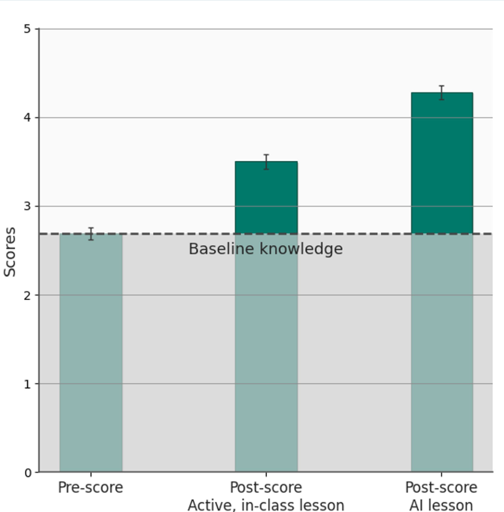
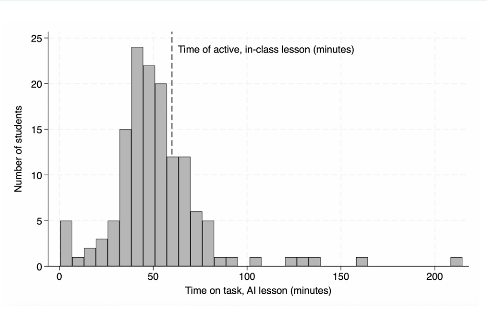
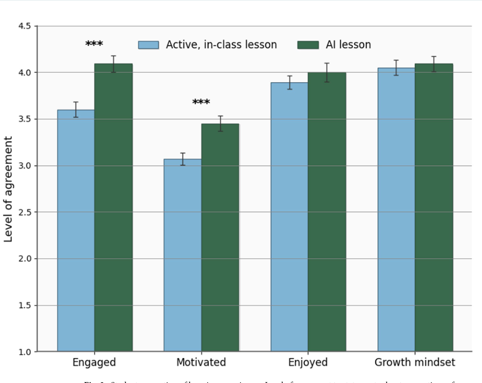

# AI tutoring outperforms in-class active learning — параллельный перевод

**Источник:** Greg Kestin, Kelly Miller, Anna Klales, Timothy Milbourne & Gregorio Ponti, *Scientific Reports* 15, 17458 (2025). DOI: https://doi.org/10.1038/s41598-025-97652-6.

**Формат:** английский текст слева; полный русский перевод справа. Один законченный авторский тезис / предложение — одна строка; пустые строки таблиц обозначают границы абзацев. Библиографические записи сохранены целиком. Изображения оригинальных трёх графиков размещены рядом с переводами их подписей и легенд.

**Объём:** все 10 страниц предоставленного PDF: заголовок и сведения об авторах, аннотация, основной текст, методы, авторские примечания, рисунки, все 35 источников, благодарности, вклад авторов, декларации и лицензионное уведомление. Упоминаемые в статье *дополнительные материалы* (Supplementary Material, Table S1–S3 и Figure S1) не входят в предоставленный 10-страничный PDF.

> Перевод предназначен для сопоставительного личного чтения. Права на оригинал сохраняются за правообладателями; в статье указана лицензия CC BY-NC-ND 4.0, ограничивающая распространение адаптированных материалов.

## Библиографические сведения / Bibliographic information

| English — original | Русский — дословный перевод |
|:---|:---|
| AI tutoring outperforms in-class active learning: an RCT introducing a novel research-based design in an authentic educational setting | Обучение с ИИ-репетитором превосходит активное обучение в аудитории: рандомизированное контролируемое исследование, представляющее новую, основанную на научных данных модель в реальных образовательных условиях. |
| Greg Kestin¹˒³, Kelly Miller²˒³, Anna Klales¹, Timothy Milbourne¹ & Gregorio Ponti¹ | Грег Кестин¹˒³, Келли Миллер²˒³, Анна Клейлс¹, Тимоти Милбурн¹ и Грегорио Понти¹. |
| OPEN | ОТКРЫТЫЙ ДОСТУП. |
| Scientific Reports (2025) 15:17458; https://doi.org/10.1038/s41598-025-97652-6 | Scientific Reports (2025), том 15, статья 17458; https://doi.org/10.1038/s41598-025-97652-6. |
| &nbsp; | &nbsp; |

## Аннотация / Abstract

| English — original | Русский — дословный перевод |
|:---|:---|
| Advances in generative artificial intelligence show great potential for improving education. | Достижения в области генеративного искусственного интеллекта демонстрируют значительный потенциал для совершенствования образования. |
| Yet little is known about how this new technology should be used and how effective it can be compared to current best practices. | Однако пока мало известно о том, как следует использовать эту новую технологию и насколько эффективной она может быть по сравнению с существующими передовыми практиками. |
| Here we report a randomized, controlled trial measuring college students’ learning and their perceptions when content is presented through an AI-powered tutor compared with an active learning class. | Здесь мы сообщаем о рандомизированном контролируемом исследовании, в котором оценивались результаты обучения студентов университета и их восприятие учебного процесса при представлении материала посредством репетитора на основе ИИ по сравнению с занятием, основанным на активном обучении. |
| The novel design of the custom AI tutor is informed by the same pedagogical best practices as employed in the in-class lessons. | Новая конструкция специально разработанного ИИ-репетитора опирается на те же передовые педагогические практики, которые применялись на аудиторных занятиях. |
| We find that students learn significantly more in less time when using the AI tutor, compared with the in-class active learning. | Мы обнаружили, что при использовании ИИ-репетитора студенты усваивают значительно больше материала за меньшее время по сравнению с активным обучением в аудитории. |
| They also feel more engaged and more motivated. | Они также чувствуют большую вовлечённость и более высокую мотивацию. |
| These findings offer empirical evidence for the efficacy of a widely accessible AI-powered pedagogy in significantly enhancing learning outcomes, presenting a compelling case for its broad adoption in learning environments. | Эти результаты представляют эмпирические доказательства эффективности широкодоступной педагогической методики на основе ИИ в отношении существенного улучшения результатов обучения и дают убедительные основания для её широкого внедрения в образовательную среду. |
| &nbsp; | &nbsp; |

## Введение / Introduction (без заголовка в оригинале)

| English — original | Русский — дословный перевод |
|:---|:---|
| With their human-like conversational style and knowledge drawn from extremely large data sets, generative artificial intelligence (GAI) chatbots have inspired visions of expert tutors available on demand through every smartphone¹. | Благодаря своему человекоподобному разговорному стилю и знаниям, полученным из чрезвычайно больших наборов данных, чат-боты на основе генеративного искусственного интеллекта (ГАИ) породили представление об экспертных репетиторах, доступных по запросу через любой смартфон¹. |
| The President of the United States, at the time of this investigation in 2023, pledged to “shape AI’s potential to transform education by creating resources to support educators deploying AI-enabled educational tools, such as personalized tutoring in schools.”¹ | Президент Соединённых Штатов во время проведения этого исследования в 2023 году пообещал «направить потенциал ИИ на преобразование образования путём создания ресурсов для поддержки педагогов, внедряющих образовательные инструменты с применением ИИ, такие как персонализированное репетиторство в школах»¹. |
| Despite this recent excitement, previous studies show mixed results on the effectiveness of learning, even with the most advanced AI models²˒³. | Несмотря на недавний энтузиазм, предшествующие исследования показывают неоднозначные результаты в отношении эффективности обучения даже при использовании наиболее передовых моделей ИИ²˒³. |
| While these models can answer technical questions, their unguided use lets students complete assignments without engaging in critical thinking. | Хотя эти модели способны отвечать на технические вопросы, их использование без надлежащего руководства позволяет студентам выполнять задания, не прибегая к критическому мышлению. |
| After all, AI chatbots are generally designed to be helpful, not to promote learning. | В конце концов, чат-боты на основе ИИ обычно создаются для оказания помощи, а не для содействия обучению. |
| They are not trained to follow pedagogical best practices (e.g., facilitating active learning, managing cognitive load⁴,¹ and promoting a growth mindset).² | Они не обучены следовать передовым педагогическим практикам (например, содействовать активному обучению, управлять когнитивной нагрузкой⁴,¹ и формировать установку на развитие)². |
| Another well-known flaw of AI tutors is their uncanny confidence when giving an incorrect answer or when marking a correct reply as incorrect⁵.³ | Ещё один хорошо известный недостаток ИИ-репетиторов — их поразительная уверенность при выдаче неверного ответа или при оценке правильного ответа как неправильного⁵,³. |
| As reported here, a carefully designed AI tutoring system, using the best current GAI technology and deployed appropriately, can not only overcome these challenges but also address significant known pedagogical challenges in an accessible way that can offer world-class education to any community or learning environment with an internet connection. | Как показано в настоящей работе, тщательно спроектированная система обучения с ИИ-репетитором, использующая лучшие из современных технологий ГАИ и внедрённая надлежащим образом, способна не только преодолеть эти трудности, но и доступным способом решить существенные известные педагогические проблемы, обеспечивая возможность получения образования мирового уровня любым сообществом или образовательной средой, имеющими подключение к интернету. |
| &nbsp; | &nbsp; |
| Although passive lectures are among the least effective modes of instruction, they remain in wide use in science, technology, engineering, and mathematics (STEM) courses⁶–⁸. | Хотя пассивные лекции относятся к наименее эффективным формам преподавания, они по-прежнему широко применяются на курсах по естественным наукам, технологиям, инженерному делу и математике (STEM)⁶–⁸. |
| Passive lectures have several long-known issues: 1. They move too quickly for some students and too slowly for others because the teacher controls the pace of instruction; 2. Students do not receive personalized feedback to their questions as they arise; and 3. They fail to maintain consistent student engagement. | Пассивным лекциям присущи несколько давно известных проблем: 1) для одних студентов они проходят слишком быстро, а для других — слишком медленно, поскольку темп обучения задаёт преподаватель; 2) студенты не получают персонализированной обратной связи на возникающие у них вопросы; и 3) они не обеспечивают устойчивой вовлечённости студентов. |
| Active learning pedagogies⁴, such as peer instruction, small-group activities, or a flipped classroom structure, have demonstrated significant improvements over passive lectures⁹–¹⁴. | Педагогические методики активного обучения⁴, такие как взаимное обучение студентов, работа в небольших группах или модель перевёрнутого класса, продемонстрировали значительные преимущества перед пассивными лекциями⁹–¹⁴. |
| However, any approach that involves one teacher working with many students will suffer, at least in part, from the same three problems that plague passive lectures. | Однако любой подход, при котором один преподаватель работает со многими студентами, по меньшей мере отчасти будет страдать от тех же трёх проблем, которые характерны для пассивных лекций. |
| &nbsp; | &nbsp; |
| Working with an expert personal tutor is generally regarded as the most efficient form of education¹⁵. | Работа с квалифицированным индивидуальным репетитором обычно рассматривается как наиболее эффективная форма обучения¹⁵. |
| A tutor can guide the student while providing personalized feedback and answering questions as they arise. | Репетитор может направлять студента, предоставляя персонализированную обратную связь и отвечая на вопросы по мере их возникновения. |
| Expert tutors will adapt their approach to a student’s individual ability, pace, and specific needs. | Квалифицированные репетиторы адаптируют свой подход к индивидуальным способностям, темпу и конкретным потребностям студента. |
| They offer a more focused and efficient learning experience, managing the student’s cognitive load. | Они обеспечивают более сфокусированный и эффективный учебный процесс, управляя когнитивной нагрузкой студента. |
| In addition, personalized instruction can foster a growth mindset, which has been shown to promote students’ persistence in the face of difficulties¹⁶˒¹⁷. | Кроме того, персонализированное обучение может способствовать формированию установки на развитие, которая, как было показано, повышает настойчивость студентов при столкновении с трудностями¹⁶˒¹⁷. |
| While the advantages of personalized instruction are clear, this model of education cannot scale to meet the needs of a large number of students¹⁵. | Хотя преимущества персонализированного обучения очевидны, эту образовательную модель невозможно масштабировать так, чтобы удовлетворить потребности большого числа студентов¹⁵. |
| &nbsp; | &nbsp; |
| What if an AI tutor could mimic the learning experience one would get from an expert (human) tutor? | Что, если бы ИИ-репетитор мог воспроизвести учебный опыт, который студент получает при работе с квалифицированным репетитором-человеком? |
| It could address the unique needs of each individual through timely feedback while adopting what is known from the science of how students learn best. | Он мог бы учитывать уникальные потребности каждого человека посредством своевременной обратной связи, одновременно применяя научные знания о том, как студенты учатся наиболее эффективно. |
| This is the focus of our work. | Именно этому посвящена наша работа. |
| Through a design that involves targeted, content-rich prompt engineering, we developed an online tutor that uses GAI and best practices from pedagogy and educational psychology to promote learning in undergraduate science education. | Посредством проектирования, включающего целенаправленную разработку содержательно насыщенных промптов, мы создали онлайн-репетитора, который использует ГАИ и передовые практики педагогики и педагогической психологии для содействия обучению студентов бакалавриата естественно-научных направлений. |
| We conducted a randomized controlled experiment in a large undergraduate physics course (N = 194) at Harvard University, with a student population broadly representative of those found across a range of institutions, to measure the difference between 1) how much students learn and 2) students’ perceptions of the learning experience when identical material is presented through an AI tutor compared with an active learning classroom. | Мы провели рандомизированный контролируемый эксперимент на многочисленном курсе физики для студентов бакалавриата Гарвардского университета (N = 194), состав участников которого в целом репрезентативен для контингента студентов различных учебных заведений, чтобы измерить различия между обучением с ИИ-репетитором и активным обучением в аудитории при представлении одного и того же материала по двум параметрам: 1) объём усвоенного студентами материала и 2) восприятие студентами учебного процесса. |
| &nbsp; | &nbsp; |

## Результаты / Results

| English — original | Русский — дословный перевод |
|:---|:---|
| In this study, students were divided into two groups, each experiencing two lessons, each with distinct teaching methodologies, in consecutive weeks. | В этом исследовании студентов разделили на две группы; каждая из них в течение двух последовательных недель проходила по одному занятию с использованием разных методов преподавания. |
| During, the first week, group 1 engaged with an AI-supported lesson at home while group 2 participated in an active learning lesson in class. | В первую неделю группа 1 занималась дома с использованием ИИ, тогда как группа 2 участвовала в аудиторном занятии с активным обучением. |
| The conditions were reversed the following week. | На следующей неделе условия поменяли местами. |
| To establish baseline knowledge, students from both groups completed a pre-test prior to each lesson, focusing on surface tension in the first week and fluid flow in the second. | Для установления исходного уровня знаний студенты обеих групп перед каждым занятием проходили предварительное тестирование, посвящённое поверхностному натяжению в первую неделю и течению жидкости — во вторую. |
| Following each lesson, students completed post-tests to measure content mastery and answered four questions aimed at gauging their learning experience, including engagement, enjoyment, motivation, and growth mindset. | После каждого занятия студенты проходили итоговое тестирование для измерения степени усвоения материала и отвечали на четыре вопроса, направленных на оценку их учебного опыта, включая вовлечённость, удовольствие от обучения, мотивацию и установку на развитие. |
| &nbsp; | &nbsp; |

## Прирост результатов обучения: баллы итогового теста / Learning gains: post-test scores

| English — original | Русский — дословный перевод |
|:---|:---|
| Learning gains were measured by comparing the post-test scores of the AI group and the in-class active learning group to the pre-test scores of the two groups combined. | Прирост результатов обучения измеряли путём сравнения баллов итогового тестирования группы с ИИ и группы активного обучения в аудитории с баллами предварительного тестирования обеих групп, объединёнными вместе. |
| Students in the AI group exhibited a higher median (M) post-score (M = 4.5, N = 142) compared to those in the in-class active learning group (M = 3.5, N = 174). | У студентов группы с ИИ медиана (M) результатов итогового теста была выше (M = 4,5; N = 142), чем у студентов группы активного обучения в аудитории (M = 3,5; N = 174). |
| The median learning gains for students, relative to the pre-test baseline (M = 2.75, N = 316), in the AI-tutored group were over double⁵ those for students in the in-class active learning group. | Медианный прирост результатов обучения студентов группы с ИИ-репетитором относительно исходного уровня предварительного тестирования (M = 2,75; N = 316) более чем вдвое⁵ превышал соответствующий прирост у студентов группы активного обучения в аудитории. |
| We conducted a two-sample rank-sum (Mann–Whitney) test to compare the distribution of post-scores of the two groups. | Для сравнения распределений результатов итогового тестирования двух групп мы провели двухвыборочный ранговый критерий суммы рангов (Манна — Уитни). |
| The analysis revealed a statistically significant difference (z = -5.6, p < 10⁻⁸). | Анализ выявил статистически значимое различие (z = −5,6; p < 10⁻⁸). |
| Figure 1 shows mean aggregate results (weeks 1 and 2 combined)⁶ of the learning gains for the group taught with in-class active learning compared to the group taught with the AI tutor. | На рисунке 1 показаны усреднённые агрегированные результаты (за первую и вторую недели вместе)⁶, характеризующие прирост результатов обучения в группе активного обучения в аудитории по сравнению с группой, обучавшейся с ИИ-репетитором. |
| &nbsp; | &nbsp; |

## Время, затраченное на выполнение задания / Time on task

| English — original | Русский — дословный перевод |
|:---|:---|
| During a 75-minute period, the in-class students spent 15 minutes taking the pre- and post-tests; we assume 60 minutes spent on learning. | В течение 75-минутного занятия студенты в аудитории затрачивали 15 минут на предварительное и итоговое тестирование; мы предполагаем, что на обучение приходилось 60 минут. |
| For students in the AI group, we tracked their use of the AI tutor platform to measure how long they spent on the material, the distribution for which is shown in Fig. 2. | Для студентов группы с ИИ мы отслеживали использование ими платформы ИИ-репетитора, чтобы измерить время, затраченное на работу с материалом; распределение этого времени показано на рисунке 2. |
| 70% of students in the AI group spent less than 60 minutes on task, while 30% spent more than 60 minutes on task. | 70 % студентов группы с ИИ потратили на задание менее 60 минут, тогда как 30 % — более 60 минут. |
| The median time on task for students in the AI group was 49 minutes. | Медианное время выполнения задания студентами группы с ИИ составило 49 минут. |
| &nbsp; | &nbsp; |

## Прирост результатов обучения: модель линейной регрессии / Learning gains: linear regression model

| English — original | Русский — дословный перевод |
|:---|:---|
| We constructed a linear regression model (Table S1) to better understand how the type of instruction (in-class active learning versus AI tutor) contributed to students’ mastery of the subject matter as measured by their post-test scores. | Мы построили модель линейной регрессии (таблица S1), чтобы лучше понять, каким образом тип обучения (активное обучение в аудитории или ИИ-репетитор) влиял на освоение студентами предметного материала, измеряемое баллами итогового тестирования. |
| This model includes the following sets of controls. | Эта модель включает следующие группы контрольных переменных. |
| First, we controlled for background measures of physics proficiency: specific content knowledge (pre-test score), broader proficiency in the course material (midterm exam before the study), and prior conceptual understanding of physics (Force Concept Inventory or FCI)¹⁸. | Во-первых, мы контролировали исходные показатели уровня владения физикой: знания по конкретной теме (балл предварительного теста), более общую степень освоения материала курса (промежуточный экзамен до исследования) и предшествующее концептуальное понимание физики (тест Force Concept Inventory, или FCI)¹⁸. |
| Second, we controlled for students’ prior experience with ChatGPT. | Во-вторых, мы контролировали предшествующий опыт использования ChatGPT студентами. |
| Third, we controlled for factors inherent to the crossover study design: the class topic (surface tension vs fluids) and the version of the pre/post tests (A vs B). | В-третьих, мы контролировали факторы, присущие перекрёстному дизайну исследования: тему занятия (поверхностное натяжение или жидкости) и версию предварительного/итогового теста (A или B). |
| Finally, we controlled for time on task. | Наконец, мы контролировали время, затраченное на выполнение задания. |
| Given that our experiment is a crossover design in which each student experiences both conditions, this model clusters at the student level. | Поскольку наш эксперимент имеет перекрёстный дизайн, в котором каждый студент проходит через оба условия, в этой модели кластеризация проводится на уровне отдельных студентов. |
| &nbsp; | &nbsp; |
| Table S1 shows that, controlling for all these factors, the students in the AI group performed substantially better on the post-test compared with those in the in-class active learning group. | Таблица S1 показывает, что при контроле всех этих факторов студенты группы с ИИ выполняли итоговый тест существенно лучше, чем студенты группы активного обучения в аудитории. |
| We show this to be a highly significant (p < 10⁻⁸) result with a large effect size. | Мы показываем, что этот результат имеет высокую статистическую значимость (p < 10⁻⁸) и большой размер эффекта. |
| While the linear regression suggests an effect size of 0.63, this is an underestimation due to ceiling effect; a quantile regression allows us to provide an estimate of the effect size that avoids ceiling effect in the post-test scores. | Хотя линейная регрессия указывает на размер эффекта 0,63, это заниженная оценка вследствие эффекта потолка; квантильная регрессия позволяет оценить размер эффекта, избежав влияния эффекта потолка в баллах итогового тестирования. |
| Such an analysis provides an effect size in the range of 0.73 to 1.3 standard deviations. | Такой анализ даёт оценку размера эффекта в диапазоне от 0,73 до 1,3 стандартного отклонения. |
| &nbsp; | &nbsp; |
| Notably, there was no correlation between the time on task and students’ post-test scores, despite quite a wide range of times measured for the AI group (Fig. 2). | Примечательно, что корреляции между временем, затраченным на выполнение задания, и баллами итогового теста студентов не наблюдалось, несмотря на довольно широкий диапазон измеренных значений времени в группе с ИИ (рис. 2). |
| As discussed further below, students’ ability to pace themselves with the AI tutor is an advantage of personalized instruction compared with in-class learning. | Как подробнее обсуждается ниже, возможность студентов самостоятельно регулировать темп работы с ИИ-репетитором является преимуществом персонализированного обучения по сравнению с аудиторным. |
| &nbsp; | &nbsp; |

## ИИ-репетитор: восприятие обучения студентами / AI tutor: students’ perceptions of learning

| English — original | Русский — дословный перевод |
|:---|:---|
| Figure 3 shows students’ average level of agreement with four statements about their perceptions of learning, broken down between the two groups (in-class active learning vs. AI tutor). | На рисунке 3 показана средняя степень согласия студентов с четырьмя утверждениями об их восприятии обучения с разбивкой по двум группам (активное обучение в аудитории и ИИ-репетитор). |
| Students rated their level of agreement on a 5-point Likert scale, with 1 representing “strongly disagree” and 5 representing “strongly agree.” | Студенты оценивали степень своего согласия по пятибалльной шкале Лайкерта, где 1 означало «совершенно не согласен», а 5 — «полностью согласен». |
| In responding to the first statement, relating to engagement, the students in the AI group agreed more strongly (Mean = 4.1, SD = 0.98) than those in the in-class active learning group (Mean = 3.6, SD = 0.92), t(311) = −4.5, p < 0.0001. | При ответе на первое утверждение, касающееся вовлечённости, студенты группы с ИИ выражали более высокую степень согласия (среднее = 4,1; SD = 0,98), чем студенты группы активного обучения в аудитории (среднее = 3,6; SD = 0,92), t(311) = −4,5; p < 0,0001. |
| Likewise, in responding to the second statement, relating to motivation, students in the AI group agreed more strongly (Mean = 3.4, SD = 1.0) than those in the in-class active learning group (Mean = 3.1, SD = 0.86), t(311) = -3.4, p < 0.001. | Аналогичным образом, отвечая на второе утверждение, касающееся мотивации, студенты группы с ИИ выражали более высокую степень согласия (среднее = 3,4; SD = 1,0), чем студенты группы активного обучения в аудитории (среднее = 3,1; SD = 0,86), t(311) = −3,4; p < 0,001. |
| Students’ average level of agreement with the remaining two statements (relating enjoyment to growth mindset) were not statistically significantly different between the two groups. | Средняя степень согласия студентов с двумя оставшимися утверждениями (об удовольствии от обучения и установке на развитие) не различалась статистически значимо между двумя группами. |
| To summarize, Fig. 3 shows that, on average, students in the AI group felt significantly more engaged and more motivated during the AI class session than the students in the in-class active learning group, and the degree to which both groups enjoyed the lesson and reported a growth mindset was comparable. | Таким образом, рисунок 3 показывает, что в среднем студенты группы с ИИ чувствовали себя значительно более вовлечёнными и мотивированными во время занятия с ИИ, чем студенты группы активного обучения в аудитории, тогда как степень удовольствия от занятия и выраженность установки на развитие в обеих группах были сопоставимыми. |
| &nbsp; | &nbsp; |

## Обсуждение / Discussion

| English — original | Русский — дословный перевод |
|:---|:---|
| We have found that when students interact with our AI tutor, at home, on their own, they learn significantly more than when they engage with the same content during an in-class active learning lesson, while spending less time on task. | Мы обнаружили, что, взаимодействуя с нашим ИИ-репетитором дома самостоятельно, студенты усваивают значительно больше материала, чем при работе с тем же содержанием на аудиторном занятии с активным обучением, затрачивая при этом меньше времени на выполнение задания. |
| This finding underscores the transformative potential of AI tutors in authentic educational settings. | Этот результат подчёркивает преобразующий потенциал ИИ-репетиторов в реальных образовательных условиях. |
| In order to realize this potential for improving STEM outcomes, student-AI interactions must be carefully designed to follow research-based best practices. | Чтобы реализовать этот потенциал для повышения результатов обучения по дисциплинам STEM, взаимодействие студентов с ИИ необходимо тщательно проектировать в соответствии с передовыми практиками, обоснованными научными исследованиями. |
| &nbsp; | &nbsp; |
| The extensive pedagogical literature supports a set of best practices that foster students’ learning, applicable to both human instructors and digital learning platforms. | Обширная педагогическая литература подтверждает совокупность передовых практик, способствующих обучению студентов и применимых как к преподавателям-людям, так и к цифровым образовательным платформам. |
| Key practices include (i) facilitating active learning¹¹˒¹⁹, (ii) managing cognitive load⁴, (iii) promoting a growth mindset¹⁵˒¹⁶, (iv) scaffolding content²⁰, (v) ensuring accuracy of information and feedback, (vi) delivering such feedback and information in a targeted and timely fashion²¹, and (vii) allowing for self-pacing²². | К основным практикам относятся: (i) содействие активному обучению¹¹˒¹⁹; (ii) управление когнитивной нагрузкой⁴; (iii) формирование установки на развитие¹⁵˒¹⁶; (iv) поэтапное структурирование материала с поддержкой учащегося²⁰; (v) обеспечение точности информации и обратной связи; (vi) предоставление такой обратной связи и информации адресно и своевременно²¹; а также (vii) предоставление возможности самостоятельно выбирать темп обучения²². |
| We aimed to design an AI system that conforms to these practices to the fullest extent current technology allows, thus establishing a model for future educational AI applications. | Мы стремились спроектировать систему ИИ, которая в максимально возможной при нынешнем уровне технологий степени соответствует этим практикам, создавая тем самым модель для будущих образовательных приложений на основе ИИ. |
| &nbsp; | &nbsp; |

## Проектирование успешных взаимодействий студентов с ИИ / Designing successful student-AI interactions

| English — original | Русский — дословный перевод |
|:---|:---|
| A subset of the best practices (i–iii) were incorporated into the AI pedagogy by careful engineering of the AI tutor’s system prompt. | Часть передовых практик (i–iii) была включена в педагогику на основе ИИ посредством тщательной разработки системного промпта ИИ-репетитора. |
| We designed the AI tutor with a system prompt with guidelines (Supplementary Material 1) to facilitate active engagement, manage cognitive load, and promote a growth mindset. | Мы разработали для ИИ-репетитора системный промпт с руководящими указаниями (Дополнительный материал 1), предназначенный для содействия активной вовлечённости, управления когнитивной нагрузкой и формирования установки на развитие. |
| However, we found that a system prompt could not reliably provide enough structure to scaffold problems with multiple parts (iv), as the AI tutor would occasionally discuss parts out of sequence or that were not immediately relevant. | Однако мы обнаружили, что один системный промпт не может надёжно обеспечивать достаточную структуру для поэтапной поддержки при решении задач, состоящих из нескольких частей (iv), поскольку ИИ-репетитор иногда обсуждал части в неправильной последовательности или те, которые не имели непосредственного отношения к текущему этапу. |
| For this reason, the AI platform was designed to guide students sequentially through each part of each problem in the lesson, mirroring the approach taken by the instructor during the in-class active learning (see screenshot of AI tutor platform in Figure S1). | По этой причине платформа ИИ была спроектирована так, чтобы последовательно проводить студентов через каждую часть каждой задачи на занятии, воспроизводя подход преподавателя во время аудиторного активного обучения (см. снимок экрана платформы ИИ-репетитора на рисунке S1). |
| &nbsp; | &nbsp; |
| The occurrence of inaccurate “hallucinations” by the current generation of large language models (LLMs) poses a significant challenge for their use in education²³. | Возникновение недостоверных «галлюцинаций» у нынешнего поколения больших языковых моделей (LLM) представляет собой существенную проблему для их использования в образовании²³. |
| Thus, we avoided relying solely on GPT-4 to generate solutions for these activities. | Поэтому мы избегали опоры исключительно на GPT-4 при генерировании решений для этих заданий. |
| Given that LLMs proceed by next-token prediction, accuracy in complex math or science problems is enhanced when the system generates, or is provided with, detailed step-by-step solutions²⁴. | Учитывая, что большие языковые модели работают путём предсказания следующего токена, точность решения сложных математических или естественно-научных задач повышается, когда система генерирует подробные пошаговые решения либо получает их в готовом виде²⁴. |
| Therefore, we enriched our prompts with comprehensive, step-by-step answers, guiding the AI tutor to deliver accurate and high-quality explanations (v) to students. | Поэтому мы дополнили наши промпты исчерпывающими пошаговыми ответами, направляя ИИ-репетитора на предоставление студентам точных и качественных объяснений (v). |
| As a result, 83% of students reported that the AI tutor’s explanations were as good as, or better than, those from human instructors in the class. | В результате 83 % студентов сообщили, что объяснения ИИ-репетитора были не хуже, а иногда и лучше объяснений преподавателей-людей в аудитории. |
| &nbsp; | &nbsp; |
| While best practices (i–v) can be readily adhered to in a classroom setting, the remaining best practices (vi–vii) cannot. | Хотя передовых практик (i–v) можно без труда придерживаться в аудитории, применить оставшиеся практики (vi–vii) таким образом нельзя. |
| Providing timely feedback that targets the specific needs of individual students (vi) and self-pacing (vii) are difficult to achieve and impossible to maintain in a typical classroom. | Предоставление своевременной обратной связи, ориентированной на конкретные потребности отдельных студентов (vi), и возможность самостоятельного выбора темпа (vii) трудно обеспечить и невозможно последовательно поддерживать в обычной аудитории. |
| We believe that the increased learning from structured AI tutoring is largely due to its ability to offer personalized feedback on demand—just as one-on-one tutoring from a (human) expert is superior to classroom instruction¹⁵. | Мы считаем, что более высокие результаты обучения при структурированном репетиторстве с ИИ в значительной степени обусловлены его способностью предоставлять персонализированную обратную связь по запросу — подобно тому, как индивидуальное обучение у эксперта-человека превосходит обучение в аудитории¹⁵. |
| In addition, interactions with the AI tutor are self-paced (vii), as indicated by the distribution of times in Fig. 2. | Кроме того, взаимодействие с ИИ-репетитором происходит в индивидуальном темпе (vii), о чём свидетельствует распределение времени на рисунке 2. |
| Students who need more time to build conceptual understanding or to fill gaps in their knowledge can take that time, instead of having to synchronously follow the pace of the in-class lesson. | Студенты, которым требуется больше времени для формирования концептуального понимания или восполнения пробелов в знаниях, могут потратить на это столько времени, сколько необходимо, вместо того чтобы синхронно следовать темпу аудиторного занятия. |
| Students who are familiar with the material or have underlying skills, however, can move through the activities in less time than required for the in-class lesson. | В то же время студенты, знакомые с материалом или обладающие необходимыми базовыми навыками, могут выполнять задания быстрее, чем это предусмотрено на аудиторном занятии. |
| We measured the students’ perception of pace during the control condition (in-class active learning) on the days the experiment took place. | В дни проведения эксперимента мы измеряли восприятие студентами темпа во время контрольного условия (активного обучения в аудитории). |
| Notably, the 3.8% of students who found the pace of class “too fast” all spent more than the median time (49 minutes) on the AI lesson, while the 2.2% who found the pace of the in-class lesson “too slow” all spent less than the median time on the AI lesson. | Примечательно, что все 3,8 % студентов, считавших темп аудиторного занятия «слишком быстрым», потратили на занятие с ИИ больше медианного времени (49 минут), тогда как все 2,2 % студентов, считавших темп аудиторного занятия «слишком медленным», потратили на занятие с ИИ меньше медианного времени. |
| &nbsp; | &nbsp; |
| Our results contrast with previous studies that have shown limitations of AI-powered instruction. | Наши результаты отличаются от выводов предшествующих исследований, выявивших ограничения обучения с помощью ИИ. |
| Krupp et al. (2023) observed limited reflection among students using ChatGPT without guidance²⁵, while Forero (2023) reported a decline in student performance when AI interactions lacked structure and did not encourage critical thinking². | Крупп и соавторы (2023) наблюдали ограниченную рефлексию у студентов, использовавших ChatGPT без руководства²⁵, тогда как Фореро (2023) сообщил о снижении успеваемости студентов, когда взаимодействия с ИИ не были структурированы и не стимулировали критическое мышление². |
| These previous approaches did not adhere to the same research-based best practices that informed our approach. | Эти предшествующие подходы не следовали тем же основанным на научных исследованиях передовым практикам, на которые опирался наш подход. |
| Our success suggests that thoughtful implementation of AI-based tutoring could lead to significant improvements to current pedagogy and enhanced learning gains for a broad range of subjects in a format that is accessible in any environment with an internet connection. | Наш успех позволяет предположить, что продуманное внедрение репетиторства на основе ИИ может привести к существенному совершенствованию современной педагогики и увеличению прироста результатов обучения по широкому кругу дисциплин в формате, доступном в любой среде с подключением к интернету. |
| &nbsp; | &nbsp; |

## Значение персональных ИИ-репетиторов для образования / Implications for personal AI tutors in education

| English — original | Русский — дословный перевод |
|:---|:---|
| How might an AI tutoring system, such as the one we have deployed, integrate into current pedagogical best practices, given its effectiveness in terms of learning gains and student perceptions? | Каким образом система обучения с ИИ-репетитором, подобная внедрённой нами, могла бы интегрироваться в современные передовые педагогические практики с учётом её эффективности с точки зрения прироста результатов обучения и восприятия студентами? |
| &nbsp; | &nbsp; |
| Existing pedagogies often fail to meet students’ individual needs, especially in classrooms where students have a wide range of prior knowledge. | Существующие педагогические методы часто не удовлетворяют индивидуальные потребности студентов, особенно в аудиториях, где их исходные знания сильно различаются. |
| Here, we have shown the advantage of using asynchronous AI tutoring as students’ first substantial engagement with challenging material. | Здесь мы продемонстрировали преимущество использования асинхронного репетиторства с ИИ в качестве первого содержательного взаимодействия студентов со сложным материалом. |
| AI could be used to effectively teach introductory material to students before class, which allows precious class time to be spent developing higher-order skills such as advanced problem solving, project-based learning, and group work. | ИИ можно использовать для эффективного преподавания студентам вводного материала до занятия, что позволяет расходовать ценное аудиторное время на развитие навыков более высокого уровня, таких как решение сложных задач, проектное обучение и групповая работа. |
| Instructors can assess these skills in person, which avoids the problematic use of AI as a shortcut on assessments such as homework, papers, and projects. | Преподаватели могут оценивать эти навыки очно, что позволяет избежать проблематичного использования ИИ как обходного пути при выполнении оцениваемых работ, таких как домашние задания, письменные работы и проекты. |
| As in a “flipped classroom” approach, an AI tutor should not replace in-person teaching—rather, it should be used to bring all students up to a level where they can achieve the maximum benefit from their time in class. | Как и в подходе «перевёрнутого класса», ИИ-репетитор не должен заменять очное преподавание; напротив, его следует использовать, чтобы довести всех студентов до уровня, на котором они смогут извлечь максимальную пользу из времени, проведённого в аудитории. |
| &nbsp; | &nbsp; |
| That said, beyond the initial introduction of material, AI tutors like the ones employed here could serve an extremely wide range of purposes, such as assisting with homework, offering study guidance, and providing remedial lessons for underprepared students. | При этом помимо первоначального знакомства с материалом ИИ-репетиторы, подобные использованным здесь, могут выполнять чрезвычайно широкий спектр задач, включая помощь с домашними заданиями, рекомендации по обучению и дополнительные занятия для недостаточно подготовленных студентов. |
| Yet our results show that, with today’s GAI technology, pedagogical best practices must be explicitly and carefully built into each such application. | Однако наши результаты показывают, что при нынешнем уровне технологий ГАИ передовые педагогические практики должны быть явным образом и тщательно встроены в каждое такое приложение. |
| As seen in previous studies²˒²⁵, instructors should avoid using AI in situations where students are likely to use it as a crutch to circumvent critical thinking. | Как показали предшествующие исследования²˒²⁵, преподавателям следует избегать применения ИИ в ситуациях, когда студенты, вероятно, будут использовать его как подпорку, позволяющую обойтись без критического мышления. |
| We advise against the notion that AI, solely due to its efficacy in enhancing teaching and learning, should entirely supplant in-class instructional methods. | Мы предостерегаем от представления о том, что ИИ должен полностью вытеснить аудиторные методы преподавания лишь потому, что он эффективен для совершенствования преподавания и обучения. |
| Our demonstration illustrates how AI can bolster student learning beyond the confines of the classroom. | Наш эксперимент демонстрирует, как ИИ может усиливать обучение студентов за пределами аудитории. |
| We advocate harnessing this capability to enable instructors to use in-class sessions for activities and projects that foster advanced cognitive skills such as critical thinking and content synthesis. | Мы выступаем за использование этой возможности, чтобы преподаватели могли посвящать аудиторные занятия видам деятельности и проектам, развивающим когнитивные навыки высокого уровня, такие как критическое мышление и синтез содержания. |
| &nbsp; | &nbsp; |

## Контекст, ограничения и направления дальнейших исследований / Context, limitations, and future directions

| English — original | Русский — дословный перевод |
|:---|:---|
| Our AI tutoring approach was applied in a setting where students were engaging substantially with material in particular subject areas for the first time. | Наш подход к репетиторству с ИИ применялся в условиях, когда студенты впервые глубоко знакомились с материалом определённых предметных областей. |
| Our lessons were comprised of activities focused on learning objectives categorized at the understanding, applying, and analyzing levels of Bloom’s Taxonomy⁷—as were the associated pre- and post-test questions⁸. | Наши занятия состояли из заданий, ориентированных на учебные цели, относящиеся к уровням понимания, применения и анализа в таксономии Блума⁷; к этим же уровням относились соответствующие вопросы предварительного и итогового тестирования⁸. |
| This stage of learning, characterized by a meaningful degree of information delivery, appears to be particularly well suited for current generative AI tutors. | Этот этап обучения, характеризующийся существенным объёмом передачи информации, по-видимому, особенно хорошо подходит для современных репетиторов на основе генеративного ИИ. |
| The significant gains and positive affect observed in this study may also depend on several factors: a heterogeneous student population requiring varying instructional paces, integration of high-quality instructional videos⁹, a large language model capable of closely following complex prompts (e.g., GPT-4), expert-crafted, question-specific prompts written by instructors experienced with the content, a carefully structured framework designed to scaffold and guide student interactions, and content that lends itself to such a format. | Наблюдавшиеся в этом исследовании значительный прирост результатов и положительные эмоциональные реакции могут также зависеть от нескольких факторов: неоднородного состава студентов, нуждающихся в различном темпе обучения; включения высококачественных учебных видеоматериалов⁹; большой языковой модели, способной точно следовать сложным промптам (например, GPT-4); подготовленных экспертами промптов для конкретных вопросов, написанных преподавателями, имеющими опыт работы с данным содержанием; тщательно структурированной системы, предназначенной для поэтапной поддержки и направления взаимодействий студентов; и содержания, подходящего для такого формата. |
| While the advantages of the experimental condition are widely generalizable and our findings have broad implications, we do not presume that structured AI tutoring will always outperform in-class active learning in all contexts, for example, those requiring complex synthesis of multiple concepts and higher-order critical thinking. | Хотя преимущества экспериментального условия допускают широкое обобщение, а наши выводы имеют далеко идущие последствия, мы не предполагаем, что структурированное репетиторство с ИИ всегда будет превосходить активное обучение в аудитории во всех контекстах, например там, где требуются сложный синтез множества понятий и критическое мышление высокого уровня. |
| &nbsp; | &nbsp; |
| Compelling directions for future work include exploring other contexts throughout the learning process where AI tutoring may be successfully implemented, such as in homework, recitation, exam studying, pre-class assignments, and laboratory. | Перспективные направления будущей работы включают изучение других контекстов на протяжении учебного процесса, в которых репетиторство с ИИ может успешно применяться, например при выполнении домашних заданий, на практических занятиях, при подготовке к экзаменам, выполнении предаудиторных заданий и лабораторных работах. |
| Valuable follow-up studies could also explicitly examine the details of such combinations throughout an entire course. | Полезные последующие исследования могли бы также специально изучить особенности таких сочетаний на протяжении целого учебного курса. |
| This would also allow for systematic integration of well-established retention enhancing strategies (e.g., spacing) and could provide insights into other novel phenomena that may arise from prolonged and varied use of AI in education, such as potential impact on collaboration skills. | Это также позволило бы систематически интегрировать хорошо зарекомендовавшие себя стратегии улучшения долговременного сохранения знаний (например, распределённое повторение) и могло бы пролить свет на другие новые явления, которые могут возникать при длительном и разнообразном использовании ИИ в образовании, такие как потенциальное влияние на навыки сотрудничества. |
| Given that the current AI tutor implementation mirrors well-established in-class active learning pedagogies and generates comparable affect¹⁰—with its primary difference (besides personalization) being the medium of delivery, which typically does not impact learning on its own²⁶—it is reasonable to expect findings from in-class active learning approaches to carry over. | Учитывая, что текущая реализация ИИ-репетитора воспроизводит хорошо зарекомендовавшие себя педагогические методики аудиторного активного обучения и вызывает сопоставимые эмоциональные реакции¹⁰, а основным её отличием (помимо персонализации) является средство подачи материала, которое само по себе обычно не влияет на обучение²⁶, разумно ожидать переноса результатов, полученных для подходов аудиторного активного обучения. |
| Nonetheless, studies that explicitly replicate known in-class active learning results²⁷˒²⁸ would be valuable for confirming and refining the details of this transferability. | Тем не менее исследования, прямо воспроизводящие известные результаты аудиторного активного обучения²⁷˒²⁸, были бы полезны для подтверждения и уточнения особенностей такого переноса. |
| Such research could include explorations of the qualities that constitute effective system prompts and behaviors for AI tutors in various situations (e.g., determining when the AI tutor should openly provide answers versus guiding students to reflect on their own responses). | Такие исследования могли бы включать изучение характеристик эффективных системных промптов и моделей поведения ИИ-репетиторов в различных ситуациях (например, определение того, когда ИИ-репетитору следует прямо давать ответы, а когда — побуждать студентов размышлять над собственными ответами). |
| &nbsp; | &nbsp; |
| Generative AI technology is developing very rapidly, allowing for expansion of the capabilities and application of AI tutoring. | Технологии генеративного ИИ развиваются очень быстро, что позволяет расширять возможности и области применения репетиторства с ИИ. |
| While accuracy of our AI tutor relied on pre-written answers, as generative AI models improve in scientific reasoning¹¹, studies could explore whether such efficacy could be achieved without a provided solution. | Хотя точность нашего ИИ-репетитора опиралась на заранее написанные ответы, по мере совершенствования способности моделей генеративного ИИ к научному рассуждению¹¹ исследования могли бы выяснить, можно ли добиться такой же эффективности без предоставления готового решения. |
| &nbsp; | &nbsp; |
| Also, in our approach, feedback was provided in response to student input, but multimodality would allow AI systems to interpret images (or audio) of a student’s work and more proactively provide feedback. | Кроме того, в нашем подходе обратная связь предоставлялась в ответ на ввод студента, однако мультимодальность позволила бы системам ИИ интерпретировать изображения (или аудио) работы студента и предоставлять обратную связь более проактивно. |
| Investigations could explore whether holistic monitoring of a student’s process could provide feedback on issues with thinking that may not be addressed by current pedagogies (in or out of the classroom) in which students typically receive targeted feedback only when they ask a question. | Исследования могли бы выяснить, способен ли целостный мониторинг процесса работы студента обеспечивать обратную связь по проблемам мышления, которые могут оставаться без внимания при существующих педагогических методиках (как в аудитории, так и вне её), когда студенты обычно получают адресную обратную связь лишь после того, как зададут вопрос. |
| &nbsp; | &nbsp; |

## Заключение / Conclusion

| English — original | Русский — дословный перевод |
|:---|:---|
| We have built an AI-based tutor, engineered with appropriate prompts and scaffolding, that helps students learn significantly more in less time and feel more engaged and motivated compared with in-class active learning. | Мы создали репетитора на основе ИИ, спроектированного с использованием надлежащих промптов и поэтапной поддержки, который помогает студентам усваивать значительно больше материала за меньшее время и чувствовать себя более вовлечёнными и мотивированными по сравнению с активным обучением в аудитории. |
| This study confirms the feasibility and effectiveness of AI tutors in educational settings, and suggests design principles to guide future development of these tools. | Это исследование подтверждает осуществимость и эффективность использования ИИ-репетиторов в образовательных условиях и предлагает принципы проектирования, которыми можно руководствоваться при дальнейшем развитии таких инструментов. |
| As the prompts described here can be adapted to any subject matter, this approach can provide students, in a wide range of disciplines, on-demand AI-powered support. | Поскольку описанные здесь промпты могут быть адаптированы к любому предметному содержанию, такой подход способен обеспечить студентам по широкому кругу дисциплин поддержку с использованием ИИ по запросу. |
| &nbsp; | &nbsp; |
| These results and principles provide a blueprint for highly effective AI-powered learning frameworks that are engaging and suggest a pathway for widely accessible education on which policymakers, technologists, and educators can collaborate. | Эти результаты и принципы задают модель высокоэффективных и вовлекающих систем обучения на основе ИИ и указывают путь к широкодоступному образованию, над которым могут совместно работать лица, определяющие образовательную политику, специалисты по технологиям и педагоги. |
| It also serves as a foundation for a series of explorations of the use of AI in educational settings. | Это также служит основой для серии исследований использования ИИ в образовательных условиях. |
| &nbsp; | &nbsp; |

## Методы / Methods

## Участники исследования / Study population

| English — original | Русский — дословный перевод |
|:---|:---|
| The present study took place during the Fall 2023 semester in Physical Sciences 2 (PS2), which is an introductory physics class for the life sciences and is Harvard’s largest physics class (N = 233). | Настоящее исследование проводилось в осеннем семестре 2023 года в рамках курса Physical Sciences 2 (PS2), который представляет собой вводный курс физики для наук о жизни и является самым многочисленным курсом физики в Гарварде (N = 233). |
| Students were randomly assigned to two groups, respecting the constraint that students who regularly worked together in class during peer instruction were placed in the same group in order to maximize the effectiveness of their in-class learning. | Студентов случайным образом распределяли в две группы при соблюдении ограничения: студенты, которые регулярно работали вместе в аудитории во время взаимного обучения, должны были попадать в одну группу, чтобы максимально повысить эффективность их аудиторного обучения. |
| The demographics of the two groups were comparable (see Table S2A), as were previous measures of their physics background knowledge (see Table S2B). | Демографические характеристики двух групп были сопоставимы (см. таблицу S2A), как и ранее измеренные показатели исходных знаний по физике (см. таблицу S2B). |
| Note that FCI pretest scores are comparable to those of students at other universities²⁹. | Отметим, что баллы предварительного теста FCI сопоставимы с результатами студентов других университетов²⁹. |
| Of the 233 enrolled students, 194 were eligible for inclusion in the study. | Из 233 записанных на курс студентов 194 соответствовали критериям включения в исследование. |
| Eligibility was based on students’ consent, participation in both in-class and AI-tutored instruction, and completion of all pre-tests and post-tests. | Соответствие критериям определялось наличием согласия студентов, участием как в аудиторном обучении, так и в обучении с ИИ-репетитором, а также прохождением всех предварительных и итоговых тестов. |
| &nbsp; | &nbsp; |
| We note that the results hold for students with both lower and higher performance abilities than typical students at various institutions, as assessed by the widely recognized FCI test. | Отметим, что результаты сохраняются как для студентов с более низкими, так и для студентов с более высокими показателями успеваемости по сравнению с типичными студентами различных учебных заведений согласно широко признанному тесту FCI. |
| They also hold for all degrees of scientific attitudes—from non-expert to expert—as gauged by the CLASS survey. | Они также сохраняются для всех уровней научных установок — от непрофессиональных до экспертных — согласно опроснику CLASS. |
| Typical pre-instruction FCI scores in educational institutions range from aproximately 30% to 50%³⁰. | Типичные результаты FCI до начала обучения в образовательных учреждениях находятся в диапазоне примерно от 30 до 50 %³⁰. |
| In this study, significant subpopulations span this range. | В этом исследовании существенные по численности подгруппы охватывали весь этот диапазон. |
| The subpopulations of students with pre-instruction FCI scores below 40% and those above 40% both showed significantly better post-test performance with AI tutoring compared to in-class active learning (p < 0.001). | Как подгруппа студентов с баллами FCI до обучения ниже 40 %, так и подгруппа с баллами выше 40 % продемонстрировали значительно лучшие результаты итогового тестирования при обучении с ИИ-репетитором по сравнению с активным обучением в аудитории (p < 0,001). |
| This improvement was similarly observed in students below and above the 65% benchmark³¹ in scientific attitudes on the CLASS. | Аналогичное улучшение наблюдалось у студентов с показателями научных установок по CLASS ниже и выше порогового значения 65 %³¹. |
| &nbsp; | &nbsp; |

## Условия проведения курса / Course setting

| English — original | Русский — дословный перевод |
|:---|:---|
| The course (PS2) meets twice per week for 75 minutes each. | Занятия по курсу (PS2) проводятся дважды в неделю по 75 минут каждое. |
| The study took place during one of the two meetings of the class during the ninth and tenth weeks of the course. | Исследование проводилось во время одного из двух еженедельных занятий на девятой и десятой неделях курса. |
| All in-class lessons employed research-based best practices for in-class active learning³². | На всех аудиторных занятиях использовались основанные на результатах исследований передовые практики аудиторного активного обучения³². |
| Each class involves a series of activities that teach physics concepts and problem-solving skills. | Каждое занятие включает ряд видов деятельности, направленных на освоение физических понятий и навыков решения задач. |
| First the instructor introduces an activity, then students work through the activity in self-selected groups with support and guidance from course staff, and finally the instructor provides targeted feedback to address students’ questions and difficulties. | Сначала преподаватель представляет задание, затем студенты выполняют его в самостоятельно сформированных группах при поддержке и руководстве сотрудников курса, и, наконец, преподаватель предоставляет адресную обратную связь в ответ на вопросы и затруднения студентов. |
| &nbsp; | &nbsp; |
| This instructional approach has proved to be a successful implementation of active learning, and has been shown to offer a significant improvement over passive lectures³³. | Этот подход к преподаванию зарекомендовал себя как успешная реализация активного обучения и, как было показано, обеспечивает существенное улучшение по сравнению с пассивными лекциями³³. |
| We note that the authors and instructors represented in the literature demonstrating this in-class active learning approach to be effective and superior to passive instruction overlap with those of the present study. | Отметим, что среди авторов и преподавателей, представленных в литературе, демонстрирующей эффективность этого подхода к аудиторному активному обучению и его превосходство над пассивным преподаванием, есть участники настоящего исследования. |
| Similar active learning approaches have been shown to increase learning across a wide range of STEM fields³⁴. | Было показано, что сходные подходы активного обучения улучшают результаты обучения по широкому кругу дисциплин STEM³⁴. |
| Although active learning pedagogies may elicit negative perceptions from students³⁵, both course instructors, as well as their presentations in the course, achieved student evaluation scores above the departmental and division averages. | Хотя педагогические методики активного обучения могут вызывать у студентов отрицательное восприятие³⁵, оба преподавателя курса, равно как и проводимые ими занятия, получили оценки студентов выше средних значений по кафедре и подразделению. |
| The active learning pedagogy, optimized over the years to cater to the vast majority of the student population, ensures minimal inactivity by strategically allowing instructors to intervene and adjust the class dynamically based on real-time observations of student engagement and performance³². | Методика активного обучения, оптимизированная на протяжении многих лет с учётом потребностей подавляющего большинства студентов, сводит периоды бездействия к минимуму благодаря тому, что преподаватели могут целенаправленно вмешиваться и динамически корректировать ход занятия на основе наблюдений за вовлечённостью и результатами студентов в реальном времени³². |
| &nbsp; | &nbsp; |
| To verify the active learning emphasis of the class, students were asked the following question at the end of the semester: “Compared to the in-class time in other STEM classes you have taken at Harvard, to what extent does the typical PS2 in-class time use active learning strategies (i.e., provide the opportunity to discuss and work on problems in class as opposed to passively listening).” | Чтобы проверить выраженность ориентации занятий на активное обучение, в конце семестра студентам задали следующий вопрос: «По сравнению с аудиторными занятиями по другим курсам STEM, которые вы проходили в Гарварде, в какой степени на типичных аудиторных занятиях PS2 используются стратегии активного обучения (то есть предоставляется возможность обсуждать и решать задачи на занятии вместо пассивного слушания)?» |
| The overwhelming majority of students (89%) indicated that PS2 used more active learning compared to other STEM courses. | Подавляющее большинство студентов (89 %) указали, что на PS2 активное обучение применялось в большей степени, чем на других курсах STEM. |
| &nbsp; | &nbsp; |

## Дизайн исследования / Study design

| English — original | Русский — дословный перевод |
|:---|:---|
| The present study was approved by the Harvard University IRB (study no. IRB23-0797) and followed a crossover design. | Настоящее исследование было одобрено институциональным комитетом по этике исследований Гарвардского университета (IRB; исследование № IRB23-0797) и проводилось по перекрёстному дизайну. |
| The design allowed for control of all aspects of the lessons that were not of interest. | Этот дизайн позволял контролировать все аспекты занятий, не представлявшие интереса для исследования. |
| The crossover design is summarized in Table S3. | Перекрёстный дизайн кратко представлен в таблице S3. |
| For each of two lessons, each student: 1) took a pre-class quiz that established their baseline knowledge of the content for that lesson; 2) engaged in either the active classroom lesson (control condition) or the AI tutor lesson (experimental condition); and 3) took a post-class quiz as a test of learning. | Для каждого из двух занятий каждый студент: 1) проходил тест перед занятием, определявший исходные знания по теме этого занятия; 2) участвовал либо в активном аудиторном занятии (контрольное условие), либо в занятии с ИИ-репетитором (экспериментальное условие); и 3) проходил тест после занятия для проверки результатов обучения. |
| The content and worksheet for the control and experimental conditions were identical. | Содержание и рабочий лист для контрольного и экспериментального условий были одинаковыми. |
| The introductions for each activity were also identical, varying only by the format of presentation: live and in-person for the control group and over pre-recorded video for the experimental group. | Вводные объяснения для каждого задания также были одинаковыми и различались только форматом представления: непосредственно и очно для контрольной группы и посредством заранее записанного видео для экспериментальной группы. |
| &nbsp; | &nbsp; |
| Given the crossover design, all students experienced both conditions once during the study. | В соответствии с перекрёстным дизайном все студенты за время исследования один раз прошли через каждое из двух условий. |
| The structure of the experimental condition differed from the control condition in that all interactions and feedback were with an AI tutor, rather than with peer-instruction followed by instructor feedback. | Структура экспериментального условия отличалась от контрольного тем, что все взаимодействия и обратная связь происходили с ИИ-репетитором, а не в рамках взаимного обучения студентов с последующей обратной связью от преподавателя. |
| Students in the experimental condition worked through the handout, asking questions and confirming answers with the AI tutor, called “PS2 Pal.” | Студенты в экспериментальном условии работали с раздаточным материалом, задавая вопросы и проверяя ответы с помощью ИИ-репетитора под названием «PS2 Pal». |
| Students were given equal participation credit for both conditions as well as for the associated pre- and post-test. | Студенты получали одинаковые баллы за участие в обоих условиях, а также за соответствующие предварительные и итоговые тесты. |
| Students were told that their performance on the pre- and post-tests would not impact their course grade in any way but were told that in order to receive participation credit they needed to demonstrate that they had made an honest effort in completing the tests. | Студентам сообщили, что их результаты предварительного и итогового тестирования никоим образом не повлияют на оценку за курс, но для получения баллов за участие им необходимо продемонстрировать, что они добросовестно приложили усилия при выполнении тестов. |
| &nbsp; | &nbsp; |

## Дополнительные меры контроля / Additional controls

| English — original | Русский — дословный перевод |
|:---|:---|
| In addition to using a crossover design we rigorously controlled for potential bias and other unwanted influences. | Помимо использования перекрёстного дизайна, мы строго контролировали потенциальные систематические ошибки и другие нежелательные влияния. |
| To prevent the specific test questions from influencing the teaching or AI tutor design, the tests were constructed by a separate team member from those involved in designing the AI or teaching the lessons. | Чтобы конкретные тестовые вопросы не влияли на преподавание или проектирование ИИ-репетитора, тесты составлял отдельный участник команды, не входивший в число тех, кто разрабатывал ИИ или проводил занятия. |
| To prevent details of the lessons or AI prompts from influencing the test of learning, the tests were written based on the learning goals for the lesson and not the specific lesson content. | Чтобы детали занятий или промпты ИИ не влияли на проверку результатов обучения, тесты составлялись на основе учебных целей занятия, а не его конкретного содержания. |
| &nbsp; | &nbsp; |
| The lesson topics were chosen such that the result would be optimally generalizable. | Темы занятий выбирались таким образом, чтобы результаты можно было обобщать в максимально возможной степени. |
| These topics were independent of each other, had little dependence on previous course content, and required no special knowledge beyond high-school level mathematics. | Эти темы не зависели друг от друга, лишь в небольшой степени опирались на ранее пройденный материал курса и не требовали специальных знаний сверх математики на уровне старшей школы. |
| The topics were also chosen to minimize the influence of potential prior knowledge of the material—over 90% of the students reported that they had not studied these topics in depth before this course. | Темы также выбирались так, чтобы минимизировать влияние возможных предварительных знаний материала: более 90 % студентов сообщили, что до этого курса не изучали эти темы углублённо. |
| &nbsp; | &nbsp; |
| To ensure that the effect was independent of the particular instructor, the two lessons were taught by different instructors (i.e., each of the course’s two co-instructors). | Чтобы обеспечить независимость эффекта от конкретного преподавателя, два занятия проводили разные преподаватели (то есть каждый из двух преподавателей, совместно ведущих курс). |
| We note that the two instructors received student evaluations on their teaching that exceeded the departmental and divisional means. | Отметим, что оба преподавателя получили оценки качества преподавания от студентов выше средних значений по кафедре и подразделению. |
| &nbsp; | &nbsp; |
| To make sure that the study design did not impact the effectiveness of in-person instruction during the experiment, students in class learned from the same instructors, with the same student:staff ratio, and in the same peer-instruction groups as they had throughout the course. | Чтобы убедиться, что дизайн исследования не повлиял на эффективность очного преподавания во время эксперимента, студенты в аудитории занимались с теми же преподавателями, при том же соотношении числа студентов и сотрудников курса и в тех же группах взаимного обучения, что и на протяжении всего курса. |
| As mentioned above, keeping students with their peer-instruction groups meant that subjects were randomized at the level of these groups (2–3 students) rather than as individuals. | Как упоминалось выше, сохранение групп взаимного обучения означало, что рандомизация участников проводилась на уровне этих групп (по 2–3 студента), а не на индивидуальном уровне. |
| An alternate linear regression model that clusters at the group level (instead of at the level of individual students) has similarly robust results for AI versus in-class instruction (p < 0.001) and negligible changes to the point estimates for the effects of each covariate. | Альтернативная модель линейной регрессии с кластеризацией на уровне групп (а не отдельных студентов) даёт столь же устойчивые результаты для сравнения обучения с ИИ и аудиторного обучения (p < 0,001) и пренебрежимо малые изменения точечных оценок влияния каждой ковариаты. |
| With this clustered model, however, it is difficult to interpret factors such as time on task, which varies widely at the individual level under the AI-tutored conditions. | Однако в этой кластеризованной модели трудно интерпретировать такие факторы, как время выполнения задания, которое в условиях обучения с ИИ-репетитором сильно варьируется на индивидуальном уровне. |
| &nbsp; | &nbsp; |
| While the time commitment for preparation of a single AI-supported lesson was very manageable, there was significant overhead. | Хотя затраты времени на подготовку одного занятия с поддержкой ИИ были вполне приемлемыми, имелись существенные дополнительные затраты. |
| Preparing system prompts for questions and solutions for a particular lesson was done over a few days. | Подготовка системных промптов для вопросов и решений конкретного занятия занимала несколько дней. |
| Since activities and solutions were already written for the in-class lesson, this time was spent converting the format of the content to a format appropriate for the AI platform as well as engaging in test conversations for each question and iterating. | Поскольку задания и решения уже были подготовлены для аудиторного занятия, это время тратилось на преобразование содержания в формат, подходящий для платформы ИИ, а также на проведение пробных диалогов по каждому вопросу и последовательные доработки. |
| The most significant time commitment involved in preparing the AI-supported lessons was the development of an AI tutor platform software that took pedagogical best practices into consideration (e.g., structured around individual questions embedded in individual assignments), which took several months. | Наибольших временных затрат при подготовке занятий с поддержкой ИИ потребовала разработка программного обеспечения платформы ИИ-репетитора, учитывавшей передовые педагогические практики (например, структуру вокруг отдельных вопросов, встроенных в отдельные задания); на это ушло несколько месяцев. |
| &nbsp; | &nbsp; |

## Доступность данных / Data availability

| English — original | Русский — дословный перевод |
|:---|:---|
| https://github.com/HarvardAItutor/Study-Data-v4. | https://github.com/HarvardAItutor/Study-Data-v4. |
| Received: 25 March 2025; Accepted: 7 April 2025 | Получено: 25 марта 2025 г.; принято: 7 апреля 2025 г. |
| &nbsp; | &nbsp; |

## Подписи к рисункам и текст внутри графиков / Figure captions and chart labels

*Рисунок 1: изображение из оригинальной статьи (с. 3). Перевод всех подписей и видимых обозначений — в таблице ниже.*

| English — original | Русский — дословный перевод |
|:---|:---|
| Fig. 1. Comparison of learning gains: A comparison of mean post-test performance between students taught with the in-class active learning and students taught with the AI tutor. | Рис. 1. Сравнение прироста результатов обучения: сравнение средних результатов итогового тестирования студентов, обучавшихся посредством активного обучения в аудитории, и студентов, обучавшихся с ИИ-репетитором. |
| Dotted line represents students’ mean baseline knowledge before the lesson (i.e., the pre-test scores of both groups). | Пунктирная линия обозначает средний исходный уровень знаний студентов до занятия (то есть результаты предварительного тестирования обеих групп). |
| Error bars show one standard error of the mean. | Планки погрешностей показывают одну стандартную ошибку среднего. |
| Scores | Баллы. |
| Baseline knowledge | Исходный уровень знаний. |
| Pre-score | Балл предварительного теста. |
| Post-score — Active, in-class lesson | Балл итогового теста — активное аудиторное занятие. |
| Post-score — AI lesson | Балл итогового теста — занятие с ИИ. |
| &nbsp; | &nbsp; |

*Рисунок 2: изображение из оригинальной статьи (с. 4). Перевод всех подписей и видимых обозначений — в таблице ниже.*

| English — original | Русский — дословный перевод |
|:---|:---|
| Fig. 2. AI tutor time on task: Total time students in the AI group spent interacting with the tutor. | Рис. 2. Время выполнения задания с ИИ-репетитором: суммарное время, которое студенты группы с ИИ провели во взаимодействии с репетитором. |
| Dotted line denotes the length of the in-class active learning lesson (60 minutes). | Пунктирная линия обозначает продолжительность аудиторного занятия с активным обучением (60 минут). |
| Time of active, in-class lesson (minutes) | Продолжительность активного аудиторного занятия (минуты). |
| Number of students | Число студентов. |
| Time on task, AI lesson (minutes) | Время выполнения задания, занятие с ИИ (минуты). |
| &nbsp; | &nbsp; |

*Рисунок 3: изображение из оригинальной статьи (с. 5). Перевод всех подписей и видимых обозначений — в таблице ниже.*

| English — original | Русский — дословный перевод |
|:---|:---|
| Fig. 3. Student perception of learning experiences: Level of agreement to statements about perceptions of learning experiences, comparing students taught by in-class active learning and students taught with the AI tutor. | Рис. 3. Восприятие студентами учебного опыта: степень согласия с утверждениями о восприятии учебного опыта при сравнении студентов, обучавшихся посредством активного обучения в аудитории, и студентов, обучавшихся с ИИ-репетитором. |
| Error bars show 1 standard error of the mean. | Планки погрешностей показывают одну стандартную ошибку среднего. |
| Asterisks above the bars denote P-values generated by dependent t-tests (***p < 0.001). | Звёздочки над столбцами обозначают P-значения, полученные с помощью t-критериев для зависимых выборок (***p < 0,001). |
| Level of agreement | Степень согласия. |
| Engaged | Вовлечённость. |
| Motivated | Мотивация. |
| Enjoyed | Удовольствие от занятия. |
| Growth mindset | Установка на развитие. |
| Active, in-class lesson | Активное аудиторное занятие. |
| AI lesson | Занятие с ИИ. |
| &nbsp; | &nbsp; |

## Подстрочные примечания авторов / Authors’ numbered footnotes

| English — original | Русский — дословный перевод |
|:---|:---|
| 1. Cognitive load refers to the total amount of mental effort used in the working memory. | 1. Когнитивная нагрузка означает совокупный объём умственных усилий, используемых в рабочей памяти. |
| This concept emphasizes that learners have a limited capacity to process new information and that instructional design should aim to manage cognitive load effectively. | Это понятие подчёркивает, что возможности обучающихся по обработке новой информации ограничены и что проектирование обучения должно быть направлено на эффективное управление когнитивной нагрузкой. |
| &nbsp; | &nbsp; |
| 2. Growth mindset refers to the belief that one’s abilities and intelligence can be developed through effort and learning. | 2. Установка на развитие означает убеждённость в том, что собственные способности и интеллект можно развивать посредством усилий и обучения. |
| &nbsp; | &nbsp; |
| 3. “ChatGPT sometimes writes plausible-sounding but incorrect or nonsensical answers.” https://openai.com/blog/chatgpt#OpenAI. | 3. «ChatGPT иногда пишет ответы, которые звучат правдоподобно, но являются неправильными или бессмысленными». https://openai.com/blog/chatgpt#OpenAI. |
| &nbsp; | &nbsp; |
| 4. Active learning “includes any type of instructional activity that engages students in learning, beyond listening, reading, and memorizing” (https://bokcenter.harvard.edu/active-learning#:~:text=Active%20learning%20includes%20any%20type,listening%2C%20reading%2C%20and%20memorizing). | 4. Активное обучение «включает любой вид учебной деятельности, вовлекающий студентов в обучение помимо слушания, чтения и запоминания» (https://bokcenter.harvard.edu/active-learning#:~:text=Active%20learning%20includes%20any%20type,listening%2C%20reading%2C%20and%20memorizing). |
| &nbsp; | &nbsp; |
| 5. Actual learning gains for students in the AI-tutored group are expected to be greater than those represented by metrics presented here due to a ceiling effect in the post-test scores (resulting from the unexpected effectiveness of the AI tutor). | 5. Ожидается, что фактический прирост результатов обучения студентов группы с ИИ-репетитором превышает показатели, отражённые в представленных здесь метриках, вследствие эффекта потолка в баллах итогового тестирования (вызванного неожиданно высокой эффективностью ИИ-репетитора). |
| Note that measures that are less sensitive to ceiling effect, such as the median, will be more reliable than measures that are more sensitive to ceiling effect, such as straight gain or mean. | Отметим, что показатели, менее чувствительные к эффекту потолка, такие как медиана, будут надёжнее показателей, более чувствительных к этому эффекту, таких как абсолютный прирост или среднее значение. |
| &nbsp; | &nbsp; |
| 6. While the data is combined, the trend for each weeks’ tests were as observed in the figure, namely post-test scores for the AI group were greater than the in-class active learning group’s scores. | 6. Хотя данные объединены, тенденция для тестов каждой недели соответствовала показанной на рисунке: баллы итогового тестирования группы с ИИ были выше баллов группы активного обучения в аудитории. |
| &nbsp; | &nbsp; |
| 7. Bloom’s Taxonomy is a hierarchical model used to classify educational learning objectives into levels of complexity and specificity. | 7. Таксономия Блума — это иерархическая модель, используемая для классификации учебных целей по уровням сложности и конкретности. |
| The original taxonomy was revised in 2001 and is as follows: remembering, understanding, applying, analyzing, evaluating, and creating. | Исходная таксономия была пересмотрена в 2001 году и включает следующие уровни: запоминание, понимание, применение, анализ, оценивание и создание. |
| Anderson, L. W. & Krathwohl, D. R. A Taxonomy for Learning, Teaching, and Assessing: A Revision of Bloom’s Taxonomy of Educational Objectives (Longman, 2001). | Андерсон Л. У. и Кратволь Д. Р. «Таксономия для обучения, преподавания и оценивания: пересмотр таксономии образовательных целей Блума» (Longman, 2001). |
| &nbsp; | &nbsp; |
| 8. 33% analyzing, 41% applying, 21% understanding, and 4% remembering. | 8. 33 % — анализ, 41 % — применение, 21 % — понимание и 4 % — запоминание. |
| &nbsp; | &nbsp; |
| 9. Videos were produced at the Harvard University Derek Bok Center production studio, and the instructor (GK) has a decade of experience hosting, writing, and producing videos and documentaries (e.g., via NOVA \| PBS). | 9. Видеоматериалы были созданы в производственной студии Центра Дерека Бока Гарвардского университета, а преподаватель (Г. К.) имеет десятилетний опыт ведения, написания сценариев и производства видеоматериалов и документальных фильмов (например, через NOVA \| PBS). |
| &nbsp; | &nbsp; |
| 10. Equivalent growth mindset and enjoyment, increased engagement and motivation, and improved satisfaction with feedback. | 10. Сопоставимые установка на развитие и удовольствие от обучения, повышенные вовлечённость и мотивация, а также более высокая удовлетворённость обратной связью. |
| &nbsp; | &nbsp; |
| 11. Currently, the models with the most advanced scientific reasoning capabilities have longer response times; in the context of AI tutoring, the model choice should take into account efficiency as well as reasoning capabilities. | 11. В настоящее время модели с наиболее развитыми способностями к научному рассуждению имеют более длительное время ответа; в контексте репетиторства с ИИ при выборе модели следует учитывать как эффективность её работы, так и способности к рассуждению. |
| &nbsp; | &nbsp; |

## Сведения об организациях и вкладе / Affiliations

| English — original | Русский — дословный перевод |
|:---|:---|
| 1. Department of Physics, Harvard University, 17 Oxford Street, Cambridge, MA 02138, USA. | 1. Физический факультет Гарвардского университета, 17 Oxford Street, Cambridge, MA 02138, США. |
| 2. School of Engineering and Applied Sciences, Harvard University, 29 Oxford Street, Cambridge, MA 02138, USA. | 2. Школа инженерных и прикладных наук Гарвардского университета, 29 Oxford Street, Cambridge, MA 02138, США. |
| 3. Greg Kestin and Kelly Miller contributed equally to this work. | 3. Грег Кестин и Келли Миллер внесли равный вклад в эту работу. |
| Corresponding author email: Kestin@fas.Harvard.edu | Адрес электронной почты автора для корреспонденции: Kestin@fas.Harvard.edu. |
| &nbsp; | &nbsp; |

## Список литературы / References

| English — original | Русский — дословный перевод |
|:---|:---|
| 1. Singer, N. Will chatbots teach your children? New York Times. https://www.nytimes.com/2024/01/11/technology/ai-chatbots-khan-education-tutoring.html (2024). | 1. Сингер Н. «Будут ли чат-боты обучать ваших детей?» New York Times. https://www.nytimes.com/2024/01/11/technology/ai-chatbots-khan-education-tutoring.html (2024). |
| 2. Forero, M. G. & Herrera-Suárez, H. J. ChatGPT in the classroom: boon or bane for physics students’ academic performance? Preprint at arXiv:2312.02422 (2023). | 2. Фореро М. Г. и Эррера-Суарес Х. Х. «ChatGPT в аудитории: благо или бедствие для академической успеваемости студентов по физике?» Препринт arXiv:2312.02422 (2023). |
| 3. Kumar, H., Rothschild, D. M., Goldstein, D. G., & Hofman, J. M. Math education with large language models: peril or promise? SSRN https://doi.org/10.2139/ssrn.4641653 (2023). | 3. Кумар Х., Ротшильд Д. М., Голдстейн Д. Г. и Хофман Дж. М. «Математическое образование с большими языковыми моделями: опасность или перспектива?» SSRN https://doi.org/10.2139/ssrn.4641653 (2023). |
| 4. Sweller, J. Cognitive load theory. In The Psychology of Learning and Motivation: Cognition in Education (eds Mestre, J. P. & Ross, B. H.) 37–76 (Elsevier Academic Press, 2011). | 4. Свеллер Дж. «Теория когнитивной нагрузки». В кн.: «Психология обучения и мотивации: познание в образовании» (ред. Местре Дж. П. и Росс Б. Х.), с. 37–76 (Elsevier Academic Press, 2011). |
| 5. Kortemeyer, G. Could an artificial-intelligence agent pass an introductory physics course? Phys. Rev. Phys. Educ. Res. 19(1), 010132 (2023). | 5. Кортемейер Г. «Может ли агент искусственного интеллекта успешно пройти вводный курс физики?» Phys. Rev. Phys. Educ. Res. 19(1), 010132 (2023). |
| 6. Henderson, C. & Dancy, M. H. Barriers to the use of research-based instructional strategies: The influence of both individual and situational characteristics. Phys. Rev. Spec. Top.-Phys. Educ. Res. 3(2), 020102 (2007). | 6. Хендерсон К. и Дэнси М. Х. «Препятствия использованию основанных на исследованиях стратегий преподавания: влияние индивидуальных и ситуационных характеристик». Phys. Rev. Spec. Top.-Phys. Educ. Res. 3(2), 020102 (2007). |
| 7. Stains, M. et al. Anatomy of STEM teaching in North American universities. Science 359(6383), 1468–1470 (2018). | 7. Стейнс М. и др. «Анатомия преподавания STEM в североамериканских университетах». Science 359(6383), 1468–1470 (2018). |
| 8. Handelsman, J. et al. Scientific teaching. Science 304, 521–522 (2004). | 8. Хандельсман Дж. и др. «Научно обоснованное преподавание». Science 304, 521–522 (2004). |
| 9. Hake, R. R. Interactive-engagement vs. traditional methods: A six-thousand-student survey of mechanics test data for introductory physics courses. Am. J. Phys. 66, 64–74 (1998). | 9. Хейк Р. Р. «Интерактивная вовлечённость против традиционных методов: исследование данных тестирования по механике шести тысяч студентов вводных курсов физики». Am. J. Phys. 66, 64–74 (1998). |
| 10. Crouch, C. H. & Mazur, E. Peer instruction: Ten years of experience and results. Am. J. Phys. 69, 970–977 (2001). | 10. Крауч К. Х. и Мазур Э. «Взаимное обучение студентов: десять лет опыта и результатов». Am. J. Phys. 69, 970–977 (2001). |
| 11. Deslauriers, L., Schelew, E., & Wieman, C. Improved learning in a large-enrollment physics class. Science 332, 862–864 (2011). | 11. Делорье Л., Шелю Э. и Виман К. «Улучшение результатов обучения на многочисленном курсе физики». Science 332, 862–864 (2011). |
| 12. Freeman, S. et al. Active learning increases student performance in science, engineering, and mathematics. Proc. Natl. Acad. Sci. U.S.A. 111, 8410–8415 (2014). | 12. Фримен С. и др. «Активное обучение повышает успеваемость студентов по естественным наукам, инженерному делу и математике». Proc. Natl. Acad. Sci. U.S.A. 111, 8410–8415 (2014). |
| 13. Fraser, J. M. et al. Teaching and physics education research: Bridging the gap. Rep. Prog. Phys. 77, 032401 (2014). | 13. Фрейзер Дж. М. и др. «Преподавание и исследования физического образования: преодоление разрыва». Rep. Prog. Phys. 77, 032401 (2014). |
| 14. Thornton, R. K., Kuhl, D., Cummings, K. & Marx, J. Comparing the force and motion conceptual evaluation and the force concept inventory. Phys. Rev. ST Phys. Educ. Res. 5, 010105 (2009). | 14. Торнтон Р. К., Куль Д., Каммингс К. и Маркс Дж. «Сравнение теста концептуального понимания силы и движения и теста Force Concept Inventory». Phys. Rev. ST Phys. Educ. Res. 5, 010105 (2009). |
| 15. Bloom, B. S. The 2 sigma problem: The search for methods of group instruction as effective as one-to-one tutoring. Educ. Res. 13(6), 4–16 (1984). | 15. Блум Б. С. «Проблема двух сигм: поиск методов группового обучения, столь же эффективных, как индивидуальное репетиторство». Educ. Res. 13(6), 4–16 (1984). |
| 16. Dweck, C. S. Mindset: The New Psychology of Success (Random House, 2006). | 16. Дуэк К. С. «Установка: новая психология успеха» (Random House, 2006). |
| 17. Yeager, D. S. & Dweck, C. S. What can be learned from growth mindset controversies? Am. Psychol. 75(9), 1269 (2020). | 17. Йегер Д. С. и Дуэк К. С. «Чему можно научиться из споров об установке на развитие?» Am. Psychol. 75(9), 1269 (2020). |
| 18. Hestenes, D., Wells, M. & Swackhamer, G. Force concept inventory. Phys. Teach. 30(3), 141–158 (1992). | 18. Хестенес Д., Уэллс М. и Суэкхамер Г. «Тест концептуального понимания силы (Force Concept Inventory)». Phys. Teach. 30(3), 141–158 (1992). |
| 19. Fredricks, J. A., Blumenfeld, P. C. & Paris, A. H. School engagement: Potential of the concept, state of the evidence. Rev. Educ. Res. 74(1), 59–109. https://doi.org/10.3102/00346543074001059 (2004). | 19. Фредрикс Дж. А., Блуменфельд П. К. и Пэрис А. Х. «Школьная вовлечённость: потенциал понятия, состояние доказательной базы». Rev. Educ. Res. 74(1), 59–109. https://doi.org/10.3102/00346543074001059 (2004). |
| 20. Wood, D., Bruner, J. S., & Ross, G. The role of tutoring in problem-solving. J. Child Psychol. Psychiatry 17(2), 89–100 (1976). | 20. Вуд Д., Брунер Дж. С. и Росс Г. «Роль репетиторства в решении задач». J. Child Psychol. Psychiatry 17(2), 89–100 (1976). |
| 21. Shute, V. J. Focus on formative feedback. Rev. Educ. Res. 78(1), 153–189 (2008). | 21. Шут В. Дж. «Внимание к формирующей обратной связи». Rev. Educ. Res. 78(1), 153–189 (2008). |
| 22. Tatum, B. C. & Lenel, J. C. A Comparison of self-paced and lecture/discussion methods in an accelerated learning format. J. Res. Innov. Teach. 5(1), (2012). | 22. Тейтум Б. К. и Ленел Дж. К. «Сравнение самостоятельного темпа обучения и метода лекций/обсуждений в формате ускоренного обучения». J. Res. Innov. Teach. 5(1), (2012). |
| 23. Meyer, J. G. et al. ChatGPT and large language models in academia: Opportunities and challenges. BioData Min. 16(1), 20–20. https://doi.org/10.1186/s13040-023-00339-9 (2023). | 23. Мейер Дж. Г. и др. «ChatGPT и большие языковые модели в академической среде: возможности и трудности». BioData Min. 16(1), 20–20. https://doi.org/10.1186/s13040-023-00339-9 (2023). |
| 24. Nye, M. et al. Show your work: Scratchpads for intermediate computation with language models. arXiv:2112.00114 (2021). | 24. Най М. и др. «Покажи ход работы: черновые области для промежуточных вычислений с языковыми моделями». arXiv:2112.00114 (2021). |
| 25. Krupp, L., Steinert, S., Kiefer-Emmanouilidis, M., Avila, K. E., Lukowicz, P., Kuhn, J., Küchemann, S., & Karolus, J. Unreflected acceptance—investigating the negative consequences of ChatGPT-assisted problem solving in physics education. In HHAI 2024: Hybrid Human AI Systems for the Social Good, Frontiers in Artificial Intelligence and Applications, Vol. 386, 199–212. IOS Press (2024). | 25. Крупп Л., Штайнерт С., Кифер-Эммануилидис М., Авила К. Э., Лукович П., Кун Й., Кюхеманн С. и Каролус Й. «Некритичное принятие: исследование негативных последствий решения задач с помощью ChatGPT при обучении физике». В кн.: «HHAI 2024: гибридные системы человека и ИИ на благо общества», Frontiers in Artificial Intelligence and Applications, т. 386, с. 199–212. IOS Press (2024). |
| 26. Clark, R. C. & Mayer, R. E. e-Learning and the science of instruction. In E-learning and the Science of Instruction: Proven Guidelines for Consumers and Designers of Multimedia Learning. Center for Creative Leadership (2011). | 26. Кларк Р. К. и Майер Р. Э. «Электронное обучение и наука о преподавании». В кн.: «Электронное обучение и наука о преподавании: проверенные рекомендации для пользователей и разработчиков мультимедийного обучения». Center for Creative Leadership (2011). |
| 27. Francis, G. E., Adams, J. P. & Noonan, E. J. Do they stay fixed? Phys. Teach. 36, 488–490 (1998). | 27. Фрэнсис Г. Э., Адамс Дж. П. и Нунан Э. Дж. «Остаются ли они неизменными?» Phys. Teach. 36, 488–490 (1998). |
| 28. McDermott, L. C., Heron, P. R. L., Shaffer, P. S., & Stetzer, M. S. Improving the preparation of K-12 teachers through physics education research. Am. J. Phys. 74, 763–767 (2006). | 28. Макдермотт Л. К., Херон П. Р. Л., Шаффер П. С. и Стетцер М. С. «Совершенствование подготовки школьных учителей K–12 посредством исследований физического образования». Am. J. Phys. 74, 763–767 (2006). |
| 29. Caballero, M. D. et al. Comparing large lecture mechanics curricula using the Force Concept Inventory: A five thousand student study. Am. J. Phys. 80(7), 638–644 (2012). | 29. Кабальеро М. Д. и др. «Сравнение программ многочисленных лекционных курсов механики с использованием Force Concept Inventory: исследование пяти тысяч студентов». Am. J. Phys. 80(7), 638–644 (2012). |
| 30. Hake, R. R. Interactive-engagement versus traditional methods: A six-thousand-student survey of mechanics test data for introductory physics courses. Am. J. Phys. 66, 64–74 (1998). | 30. Хейк Р. Р. «Интерактивная вовлечённость против традиционных методов: исследование данных тестирования по механике шести тысяч студентов вводных курсов физики». Am. J. Phys. 66, 64–74 (1998). |
| 31. Perkins, K. K., Adams, W. K., Pollock, S. J., Finkelstein, N. D., & Wieman, C. E. Correlating student beliefs with student learning using the Colorado Learning Attitudes about Science Survey. AIP Conf. Proc. 790, 61–64 (2005). | 31. Перкинс К. К., Адамс У. К., Поллок С. Дж., Финкельштейн Н. Д. и Виман К. Э. «Корреляция убеждений студентов с результатами обучения с использованием Колорадского опросника установок в отношении изучения естественных наук». AIP Conf. Proc. 790, 61–64 (2005). |
| 32. McCarty, L. S. & Deslauriers, L. Transforming a large university physics course to student-centered learning, without sacrificing content: A case study. In The Routledge International Handbook of Student-Centered Learning and Teaching in Higher Education, 186–200 (Routledge, 2020). | 32. Маккарти Л. С. и Делорье Л. «Преобразование многочисленного университетского курса физики в обучение, ориентированное на студента, без потери содержания: анализ случая». В кн.: «Международное руководство Routledge по студентоцентрированному обучению и преподаванию в высшем образовании», с. 186–200 (Routledge, 2020). |
| 33. Miller, K., Callaghan, K., McCarty, L. S. & Deslauriers, L. Increasing the effectiveness of active learning using deliberate practice: A homework transformation. Phys. Rev. Phys. Educ. Res. 17(1), 010129 (2021). | 33. Миллер К., Каллаган К., Маккарти Л. С. и Делорье Л. «Повышение эффективности активного обучения с помощью целенаправленной практики: преобразование домашних заданий». Phys. Rev. Phys. Educ. Res. 17(1), 010129 (2021). |
| 34. Freeman, S. et al. Active learning increases student performance in science, engineering, and mathematics. Proc. Natl. Acad. Sci. 111(23), 8410–8415 (2014). | 34. Фримен С. и др. «Активное обучение повышает успеваемость студентов по естественным наукам, инженерному делу и математике». Proc. Natl. Acad. Sci. 111(23), 8410–8415 (2014). |
| 35. Deslauriers, L., McCarty, L. S., Miller, K., Callaghan, K. & Kestin, G. Measuring actual learning versus feeling of learning in response to being actively engaged in the classroom. Proc. Natl. Acad. Sci. 116(39), 19251–19257 (2019). | 35. Делорье Л., Маккарти Л. С., Миллер К., Каллаган К. и Кестин Г. «Измерение фактического обучения в сравнении с ощущением обучения при активной вовлечённости в аудитории». Proc. Natl. Acad. Sci. 116(39), 19251–19257 (2019). |
| &nbsp; | &nbsp; |

## Благодарности / Acknowledgements

| English — original | Русский — дословный перевод |
|:---|:---|
| Acknowledgments: We wish to thank Logan McCarty for thoughtful comments, conversations, insights, and edits as well as for his general support for the project. | Благодарности: мы хотели бы поблагодарить Логана Маккарти за вдумчивые замечания, беседы, ценные идеи и правки, а также за его общую поддержку проекта. |
| Carl Weiman, Chris Stubbs, David Prichard, and Phillip Sadler provided valuable input on this manuscript. | Карл Виман, Крис Стаббс, Дэвид Причард и Филлип Сэдлер внесли ценный вклад в работу над этой рукописью. |
| We are grateful to Louis Deslauriers for supportively sharing his expertise and insight across many collaborations. | Мы благодарны Луи Делорье за то, что он с готовностью делился своим опытом и глубоким пониманием в рамках многих совместных проектов. |
| Videos included in the AI-supported lessons were recorded through the Harvard University Derek Bok Center’s Learning Lab with support of Marlon Kuzmick, Danielle Duke, and Casey Cann. | Видеоматериалы, включённые в занятия с поддержкой ИИ, были записаны в учебной лаборатории Центра Дерека Бока Гарвардского университета при поддержке Марлона Кузмика, Даниэль Дьюк и Кейси Канн. |
| Demonstration videos were set up and recorded by Harvard’s Natural Sciences Lecture Demonstration Group, Daniel Davis, Allen Crockett, and Daniel Rosenberg. | Подготовку и запись демонстрационных видеоматериалов осуществляли Группа лекционных демонстраций по естественным наукам Гарварда, Дэниел Дэвис, Аллен Крокетт и Дэниел Розенберг. |
| Nene Zhvania helped in transferring content into the AI tutor platform. | Нене Жвания помогала переносить содержание на платформу ИИ-репетитора. |
| We also wish to acknowledge ChatGPT, which was used for surface-level grammatical input. | Мы также хотели бы отметить ChatGPT, который использовался для поверхностной грамматической правки. |
| &nbsp; | &nbsp; |

## Вклад авторов / Author contributions

| English — original | Русский — дословный перевод |
|:---|:---|
| Conceptualization: G.K., K.M., A.K., T.W.M. | Разработка концепции: Г. К., К. М., А. К., Т. У. М. |
| Methodology: G.K., K.M., A.K., G.P. | Методология: Г. К., К. М., А. К., Г. П. |
| Software Conceptualization and Design: G.K. | Разработка концепции и проектирование программного обеспечения: Г. К. |
| Software Engineering: G.K. | Программная инженерия: Г. К. |
| Project Administration: G.K. | Управление проектом: Г. К. |
| Validation: G.K., K.M. | Валидация: Г. К., К. М. |
| Formal Analysis: G.K., K.M. | Формальный анализ: Г. К., К. М. |
| Investigation: G.K., K.M., T.W.M., G.P. | Проведение исследования: Г. К., К. М., Т. У. М., Г. П. |
| Data Curation: G.K., K.M. | Подготовка и систематизация данных: Г. К., К. М. |
| Writing—Original Draft: G.K., K.M. | Написание первоначального варианта рукописи: Г. К., К. М. |
| Writing—Review & Editing: G.K., K.M., A.K., G.P. | Рецензирование и редактирование текста: Г. К., К. М., А. К., Г. П. |
| Supervision: G.K., K.M. | Научное руководство: Г. К., К. М. |
| &nbsp; | &nbsp; |

## Декларации / Declarations

## Конкурирующие интересы / Competing interests

| English — original | Русский — дословный перевод |
|:---|:---|
| The authors declare no competing interests. | Авторы заявляют об отсутствии конкурирующих интересов. |
| &nbsp; | &nbsp; |

## Дополнительная информация / Additional information

| English — original | Русский — дословный перевод |
|:---|:---|
| Supplementary Information: The online version contains supplementary material available at https://doi.org/10.1038/s41598-025-97652-6. | Дополнительные материалы: онлайн-версия содержит дополнительные материалы, доступные по адресу https://doi.org/10.1038/s41598-025-97652-6. |
| Correspondence and requests for materials should be addressed to G.K. | Корреспонденцию и запросы на предоставление материалов следует направлять Г. К. |
| Reprints and permissions information is available at www.nature.com/reprints. | Информация о репринтах и разрешениях доступна по адресу www.nature.com/reprints. |
| Publisher’s note Springer Nature remains neutral with regard to jurisdictional claims in published maps and institutional affiliations. | Примечание издателя: Springer Nature сохраняет нейтралитет в отношении юрисдикционных претензий, отражённых в опубликованных картах и сведениях об институциональной принадлежности. |
| &nbsp; | &nbsp; |

## Лицензия и авторские права / Open access and copyright

| English — original | Русский — дословный перевод |
|:---|:---|
| Open Access This article is licensed under a Creative Commons Attribution-NonCommercial-NoDerivatives 4.0 International License, which permits any non-commercial use, sharing, distribution and reproduction in any medium or format, as long as you give appropriate credit to the original author(s) and the source, provide a link to the Creative Commons licence, and indicate if you modified the licensed material. | Открытый доступ. Эта статья распространяется на условиях международной лицензии Creative Commons «С указанием авторства — Некоммерческое использование — Без производных произведений» 4.0, которая разрешает любое некоммерческое использование, совместное предоставление, распространение и воспроизведение в любых средствах и форматах при условии надлежащего указания авторства оригинальных авторов и источника, предоставления ссылки на лицензию Creative Commons и указания того, вносились ли изменения в лицензированный материал. |
| You do not have permission under this licence to share adapted material derived from this article or parts of it. | В соответствии с этой лицензией у вас нет разрешения распространять адаптированные материалы, созданные на основе этой статьи или её частей. |
| The images or other third party material in this article are included in the article’s Creative Commons licence, unless indicated otherwise in a credit line to the material. | Изображения и другие материалы третьих лиц, содержащиеся в этой статье, включены в лицензию Creative Commons, распространяющуюся на статью, если иное не указано в строке с информацией об авторских правах на соответствующий материал. |
| If material is not included in the article’s Creative Commons licence and your intended use is not permitted by statutory regulation or exceeds the permitted use, you will need to obtain permission directly from the copyright holder. | Если материал не включён в лицензию Creative Commons, распространяющуюся на статью, а предполагаемое использование не разрешено законодательством или выходит за пределы разрешённого использования, вам потребуется получить разрешение непосредственно от правообладателя. |
| To view a copy of this licence, visit http://creativecommons.org/licenses/by-nc-nd/4.0/. | Чтобы ознакомиться с копией этой лицензии, посетите http://creativecommons.org/licenses/by-nc-nd/4.0/. |
| © The Author(s) 2025 | © Автор(ы), 2025. |

---

**Копия оригинального документа:** `nature-edu.pdf` (в составе архива).