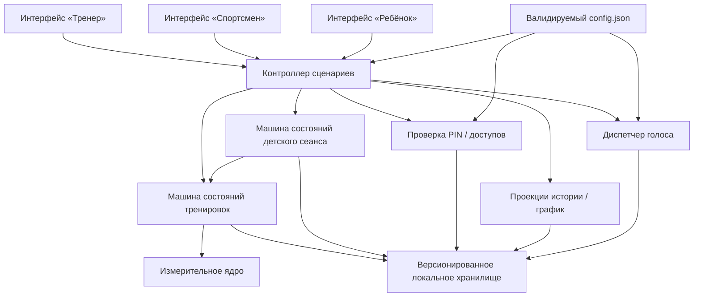
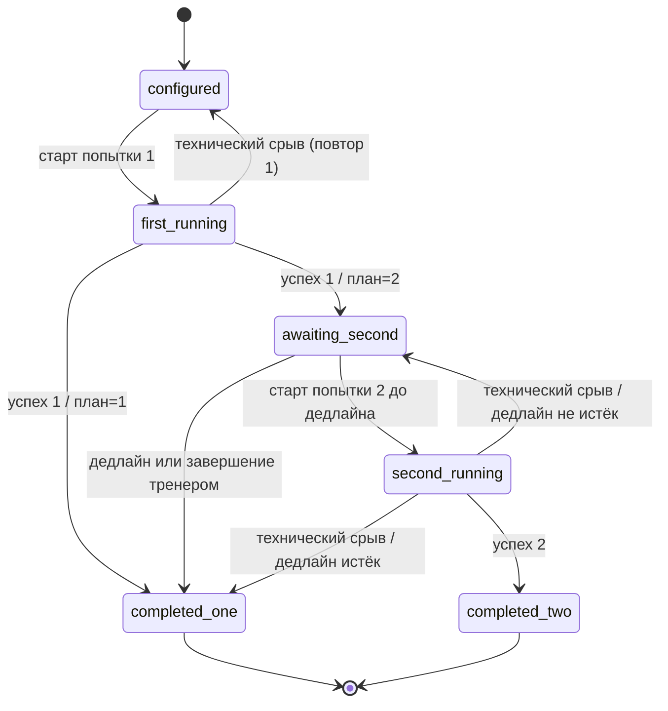
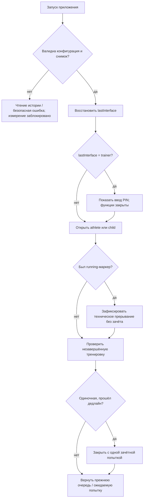

# Interval Lab 2.0 — технический проект

**Редакция:** Technical Design Draft 0.1  
**Дата:** 12.11.2026  
**Статус:** проектное решение для ревью, **не разрешение на программную реализацию и не утверждённый релиз**.  
**Продуктовая основа:** `interval_lab_product_specification_2_0_draft.md` (Product Specification 2.0, draft 0.1).  
**Текущая кодовая основа:** Interval Lab 1.4.3; `t39s/dev-sandbox`, каталог `interval-lab`.  
**Граница работы:** проектирование и выборочная сверка исходников. Код, конфигурация, данные пользователей и GitHub не изменены. Тесты приложения в рамках этой работы не запускались.

> **Обозначения:** **[R]** — решение заказчика из продуктовой спецификации; **[D]** — инженерное проектное предложение; **[L]** — отложено; **[V]** — требуется проверить при реализации/испытании. Проектные решения не выдаются за утверждённые требования.

## 0. Результат и техническая позиция

**Рекомендуемая архитектура:** одно автономное PWA с единым измерительным ядром, тремя пользовательскими интерфейсами («Тренер», «Спортсмен», «Ребёнок») и конечными автоматами `Attempt → Workout → ChildSession`. Не создавать три приложения и не связывать режим измерения («С отсечками» / «Старт–Стоп») с пользовательской ролью. Сохранить локальную архитектуру, но перейти к явно версионированным и проверяемым снимкам состояния.

**Пять ключевых решений [D]:**

1. Разделить **успешную попытку** (момент появления зачётного времени), **тренировку** (объединение 1–2 попыток одного человека) и **детский сеанс** (сценарий организации одной или двух тренировок).
2. Хранить **все взаимозависимые записи и состояние очереди в одном атомарно заменяемом JSON-снимке**, не распределяя незавершённую транзакцию по нескольким ключам `localStorage`.
3. Мигрировать из старой модели v4 **в новый ключ**, не перезаписывая старый: миграция должна быть повторяемой, проверяемой и обратимой до удаления исходного ключа.
4. Рекорд вычислять **по зачётным попыткам**; график — **по завершённым тренировкам**. Не хранить один редактируемый «текущий рекорд» как единственный источник истины.
5. Рассматривать PIN как **локальную блокировку интерфейса от случайных действий**, а не как защищённую аутентификацию или серверное разграничение прав.

**Граница версии:** проект определяет поведение целевой 2.0. Он не меняет принятую базу 1.4.3 и не отменяет отдельное решение заказчика отложить пересмотр «Завершить досрочно».

---

## 1. Верифицированная исходная точка

### 1.1. Основания сверки

Прочитаны `config.json`, `README.md`, `index.html`, `app.js`, `model.js`, `sw.js`, `MANIFEST_SHA256.txt` из ветки `main`. Также проверен commit [`6375eb771f84a7…`](https://github.com/t39s/dev-sandbox/commit/6375eb771f84a8a7c2806a142b7c0a9d0c15fc43): он изменил только `interval-lab/config.json`. Это **выборочная статическая проверка**: без выполнения браузерных и интеграционных тестов.

| Аспект | Фактическое состояние 1.4.3 | Значение для проекта |
|---|---|---|
| Конфигурация | `minTapGapMs: 500`, `intervalCount: 20` | Сохранить семантику; добавить новые поля после проектирования |
| Измерение | Два режима; отсекаются повторные нажатия при `Δt ≤ 500 мс`; 20 отсечек = 21 принятое касание | Измерительное ядро не переписывать без необходимости |
| Точность | В `model.js`: округление сохраняемых интервалов до целых миллисекунд, `formatSeconds()` = 3 знака; экран таймера `formatClock()` = сотые | Результаты показывать до 0,001 с; часы работающего таймера могут иметь отдельную визуальную точность |
| Хранилище | Ключ `interval-lab:data:v1`, объект `version: 4`, `sessions`, `archived`, `incomplete` | Нужна миграция структуры, а не обнуление данных |
| `sessions` | Содержит `exercises[]` из 1–2 измерений и статус `pending/closed` | Слово `session` **не эквивалентно** новому детскому сеансу |
| Удаление | В нынешнем UI доступны удаления разных записей | Разграничить права в новой навигации |
| История и сравнение | Есть общая история нескольких спортсменов и сравнение по закрытым сериям | Построить отдельный детский график по завершённым тренировкам |
| Отдых | Выводится прошедшая пауза; согласованный таймер отдыха 120 с не реализован | Новая машина состояний отдыха |
| Звук, PIN, интерфейсы | В прочитанных ключевых файлах не обнаружена целевая реализация | Новые компоненты |
| Offline | Service Worker кэширует `config.json` и приложение | Нужна версия кэша и тест обновления конфигурации |
| Release metadata | README-пример показывает `intervalCount: 10`, manifest для `config.json` устарел | Исправлять при отдельном релизном цикле, **не сейчас** |

**Фиксация исходных файлов:** см. §14. Перед началом разработки необходимо проверить, не сдвинулась ли `main`, и закрепить конкретный commit SHA как baseline реализации; приведённый commit описывает подтверждённое изменение конфига, но сам по себе не доказывает неизменность всего проекта впоследствии.

### 1.2. Ограничения платформы

- PWA и `localStorage` не дают гарантированного хранения навсегда: очистка данных браузера, приватный режим, ограничения устройства и ошибки записи остаются рисками.
- `performance.now()` подходит для времени **в работающем приложении**, но его значение не переносится между перезапусками. Для дедлайнов нужны абсолютные временные метки.
- Web Speech API зависит от браузера, доступных голосов, разрешений и системных настроек; некоторые браузеры могут блокировать синтез без взаимодействия пользователя. Нельзя обещать воспроизведение на каждом устройстве без испытаний.
- Клиентский PIN, даже хешированный, не защищает данные от человека, умеющего работать с devtools или локальным хранилищем. Это не противоречит принятому назначению защиты от случайных действий детей.

---

## 2. Архитектура компонентов



**Границы ответственности [D]:**

- **Измерительное ядро:** касания, дебаунс, монотонные часы, фиксация отсечек и общий результат. Не знает об имени ребёнка, тренерском PIN или графике.
- **Доменная модель:** `Attempt`, `Workout`, `ChildSession`, инварианты, переходы состояний, идемпотентность событий.
- **Контроллер сценариев:** готовит следующую попытку, выбирает интерфейс и управляет последовательностью; не вычисляет физическое время самостоятельно.
- **Хранилище:** валидирует и сохраняет **полный снимок**; возвращает подтверждение или ошибку; экспорт и миграция.
- **Проекции:** строят истории, лучшие значения и графики *из* сохранённых измерений, не подменяя первичные записи.
- **Диспетчер голоса:** последовательная очередь объявлений с отменой и явным признаком завершения; не блокирует сохранение результата.
- **Проверка PIN:** контролирует открытие тренерской навигации; не объявляется «security boundary».

**Практическая стратегия для 1.4.3:** сохранять чистые функции `model.js` и работающее измерение `app.js` настолько, насколько возможно; извлекать новые доменные операции в отдельный модуль и менять UI поэтапно. Не выполнять большой рефакторинг измерительного ядра одновременно с миграцией хранилища.

---

## 3. Точная предметная модель данных [D]

### 3.1. Структура

| Объект | Поля (не исчерпывающе) | Инвариант |
|---|---|---|
| `Athlete` | `id`, `name`, `createdAt?` | ID уникален, имя непустое; тренер тоже имеет профиль спортсмена |
| `Attempt` | `id`, `athleteId`, `workoutId?`, `status`, `mode`, `startedAt`, `endedAt?`, `totalMs?`, `intervalsMs[]`, `targetIntervals?`, `ordinal`, `recordEvent?` | Зачёт только при `status=completed`, `totalMs` — целое положительное число миллисекунд |
| `Workout` | `id`, `athleteId`, `plannedAttempts` (1/2), `attemptIds[]`, `status`, `createdAt`, `completedAt?`, `closeReason?` | Не более двух зачётных попыток одного спортсмена; «завершено» без зачётной попытки запрещено |
| `ChildSession` | `id`, `athleteIds[]` (1/2), `plannedAttempts`, `workoutIds[]`, `sequence[]`, `nextIndex`, `status`, `startedAt`, `endedAt?`, `closeReason?` | Все ID участников различны; порядок вычисляется детерминированно; отсутствуют фиктивные тренировки |
| `LegacyArchive` | `id`, `athleteId`, `date`, `bestMs` | Архивный итог без созданных задним числом измерений |
| `LegacyIncomplete` | исходные сведения о неполном измерении | Незачётная запись сохранена без выдуманного завершения |
| `DeviceState` | `lastInterface`, `trainerActivated`, `soundEnabled`, `selectedAthleteId?`, `activeWorkoutId?`, `activeChildSessionId?`, `screen?` | Последний интерфейс устойчив; **признак разблокированного тренера не сохраняется** |

`Attempt.recordEvent` — необязательная метка **исторического факта объявления** (`previousRecordMs`, `newRecordMs`, `wasAnnounced` и т. п.). **Не использовать** такую метку как первичный источник действующего рекорда: он заново вычисляется из сохранённых зачётных попыток после удаления/импорта. Историческую речь нельзя путать с текущим состоянием истории.

**Данные измерений** разделяют `mode` и роль; `intervalsMs` содержит только реальные отсечки, не синтетические. Для режима `Старт–Стоп` массив пуст, `totalMs` измеряется отдельно. Для режима «С отсечками» `sum(intervalsMs) === totalMs` после согласованного округления.

### 3.2. Предлагаемый JSON-контракт нового хранилища

Ниже **схематический фрагмент**, не готовый импортный файл. Угловые имена — текстовые заглушки, а не значения.

```json
{
  "schemaVersion": 5,
  "revision": 17,
  "athletes": [{ "id": "a-1", "name": "Петя" }],
  "attempts": [{
    "id": "p-1", "athleteId": "a-1", "workoutId": "w-1",
    "ordinal": 1, "mode": "stopwatch", "status": "completed",
    "startedAt": "2026-11-12T10:00:00.000Z",
    "endedAt": "2026-11-12T10:00:25.357Z",
    "totalMs": 25357, "intervalsMs": []
  }],
  "workouts": [{
    "id": "w-1", "athleteId": "a-1", "plannedAttempts": 2,
    "attemptIds": ["p-1"], "status": "awaiting_second",
    "createdAt": "2026-11-12T10:00:00.000Z",
    "secondDeadlineAt": "2026-11-12T10:05:25.357Z"
  }],
  "childSessions": [],
  "legacyArchives": [],
  "legacyIncomplete": [],
  "deviceState": {
    "lastInterface": "child", "trainerActivated": true,
    "soundEnabled": false, "activeWorkoutId": "w-1"
  }
}
```

Смысл этого примера — показать связи и статусы. В реальной схеме должны быть полностью заданы ограничения типов, дополнительные поля для восстановления активного измерения и **правила совместимости**.

### 3.3. Источник истины

1. Первичные факты: успешно завершённые `Attempt`, архивные записи и статусы `Workout`/`ChildSession`.
2. Производные данные: лучший результат тренировки, текущий рекорд, разница с прежним рекордом, данные точек графика, состояние списка «Последние пять».
3. Конфигурационные значения (`restDurationSec`, `resultDisplaySec`, количество интервалов и PIN-проверка) загружаются из `config.json`, но **применённые к уже начатой тренировке параметры фиксируются при её создании**. Это не позволяет изменение config посреди сеанса задним числом изменить дедлайны или число отсечек.
4. Локальные пользовательские предпочтения (`soundEnabled`) общие для устройства и не должны смешиваться с индивидуальной историей.

### 3.4. Контракты хранения

- Новый ключ: **`interval-lab:data:v5`** [D]. Существующий `interval-lab:data:v1` (с содержимым `version:4`) на этапе миграции **оставить неизменным**.
- Каждая операция, влияющая на связанные записи (`Attempt`, `Workout`, индекс очереди, `DeviceState`), оформляется как **один изменённый снимок**. Сначала проверка модели и подготовка следующего значения, затем **один успешный `localStorage.setItem()`**; только после этого — сообщение «сохранено» и продвижение UI.
- `revision` увеличивается по каждой успешной операции. В рамках одной вкладки повторение события завершения попытки по одному `attemptId` — **идемпотентно** (не создаёт дубликат). `revision` не защищает автоматически от конкурентной записи двух вкладок; см. §11.
- Не хранить в конфигурации, истории или экспортируемых данных PIN открытым текстом. Хеш/соль — в общей конфигурации, а локальный флаг активации — в `DeviceState`. **В JSON-экспорт истории не включать ни `trainerActivated`, ни `lastInterface`, ни локальное состояние звука, ни PIN-verifier**: это параметры данного устройства, не результаты спортсменов. При импорте сохранить местные настройки и не активировать тренерский интерфейс через импортированные данные.
- Не объявлять успешное сохранение при исключении или нарушении проверки. При ошибке блокировать запуск новых попыток до восстановления возможности записи или обеспечить явный аварийный экспорт **только фактически сохранённых** данных.

### 3.5. Удаление

- Спортсмен может удалить только прерванную попытку; завершённые попытки и тренировки в его интерфейсе неизменяемы.
- Тренер вправе удалять любые локальные записи, включая отдельные попытки. [D] Удаление последней успешной попытки одновременно удаляет тренировку из зачётной истории. Удаление одной из двух — закрытая тренировка превращается в закрытую с одной попыткой; никакой результат `0` не создаётся.
- Если удалённая запись относится к **активному детскому сеансу**, сначала остановить/закрыть затронутый сценарий через тренерский интерфейс, затем выполнить каскадный пересчёт; не оставлять ссылку на отсутствующий `attemptId`.
- После удаления пересчитываются все проекции истории и рекордов. Подтверждение для разрушительных операций — обязательно [D]. Импорт старого архива может восстановить удалённые записи, поэтому требуется предупреждение.

---

## 4. Конечные автоматы и события [D]

### 4.1. Попытка

| Из | Событие | В | Действие |
|---|---|---|---|
| `ready` | первое принятое касание | `running` | Зафиксировать `startedAt`, `attemptId`, `mode`, параметры измерения и аварийный маркер активного запуска |
| `running` | промежуточная отсечка | `running` | Добавить точную отсечку по измерительному ядру; не создавать зачёт до завершения |
| `running` | корректное последнее касание | `completed` | Рассчитать `totalMs`, сохранить попытку и состояние тренировки одной транзакцией |
| `running` | закрытие/перезапуск приложения | `interrupted` | При восстановлении не засчитывать результат; разрешить повторную попытку в прежнем слоте |
| `ready` | отмена до начала | `ready` | Ничего не измерено; зачётную попытку не создавать |

**Функция «Завершить досрочно» [L]:** в 1.4.3 она существует в режиме отсечек и создаёт `incomplete`, но её судьба не определена. Поэтому новый автомат **не расширяет** её семантику. При миграции все существующие `incomplete` сохраняются отдельно без зачёта.

**Инварианты:** `completed ⇒ endedAt ∧ totalMs > 0`; `interrupted ⇒ нет зачётного totalMs`; одно измерение нельзя зачесть дважды; повторный запуск после технического прерывания занимает **тот же запланированный слот**, а не автоматически следующий.

### 4.2. Тренировка



`first_running`, `second_running` — **преходящие рабочие состояния** с маркером для восстановления, но не с восстановимым секундомером. После перезапуска текущая попытка помечается прерванной, а слот остаётся доступен, если это не запрещено дедлайном.

**Правило одной попытки:** `plannedAttempts=1`, после первой успешной — `completed_one` без экрана отдыха.

**Правило двух попыток:** `plannedAttempts=2`, после первой успешной — `awaiting_second`, с отдыхом только в сценарии одного спортсмена. При успешном втором измерении — `completed_two`.

**Дедлайн при одиночном исполнении [R]:**

```text
secondDeadlineAt = min(
    attempt1.endedAt + 300 секунд,
    attempt1.startedAt + 600 секунд
)
```

- Если `now >= secondDeadlineAt` и вторая попытка **не начата**, закрыть тренировку с одной попыткой; показать согласованное уведомление.
- Если вторая попытка **уже началась до** `secondDeadlineAt`, не прерывать её по таймеру ожидания; финиш засчитывается.
- Если повторный запуск после прерывания второй попытки происходит **после** дедлайна, закрыть с первой попыткой [D]; иначе разрешить повтор в том же слоте.
- Для двух детей дедлайн **не рассчитывается и не применяется**.

**Пограничное уточнение [D]:** если сама первая попытка длится настолько долго, что срок «10 минут от её старта» уже наступил, не прерывать выполняемую первую попытку; после успеха закрыть тренировку с одной попыткой без неосуществимого ожидания второй.

### 4.3. Детский сеанс

```mermaid
stateDiagram-v2
  [*] --> configured
  configured --> active: тренер начинает
  active --> active: завершена очередная попытка; очередь продвинута
  active --> completed: выполнены все запланированные попытки
  active --> force_closed: тренер вводит PIN и завершает
  completed --> review: итог ребёнка Б или А (если он один)
  force_closed --> review: история доступных результатов
  review --> [*]
```



План очереди формируется **один раз** при запуске; при числе участников и попыток:

| Участники | 1 попытка | 2 попытки |
|---|---|---|
| А | `A1` | `A1 → A2` |
| А, Б | `A1 → Б1` | `A1 → Б1 → A2 → Б2` |

**Критическое правило [R]:** `nextIndex` увеличивается **в одном снимке с сохранением завершённой попытки**. При повторном запуске после Б1 восстанавливается А2, а не Б1 или Б2. Начавшаяся, но не законченная попытка не продвигает очередь.

**Принудительное завершение [R]:** участник с одной или двумя зачётными попытками получает завершённую тренировку по фактически выполненному объёму. Для участника без зачётных попыток не создавать фиктивный результат [D; уточнение из предыдущего проекта]. Доступ только из тренерского интерфейса с PIN. **Во время работающего секундомера** отдельный способ остановки не утверждён [L]; предложено разрешать принудительное завершение между попытками, не превращая его в скрытое «досрочное завершение» измерения.

### 4.4. Восстановление после перезапуска



- Абсолютные метки времени сохраняются до перезапуска; при открытии не требуется восстановление `performance.now()` предыдущей сессии.
- Последний интерфейс восстанавливается, **тренерский всегда остаётся заблокированным до PIN**. Никакого `trainerUnlocked:true` в хранилище.
- Не показывать повторно «Новый рекорд!» автоматически по причине перезапуска, если событие уже было озвучено; включение звука пользователем при отображаемом результате может инициировать произнесение текущего результата [R].
- Подозрительное изменение системных часов следует диагностировать отдельно [V]: офлайн-приложение не имеет достоверного источника времени независимо от пользователя.

---

## 5. Алгоритмы результатов и рекордов

### 5.1. Числа

**[R]** Все сохранённые и сравниваемые времена — целые миллисекунды; экран показывает `24,357 с`, голос — округлённые `24,4 с`. Округление для голосового воспроизведения **не меняет** зафиксированный результат. При равенстве миллисекунд новый рекорд не объявляется.

`workoutBestMs = min(totalMs for completed attempts in workout)`, если тренировка `completed_one` или `completed_two`; иначе она **не имеет точки** на графике.

### 5.2. Рекорд и первая тренировка

```text
previousBestMs = минимум всех более ранних зачётных попыток спортсмена
                  (+ совместимые архивные базовые записи, если политика включения выбрана)
newRecord = previousBestMs exists AND currentAttempt.totalMs < previousBestMs
```

**Особый согласованный случай [R]:** первая тренировка — **исходный ориентир, не «новый рекорд»**. Чтобы дважды не объявить рекорд на первой тренировке, вводится правило [D]: `baselineExistsAtWorkoutStart` фиксируется при начале тренировки. Если до неё не было истории, её попытки устанавливают исходную базу без поздравления. После появления ранее завершённой тренировки другие новые попытки сравниваются с лучшей предшествующей зачётной попыткой. При этом рекорд **может** быть обновлён попыткой текущей, ещё открытой тренировки.

**Пример:** предыдущая тренировка 25 000 мс; А1 = 23 000 ⇒ объявить рекорд; А2 = 24 000 ⇒ второй раз не объявлять; итог тренировки 23 000, рекорд показан. Если А2 = 22 000 ⇒ объявить рекорд и после второй попытки.

**После удаления тренером:** `currentBest` и график пересчитать по оставшейся истории. Отдельные прошлые фразы, уже произнесённые пользователю, не могут быть «отменены»; в UI не показывать устаревшие рекордные события, если удалён базовый результат [D].

**Архив [D, не утверждено]:** старые записи `archived` имеют итоговое `bestMs`, но не содержат отдельных измерений. Рекомендуется хранить их самостоятельным типом и использовать как исторический базовый результат, **не создавая искусственные попытки**. Проверить это правило на реальном экспортном файле прежде, чем утверждать аналитику.

### 5.3. Два режима измерения

Ни `intervals`, ни `stopwatch` не должны менять принцип выбора лучшего общего времени. **[V]** Перед выпуском проверить, что одно и то же упражнение измеряется сопоставимо в обоих режимах. При необходимости в сравнении показывать предупреждение о различиях способа измерения, но не удалять исторические результаты только по признаку режима.

### 5.4. График и история

- Каждая **завершённая тренировка** даёт **одну** точку — её `workoutBestMs`. Ожидающая вторую попытку точку не создаёт, даже если рекорд уже изменён после первой.
- Ось X: равномерные позиции тренировок, подписи `ДД.ММ`, сортировка по фактическому времени начала + стабильному ID. Несколько тренировок одного дня остаются разными точками.
- Ось Y: `min=0`, верхняя граница >= максимального показанного времени. Запрещать графическому движку «автосдвигать» нижнюю границу над 0.
- Рекорд выделен **символом и/или цветом**, точное значение доступно текстом; для нецветового восприятия символ предпочтителен.
- По умолчанию в детской истории отображаются **пять последних тренировок**; действие «Вся история» открывает остальные. Подробности показывают все фактически завершённые попытки, дату и время.
- После последней попытки итоговый экран не скрывается по таймеру; для пары детей сначала показывается только результат Б. После закрытия сеанса А самостоятельно выбирает своё имя из двух доступных.

**Пограничный случай [D]:** если рекорд обновлён в ожидающей второй попытки тренировке, на графике ближайший опубликованный рекорд может быть выше текущего общего рекорда; это допустимо только при явно различимых подписях «Рекорд» и «Тренировки». Не рисовать ложную точку до закрытия тренировки.

---

## 6. Отдых, показ результата и голос

### 6.1. Таймеры

| Таймер | Когда действует | Источник | Переход |
|---|---|---|---|
| `restDurationSec` (120 с) | Спортсмен, один ребёнок, после А1 при плане из 2 | `config.json` + время окончания А1 | К готовому секундомеру; «Можно начинать», если звук включён |
| `resultDisplaySec` (5/10/15 с на испытаниях) | Промежуточный результат, в том числе при чередовании | `config.json` | Переход после окончания окна **и** текущей речи |
| 5/10 минут | Одиночная тренировка с ожидаемой второй попыткой | Абсолютные метки А1 | Автоматическое завершение с одной попыткой, если вторая не началась |
| На итоговом экране | — | Без тайм-аута | До действия пользователя |

Результат А1 появляется **сразу**, одновременно начинается отдых. Первые `resultDisplaySec` результат крупный, таймер отдыха второстепенный. Затем таймер крупный, кнопка «Начать раньше» доступна; прежний результат может отображаться ненавязчиво [D].

Кнопка «Начать раньше» переводит к **готовому** секундомеру **без автозапуска** и **без фразы «Можно начинать»**. При естественном окончании отдыха фраза есть. Если озвучивание результата ещё идёт в момент перехода, дождаться завершения речи без остановки часов отдыха.

**Двое детей:** таймера отдыха и дедлайна нет, только промежуточное окно показа результата, после которого автоматически активируется следующий ребёнок и произносится его имя.

### 6.2. Модель настройки звука

Для устранения логически невозможной комбинации «настройка скрыта, но звук включён» предлагается [D] **перечислимое состояние** вместо двух независимых флагов:

```json
{
  "audioPolicy": "user-controllable"
}
```

- `off`: озвучка выключена, переключатель скрыт.
- `user-controllable`: переключатель доступен, его состояние `deviceState.soundEnabled` сохраняется на конкретном устройстве при смене спортсмена и перезапуске.

Это соблюдает принятое ограничение, что скрытая настройка означает выключенный звук. Значение пользовательского состояния по умолчанию при первом запуске — **включено** [D; проверить удобство], но если политика `off`, фактический звук всегда выключен независимо от сохранённого предпочтения.

### 6.3. Очередь речи

```text
onAttemptCompleted(a):
  save(a + workout/session progress)
  if soundAllowed:
    enqueue(speak(formatTenths(a.totalMs)))
    if recordEvent(a): enqueue(speak("Новый рекорд!"))

onChildTurnChanged(next):
  if soundAllowed: enqueue(speak(next.name))

onRestExpiredNaturally():
  if soundAllowed: enqueue(speak("Можно начинать"))

onMute(): cancelCurrentSpeech(); clearQueuedSpeech()
onUnmuteWhileResultVisible(): enqueueCurrentResultOnceForThisToggle()
```

- Очередь строго последовательная. Смена экрана после промежуточного результата ждёт завершения относящегося к нему речевого события **после** истечения окна показа.
- При выключении звука **немедленно** остановить текущее слово/фразу и сбросить будущие голосовые сообщения.
- При включении звука, пока результат ещё открыт, **озвучить текущий результат, даже если он уже был объявлен**. Если текущая попытка установила рекорд, [D] воспроизвести и «Новый рекорд!» после времени; это следует дополнительно проверить на удобство, не нарушая правила отсутствия автоматического дублирования на финале.
- Если голос недоступен, не зависать в ожидании обещанного события; завершить ожидание по корректному fallback с записью диагностического статуса [D]. Нельзя считать отсутствие ошибки API доказательством, что человек услышал речь.
- `speechSynthesis.cancel()` и завершение `SpeechSynthesisUtterance` требуют тестов в целевых мобильных браузерах. Нельзя привязывать целостность данных к успешному аудиовыводу.

---

## 7. Прототипы трёх пользовательских интерфейсов

Ниже **текстовые wireframes** для проектирования информационной иерархии; не являются утверждённым визуальным дизайном. Изображения аватаров не используются. Во время измерения большая нажимаемая зона должна быть отделена от настроек и кнопок навигации.

### 7.1. «Тренер»: подготовка сеанса

```text
┌──────────────────────────────────────┐
│ INTERVAL LAB          ТРЕНЕР         │
│                                      │
│ ДЕТСКОЕ ЗАНЯТИЕ                     │
│                                      │
│ Участник А     [Петя          ▼]     │
│ Участник Б     [Маша          ▼]     │
│                 [Один] [Двое]        │
│                                      │
│ Попыток каждому  [ 1 ] [● 2 ]        │
│                                      │
│      [ НАЧАТЬ ЗАНЯТИЕ ]             │
│                                      │
│ [История / спортсмены]               │
│ [Мои упражнения — Спортсмен]          │
└──────────────────────────────────────┘
```

**Права:** именно тренер формирует пару и может принудительно завершить сеанс. Изменение `config.json` не предлагается как поле этого интерфейса. Возврат из других интерфейсов — по PIN. Запуск при некорректной конфигурации блокируется без повреждения истории.

### 7.2. «Спортсмен»: личная тренировка

```text
┌──────────────────────────────────────┐
│ МОЯ ТРЕНИРОВКА            История    │
│                                      │
│ Попыток:          [1] [● 2]         │
│                                      │
│              ГОТОВ                   │
│                                      │
│                0                     │
│             00:00.000               │
│                                      │
│        КОСНИТЕСЬ ДЛЯ СТАРТА          │
│                                      │
│ [Звук: включён] если разрешено       │
└──────────────────────────────────────┘
```

**После А1** (план = 2):

```text
┌──────────────────────────────────────┐
│ ПОПЫТКА 1                            │
│                                      │
│            24,357 с                  │
│          Новый рекорд! *             │
│                                      │
│          Отдых  01:52               │
│                                      │
│        [ Начать раньше ]             │
└──────────────────────────────────────┘
* только при достижении рекорда
```

Через окно `resultDisplaySec` внимание смещается на таймер отдыха. Секундомер не стартует автоматически ни по истечении отдыха, ни по нажатию «Начать раньше».

### 7.3. «Ребёнок»: одна или две персоны

```text
┌──────────────────────────────────────┐
│              ПЕТЯ                    │
│          ТВОЯ ОЧЕРЕДЬ               │
│                                      │
│                 0                    │
│             00:00.000               │
│                                      │
│          НАЖМИ ДЛЯ СТАРТА           │
│                                      │
│                                      │
│       [ Звук ] (если разрешено)      │
└──────────────────────────────────────┘
```

- Детский интерфейс — **один** для одного и двух детей. Вариант с одним ребёнком после А1 включает экран отдыха, как у взрослого. Вариант с двумя автоматически сменяет Петю/Машу, без выбора профиля в активном сеансе.
- После последней попытки: личный результат **последнего** участника; для двух детей это Б. Ни списка всех спортсменов, ни редактирования, ни удаления завершённых результатов.
- После закрытия сеанса доступен простой экран истории с **двумя текстовыми именами**, если участников было двое. Для одного — только его имя. История ребёнка открывается **самостоятельно**, PIN для просмотра не нужен.

### 7.4. Общий итоговый экран (персональный)

```text
┌──────────────────────────────────────┐
│ МАША                                 │
│                                      │
│ ЛУЧШИЙ РЕЗУЛЬТАТ                    │
│             23,000 с                │
│          ★ Новый рекорд             │
│                                      │
│ ПРОГРЕСС                             │
│   секунды (от 0)                     │
│   ┌────────────────────────┐         │
│   │       •                │         │
│   │      /  \      ★       │         │
│   │   • /    \    /        │         │
│ 0 └────────────────────────┘         │
│     01.11   05.11   12.11           │
│                                      │
│ [Последние 5] [Вся история]          │
│ [Попытка 1 / Попытка 2 — детали]    │
└──────────────────────────────────────┘
```

**Схема условная:** высоты/точки здесь не являются реальными данными. В работающем графике символ рекорда должен соответствовать настоящему минимуму, ось Y начинаться с нуля; доступна текстовая таблица с точными временами.

### 7.5. Навигационная матрица

| Из | В | Условие |
|---|---|---|
| «Спортсмен» | «Тренер» | Успешный PIN; если устройство не активировано, первая проверка активирует локальные функции |
| «Ребёнок» | «Тренер» | Успешный PIN, включая принудительное завершение сеанса |
| «Тренер» | «Спортсмен» | Без PIN; личный профиль тренера |
| «Тренер» | «Ребёнок» | После настройки детского сеанса; без PIN повторно |
| Детский активный сеанс | История другого ребёнка | **Запрещено**, пока сеанс не завершён |
| Детский завершённый сеанс | История А/Б | Разрешён выбор только участников последней выбранной пары |
| Последний интерфейс «Тренер» после перезапуска | «Тренер» | **Только через новый ввод PIN** |

---

## 8. Конфигурация и локальный доступ

### 8.1. Предлагаемый контракт `config.json` [D]

```json
{
  "minTapGapMs": 500,
  "intervalCount": 20,
  "restDurationSec": 120,
  "resultDisplaySec": 10,
  "audioPolicy": "user-controllable",
  "trainerAccess": {
    "algorithm": "PBKDF2-SHA256",
    "iterations": 200000,
    "saltB64": "<случайная-соль-base64>",
    "verifierB64": "<хеш-base64>"
  }
}
```

**Примечание к RC2:** `resultDisplaySec: 10` остаётся экспериментальным значением. PIN получен от тренера, в RC2 создана соль и PBKDF2-SHA256 verifier; совместимость с WebCrypto на целевых телефонах ещё не подтверждена. Приведённый выше фрагмент остаётся примером контракта, а не актуальным содержимым файла `config.json`.

**Валидатор [D]:**

- `minTapGapMs` — целое 0…60000 (сохранить существующее правило).
- `intervalCount` — целое 1…200 (сохранить существующее правило).
- `restDurationSec` — целое неотрицательное число, проектный верхний предел **меньше 300 с**, чтобы типовой отдых не противоречил первому дедлайну; при реальной длительной первой попытке действует отдельный 10-минутный срок. Окончательный диапазон определить при реализации без скрытого изменения правила 120 с.
- `resultDisplaySec` — положительное целое, для испытаний строго 5, 10 или 15; расширение диапазона после испытаний возможно.
- `audioPolicy` — ровно `off` или `user-controllable`.
- `trainerAccess` — распознаваемая схема проверки; при её ошибке **не открывать тренерские функции** и показывать диагностическое уведомление, не теряя историю.

Новая конфигурация начинает действовать после обновления/reload. **Снимок применяемых параметров** (измерение, отдых, срок показа) сохраняется для уже созданной тренировки и детского сеанса; изменение конфига не переписывает ранее сохранённые результаты.

### 8.2. PIN

- **PIN выбирает тренер**, затем передаёт разработчику при отдельной задаче на реализацию; не создавать его сейчас.
- Разработчик вычисляет соль и медленный проверочный хеш, публикует **только соль и хеш**. В коде приложения PIN открытым текстом не должен встречаться.
- Правило «устройство активировано как тренерское» — локальный незащищённый флаг `trainerActivated`; флаг **не** равен текущей разблокировке. PIN обязателен при каждом входе в «Тренер» из других интерфейсов и после перезапуска.
- **Модель угроз**: случайные действия детей. Хранение хеша в доступном PWA и отсутствие сервера не дают строгой защиты при намеренном обходе. Нельзя рекламировать механизм как безопасную систему учётных записей.
- В случае недоступности проверки — интерфейс тренера остаётся закрытым; просмотр/экспорт сохранённой истории не должен блокироваться безусловно из-за ошибки PIN [D, проверка сценария].

---

## 9. Миграция с 1.4.3 без потери истории

### 9.1. Правило безопасности

**[D] Миграция — отдельная проверяемая операция, не обновление старого JSON «на месте».** Исходный `interval-lab:data:v1` остаётся без изменения. Новая модель пишет только в `interval-lab:data:v5` после полной валидации преобразованного снимка. При ошибке новая версия не должна замещать данные пустым хранилищем или считать конверсию успешной.

### 9.2. Таблица соответствий

| Поле v4 | В модели v5 | Условия |
|---|---|---|
| `athletes[]` | `athletes[]` | Сохранить исходные ID и имена |
| `sessions[].id` | `workouts[].legacyOrigin.sessionId`, новый ID тренировки или исходный с namespace | Не превращать в `ChildSession` |
| `sessions[].exercises[i]` | `attempts[]` с устойчивыми IDs, детерминированными из `session.id` + номера | Сохранить время/режим/интервалы без изменения измеренных чисел |
| `sessions[].status=closed`, 1 попытка | `completed_one` | Итог по одной успешной попытке |
| `sessions[].status=closed`, 2 попытки | `completed_two` | Итог по минимуму двух |
| `sessions[].status=pending`, 1 попытка | `legacy_pending` | Не применять автоматически новые сроки к историческим сериям |
| `archived[]` | `legacyArchives[]` | Не создавать несуществующие `Attempt` |
| `incomplete[]` | `legacyIncomplete[]` | Не засчитывать как завершённые попытки; сохранить исходные отсечки |
| `mode`, `target`, `selectedAthleteId` | Переносимые предпочтения/метаданные | Не подменять действующую конфигурацию; исторический `target` сохранить для проверки |

**Главный риск:** применение новых дедлайнов 5/10 минут к старым `pending` записям автоматически закрыло бы часть исторических серий. **Предлагается специальный `legacy_pending`**: его можно просмотреть, продолжить или завершить отдельной явно инициированной операцией, но миграция не изменяет его исторический статус автоматически. Это **изъятие из нового правила сроков** исключительно для старых данных [D].

### 9.3. Последовательность миграции

1. До обновления рекомендовать **экспорт JSON** существующей 1.4.3 и сохранение архива вне браузера.
2. Прочитать старый ключ; проверить v4 существующим `validateStore`. Для импортов старых версий сначала нормализовать v1–v4.
3. Преобразовать в памяти, создав детерминированные ID попыток (`legacy-attempt:<sessionId>:<index>`) и явные ссылки `workoutId`.
4. Провести полную валидацию v5: имена, уникальность ID, ссылки, количество попыток, статусы, арифметику `totalMs`, хронологию.
5. Сохранить новый снимок **одним `setItem` по новому ключу**; затем перечитать его и проверить совпадение контрольных ключевых итогов.
6. Маркировать миграцию завершённой только после успешного сохранения и проверки. При сбое оставить старый ключ в сохранности и показать причину, не создавая фиктивной «пустой» истории.
7. После выпуска провести испытания **экспорт → импорт → экспорт** и восстановление из резервной копии. Старый ключ не удалять без отдельной подтверждённой политики очистки.

**Инварианты миграции:** число спортсменов неизменно; все исходные зачётные попытки сохраняют время в миллисекундах и режим; все архивные и неполные записи сохранены; завершённость `closed` сохраняется; старые `pending` не закрыты молча; новые рекорды не объявляются задним числом.

### 9.4. Импорт в новой версии

**[D]** Поддерживать ввод JSON v1–v5. Импорт старых форматов проходит через конвертер **без** изменения оригинального файла. При конфликте ID/данных не выполнять молчаливое переписывание; пользователю показать понятное сообщение. Для резервной копии предусмотреть отдельное **восстановление снимка** с подтверждением и предупреждением, что в нём могут находиться ранее удалённые записи. Импортировать **только данные спортсменов и измерений**: локальный флаг тренерской активации, последний интерфейс и пользовательские предпочтения с чужого устройства не переносить. Не обещать автоматическую синхронизацию между устройствами.

**Риски совместимости:** старое приложение v1.4.3 не умеет читать v5; новый формат JSON-экспорта должен явно указывать версию схемы. Нужен тест импорта архивных данных с неполными датами и сериями с разными измерительными режимами.

---

## 10. Последовательности основных сценариев

### 10.1. Один спортсмен, две попытки

```mermaid
sequenceDiagram
  participant U as Спортсмен
  participant UI as Интерфейс
  participant D as Доменная модель
  participant S as Хранилище
  participant T as Таймеры/звук
  U->>UI: Начать попытку 1
  UI->>D: startAttempt()
  D->>S: commit(running marker)
  U->>UI: Последняя отсечка / стоп
  UI->>D: completeAttempt(totalMs)
  D->>S: commit(attempt + workout.awaiting_second)
  S-->>UI: подтверждение записи
  UI->>T: Показ результата + звук; отдых 120 с
  alt Досрочно
    U->>UI: «Начать раньше»
    UI->>T: Отменить отдых, без голосового объявления
  else Окончание отдыха
    T->>UI: «Можно начинать»; готовый таймер
  end
  U->>UI: Начать попытку 2
  UI->>D: startAttempt()
  D->>S: commit(running marker)
  U->>UI: Завершить попытку 2
  UI->>D: completeAttempt(totalMs)
  D->>S: commit(attempt + completed_two)
  S-->>UI: подтверждение записи
  UI-->>U: Итог, рекорд, график (без автозакрытия)
```

### 10.2. Пара детей

```mermaid
sequenceDiagram
  participant C as Тренер
  participant UI as Детский интерфейс
  participant D as Модель ChildSession
  participant S as Хранилище
  C->>D: выбрать А и Б; две попытки
  D->>S: commit(session A1,B1,A2,B2)
  D-->>UI: А1 — готовый таймер
  loop Для каждой запланированной попытки
    UI->>D: завершена попытка
    D->>S: commit(attempt + nextIndex)
    S-->>UI: сохранено
    UI-->>UI: показать время / произнести время, рекорд при наличии
    opt Есть следующий участник
      UI-->>UI: ждать resultDisplaySec и завершения речи
      D-->>UI: показать и озвучить имя следующего
    end
  end
  D->>S: commit(session.completed)
  UI-->>UI: итог только ребёнка Б; доступ к истории А после сеанса
```

### 10.3. Падение браузера и возврат

```text
A1 успешно сохранена → Б1 успешно сохранена → A2 started/running → браузер закрыт
     ↓ при открытии
читаем единственный подтверждённый снимок
     ↓
маркер A2-running → interrupted (время не засчитано)
     ↓
nextIndex по-прежнему указывает на A2
     ↓
ребёнок А видит готовый секундомер, запускает A2 повторно
```

Для одиночной тренировки при возврате дополнительно проверить срок ожидания второй попытки. Для двух детей срок не применяется.

---

## 11. Надёжность, конкуренция вкладок, безопасность

### 11.1. Сохранение и повтор событий

- Событие завершения измерения записывать с идентификатором попытки **до** перехода к голосу/новому участнику.
- При двойном callback по финишному касанию один и тот же `attemptId` не должен создать два результата.
- Ошибка `setItem` должна оставить интерфейс без ложного «сохранено» и запретить продвижение очереди на неподтверждённый результат.
- Сохранение времени/очереди в **разных localStorage-ключах** в данном проекте не допускается: это создаёт частично завершённые операции.

### 11.2. Несколько вкладок [V]

`localStorage` не предоставляет транзакционного сравнения и записи между двумя одновременно работающими вкладками. **[D]** На первом этапе гарантировать корректную работу при **одной активной вкладке** приложения. При обнаружении второго активного экземпляра (например, через `BroadcastChannel`/`storage`-события) показывать сообщение о конфликте и блокировать измерение в одном экземпляре. Альтернативу с Web Locks проверять на целевых браузерах. Не заявлять строгую защиту от конкурентных записей без реального теста.

### 11.3. PIN и данные

- Не хранить PIN открытым текстом и не логировать введённые значения.
- PIN для пользовательского интерфейса — не полноценный механизм защиты данных, экспортов и хранилища от умышленного доступа.
- Не показывать ребёнку тренерские кнопки удаления, настройки пары, импорт и управление профилями. Ввод PIN доступен в отдельном понятном экране.
- При ошибке проверки PIN вход в «Тренер» невозможен; не допускать невидимого fallback к открытому тренерскому интерфейсу.

### 11.4. Offline, PWA и обновления

- Обновить имя service-worker cache при релизе новой схемы; гарантировать, что `app.js`, `model.js` и `config.json` **одной совместимой версии** используются вместе.
- Проверить первый online-запуск, следующий offline-запуск, изменение config, reload, восстановление после обновления и ситуацию старого активного service worker.
- Обновление программы никогда само по себе не должно удалять локальную историю. Экспорт перед миграцией — обязательный пункт процедуры внедрения.

---

## 12. Инженерные решения по оставшимся развилкам

| ID | Развилка | Рекомендуемое решение | Статус |
|---|---|---|---|
| D-01 | Где хранить новую модель | Новый ключ `interval-lab:data:v5`; старый v4 не переписывать | [D] |
| D-02 | Что делать со старыми `pending` | `legacy_pending`; не применять новые дедлайны автоматически | [D] |
| D-03 | Время показа результата | `10 с` только для тестового прототипа, испытать 5/10/15 | [D/V] |
| D-04 | Звук скрыт | Одна enum-политика `off/user-controllable`; скрытый = выключенный | [D] |
| D-05 | Рекорд в первой тренировке | Не объявлять до появления исходной тренировочной базы | [D] |
| D-06 | Архивные записи как база | Учитывать `LegacyArchive.bestMs`, не создавать попытку | [D/V] |
| D-07 | Удаление последней попытки | Удалять зачётную тренировку, не создавать нулевой результат | [D] |
| D-08 | Рестарт работающего измерения | `interrupted`, без зачёта, повтор в том же слоте | [R] |
| D-09 | Прерывание второй + истёкший срок | Закрыть одиночную тренировку с первой попыткой | [D] |
| D-10 | Принудительное закрытие детского сеанса во время текущего измерения | Не реализовывать скрытую остановку измерения; тренер закрывает между попытками | [D/L] |
| D-11 | Пара на экране после окончания | Сохранять два разрешённых имени для просмотра истории | [R] |
| D-12 | Изменение системного времени | Выявлять аномалии; фиксировать ограничение офлайн-часов | [V] |
| D-13 | Исполнение на разных телефонах | Испытать синтез речи, Wake Lock, фоновые таймеры, `localStorage` | [V] |
| D-14 | Источник «истинного рекорда» | Всегда вычислять из истории зачётных попыток с выбранной политикой архива | [D] |

**Не разрешённые до испытаний вопросы — не основание вновь запускать длинный опрос.** Для них предусмотрены проектные значения, конкретные тесты и явное документирование результата. Эскалировать заказчику только настоящую продуктовую развилку, несовместимую с уже принятыми требованиями.

---

## 13. План проверки: тесты и критерии перехода к реализации

### 13.1. Проверка модели до UI

1. `Attempt`: полный финиш, касания около границы `500 мс`, точность миллисекунд, повторный callback, прерывание.
2. `Workout`: 1/2 попытки, статус `awaiting_second`, естественное и принудительное закрытие, завершение с одной попыткой по более раннему дедлайну.
3. `ChildSession`: A1/B1/A2/B2 и A1/B1, one-child A1/A2, восстановление по `nextIndex`, принудительное закрытие на каждом возможном шаге.
4. Рекорд: нет объявления в первой тренировке, улучшение в А1 и А2, равенство до 0,001 с, удаление и пересчёт, рекорд из ожидающей тренировки.
5. Миграция: настоящая v4-структура, v1–v3 в импорте, архивы, `incomplete`, старые `pending`, одинаковые ID, повтор миграции.
6. Хранилище: ошибка записи, разрушенный JSON, частично прерванное сохранение, пустое хранилище, две вкладки, повторный импорт.

### 13.2. Браузерные сценарии

| ID | Проверка | Наблюдаемый критерий |
|---|---|---|
| E2E-01 | Тренерский доступ | Локальная активация, повторный PIN после перезапуска, отсутствие тренерских кнопок у ребёнка |
| E2E-02 | Один ребёнок | 120-секундный отдых, «Начать раньше», готовый таймер без автоматического старта |
| E2E-03 | Двое детей | A1 → Б1 → A2 → Б2 без ручных переключений и без отдельного таймера отдыха |
| E2E-04 | Рестарт между Б1 и А2 | Сохранены Б1/А1, следующий — А2 |
| E2E-05 | Рестарт в А2-running | А2 незачётна, не продвигает очередь, допускается повтор |
| E2E-06 | Дедлайн | Ровно границы 5 и 10 минут, при уже начатой попытке прерывания нет |
| E2E-07 | Принудительное закрытие после А1/Б1 | Обе тренировки закрыты с фактическими одной попытками; сравнение корректно |
| E2E-08 | Голос | Время → рекорд; отключение немедленно, включение переозвучивает текущий результат |
| E2E-09 | Таймер показа | Проверка 5/10/15, речь не обрывается, отдых идёт независимо |
| E2E-10 | График | Нулевая ось Y, даты равномерно по X, два занятия за день, пять последних |
| E2E-11 | Локальный импорт/экспорт | Результаты не теряются, старые форматы работают, удаления доступны согласно роли |
| E2E-12 | Offline/update | Кэшируется совместимая версия, история после обновления не теряется |

### 13.3. Реальные наблюдения

Провести испытания на фактических телефонах взрослого, тренера, ребёнка второго класса и пары детей. Наблюдать: способность начать измерение без подсказки; правильное понимание имени следующего ребёнка; количество ошибочных касаний по UI; различимость обратного отсчёта и результата; восприятие фраз синтеза речи; достаточность вариантов 5/10/15 секунд. Не подменять результаты испытаний экспертным предположением.

### 13.4. Gates

- **G0 — дизайн:** документация непротиворечива, оформлены статусы [R/D/L/V], данные и сценарии согласованы между разделами.
- **G1 — модель:** тесты миграции на копиях истории и доменные инварианты проходят; оригинальные данные не затронуты.
- **G2 — измерение:** регрессии «С отсечками» и «Старт–Стоп» отсутствуют по проведённым тестам; число интервалов соответствует текущему конфигу.
- **G3 — UX:** взрослый, один ребёнок, двое детей и тренер проходят основные сценарии без неразрешённых переходов.
- **G4 — выпуск:** повторно сверены exact bytes/manifest/config/README; есть экспорт/план возврата и результаты тестов.

Ни один gate **не считается пройденным** только потому, что он описан в этом документе.

---

## 14. Ссылки на исходные материалы и управление версиями

### 14.1. Исходные файлы (подвижная ветка `main`)

- [`interval-lab/config.json`](https://github.com/t39s/dev-sandbox/blob/main/interval-lab/config.json) — текущие `500` и `20`.
- [`interval-lab/README.md`](https://github.com/t39s/dev-sandbox/blob/main/interval-lab/README.md) — поведение 1.4.3; пример числа интервалов устарел.
- [`interval-lab/app.js`](https://github.com/t39s/dev-sandbox/blob/main/interval-lab/app.js) — управляющий интерфейс и измерительная логика.
- [`interval-lab/model.js`](https://github.com/t39s/dev-sandbox/blob/main/interval-lab/model.js) — формат v4, проверка и миграция v1–v3, функции анализа.
- [`interval-lab/index.html`](https://github.com/t39s/dev-sandbox/blob/main/interval-lab/index.html) — существующая навигация и страницы.
- [`interval-lab/sw.js`](https://github.com/t39s/dev-sandbox/blob/main/interval-lab/sw.js) — офлайн-кэш.
- [`interval-lab/MANIFEST_SHA256.txt`](https://github.com/t39s/dev-sandbox/blob/main/interval-lab/MANIFEST_SHA256.txt) — список SHA для артефактов; устарел после последнего config-only commit.
- [Проверенный config-only commit](https://github.com/t39s/dev-sandbox/commit/6375eb771f84a8a7c2806a142b7c0a9d0c15fc43) — изменён только `interval-lab/config.json`.

### 14.2. Следующий шаг после этого документа

1. **Предметное ревью этого технического проекта** на полноту и соответствие продуктовой спецификации, без нового опроса по частностям.
2. После отдельного решения заказчика о начале разработки — закрепить неизменяемый кодовый baseline (commit SHA) и выполнить **G1: модель + миграция** до UI-реализации.
3. Лишь затем реализовать экраны, автоматическое чередование, голос и аналитику. Все изменения проверить на копиях пользовательских данных.

**Итог:** подготовлена целевая техническая архитектура, модель данных и переходов, схемы интерфейсов, схема безопасной миграции и план проверки. **Никакие изменения продукта не выполнены.**
