<!-- Страница оригинала: 1 -->

Федерация настольного тенниса России

# Особенности обучения технике и тактике настольного тенниса в КНР

Сборник методических материалов №1

WWW.TTFR.RU

Москва 2011


<!-- Страница оригинала: 2 -->

УДК 796.386 О - 75

Особенности обучения технике и тактике настольного тенниса в КНР. Сборник методических материалов № 1 /Федерация настольного тенниса России/ Авторы-составители Астахов С.В., Барчукова Г.В. – М.: Из-во « », 2011. - 49 с.

Сборник методических материалов подготовлен по материалам публикации китайского специалиста, тренера китайской национальной сборной команды и главного тренера сборной женской команды Китая Ли Ксяо-дун, личных наблюдений Астахова С.В. и научных исследований комплексной научной группы под руководством д.п.н., профессора Барчуковой Г.В. и рекомендован Федерацией настольного тенниса России как методическое пособие тренерам и специалистам в области настольного тенниса.

В сборнике освещены важные вопросы не только особенностей обучения технике и тактике, которые раскрывает один из ведущих тренеров КНР, но и ценные наблюдения по технике и тактике игры китайских теннисистов и организации и проведении тренировочного процесса на сборах КНР.

Особую ценность представляют не только многообразно иллюстрированные особенности техники китайских теннисистов, но и методические и практические рекомендации, а также схемы игры и задания которые, по мнению авторов-составителей, будут полезны тренерам различного уровня квалификации.

© Федерация настольного тенниса России, 2011

<!-- Страница оригинала: 3 -->

## СОДЕРЖАНИЕ

Ли Ксяо-дун КАК ДОБИТЬСЯ ПОБЕДЫ В СОВРЕМЕННОМ НАСТОЛЬНОМ ТЕННИСЕ ………………………….……..………………….4

Астахов С.В. ОСОБЕННОСТИ ПОСТРОЕНИЯ ТРЕНИРОВОЧНОГО ПРОЦЕССА В КИТАЙСКОЙ НАРОДНОЙ РЕСПУБЛИКЕ ……….………22

Астахов С.В. МЕТОДИЧЕСКИЕ РЕКОМЕНДАЦИИ ПО ТЕХНИКЕ СОВРЕМЕННОГО НАСТОЛЬНОГО ТЕННИСА ПО РЕЗУЛЬТАТАМ НАБЛЮДЕНИЙ НА СОВМЕСТНОМ УЧЕБНО-ТРЕНИРОВОЧНОМ СБОРЕ ЮНОШЕСКИХ СБОРНЫХ КОМАНД РОССИИ И КИТАЯ……... 31

Барчукова Г.В. СТРАТЕГИЯ ПОДАЧ В СОВРЕМЕННОМ НАСТОЛЬНОМ ТЕННИСЕ ………………………………………………………………………44

<!-- Страница оригинала: 4 -->

## КАК ДОБИТЬСЯ ПОБЕДЫ В СОВРЕМЕННОМ НАСТОЛЬНОМ ТЕННИСЕ

Ли Ксяо-дун тренер национальной сборной Китая по настольному теннису  
Ассоциация настольного тенниса Китая  
14 ноября 2009 года

### Краткие сведения об авторе Ли Ксяо-дун:

- Тренер Ассоциации Настольного тенниса Китая

- Заместитель Председателя Комитета Технических Исследований

- Тренер китайской национальной сборной (Главный тренер женской команды)

- 12-ти летний опыт работы со сборной Пекина, и 22-х летний опыт работы с национальной сборной Китая

- Заслуги в воспитании чемпионов мира и чемпионов Олимпийских игр, например Тенг Йи, Ван Тао, Йань Сень, Ван Ликин, Ван Нань, Ли Джу и др.

- Исследования и разработки в области теории настольного тенниса, проведение семинаров для широких слоёв спортивного сообщества Китая, публикация многочисленных статей в профессиональных журналах

<p>_________</p>

Являясь представителем Ассоциации настольного Тенниса Китая, я имею честь и удовольствие поделиться некоторыми идеями с нашими Европейскими коллегами. Данное сотрудничество представляет огромную пользу в деле успешного развития настольного тенниса, как в Европе, так и во всѐм мире. Сегодняшний день поистине ознаменован прекрасным началом. Я вполне уверен, что с вашей непрестанной помощью, нам удастся в ближайшем будущем воплотить в жизнь наши мечты и цели.

Я собираюсь охватить следующие пять тем:

### I. Стадии развития настольного тенниса.

Начало развитию настольного тенниса было положено в Англии в начале 20-го века. В то время игра представляла собой увеселительное времяпрепровождение для аристократии, и к ней относились как к «теннису на обеденном столе» и не принимали всерьѐз. Однако, в конце прошлого века, благодаря стараниям «энтузиастов настольного тенниса», пустяшная развлекательная игра развилась в замечательный соревновательный вид спорта, оказывающий колоссальное эмоциональное воздействие. Существуют пять степеней развития.

<!-- Страница оригинала: 5 -->

#### Первая стадия развития: период игроков оборонительного плана (начало 1920-х – конец 1940-х)

Это период, когда европейские игроки применяли подрезку, уделяя особое внимание контролю и оборонительной тактике. Развитие настольного тенниса находилось на стадии формирования и поиска. Этот период характеризуется длительными обменами ударами, примитивным инвентарѐм, долгими розыгрышами, и слабым уровнем противоборства. На данном этапе не требовалось значительных усилий, и игроки применяли в основном только подставку и подрезку.

#### Вторая стадия развития: период перьевой хватки ракетки и накатов (начало 1950-х – конец 50-х)

Новый способ ведения игры, предложенный японскими мастерами, при котором применяется перьевая хватка ракетки и используется только одна из еѐ сторон при накатах, положила начало новой эпохи развития игры, которая стала двигаться в ином направлении. Тактика нападения вытеснила оборонительную тактику. Удары стали более агрессивными и сильными. Данный способ ведения игры повлиял на мировое развитие настольного тенниса, и вскоре европейцы уступили пальму первенства.

#### Третья стадия развития: период ведения игры с перьевой хваткой ракетки и быстрыми атакующими действиями (начало 1960-х – конец 70-х)

Основываясь на предложенной японцами тактике постоянного давления, китайцы, исходя из национальных характерных особенностей и положения, разработали свой собственный стиль ведения игры, при котором используется ракетка с пупырчатыми накладками, перьевая хватка и быстрые атакующие действия. Созидательный и динамичный стиль игры ознаменовался увеличением темпа, игровой инициативы и разнообразия ударов. Его преимущества вскоре проявились в противостоянии между Китаем и Японией. В конечном счѐте, этот стиль стал определяющим и главенствующим в тенденции развития того времени.

#### Четвѐртая стадия развития: период противостояния между Европой и Азией (конец 1970-х – середина 90-х)

Возникновение в Европе стиля с использованием обеих сторон ракетки при игре справа и слева ознаменовало завершение развития собственно европейского стиля и тактики. Этот стиль был передовым и располагал возможностями для развития. Он привѐл к противостоянию между Европой и Азией, к столкновению двух различных стилей игры, их смешению, и взаимодействию. Это был период процветания, ознаменованный появлением плеяды великих игроков и бескомпромиссной борьбы.

#### Пятая стадия развития: период глобализации (середина 1990-х – по настоящее время)

<!-- Страница оригинала: 6 -->

В настоящее время, несмотря на то, что Китай имеет небольшое преимущество во многих соревнованиях, мы, весь мир, находимся, по большому счѐту, на одном техническом уровне. По мере развития спорта, укоренилось общее мнение о том, что спортивное состязание должно проводиться и рассматриваться как зрелищное мероприятие. Наши взгляды на скорость, силу удара, вращение мяча и агрессивность, наше понимание этих элементов удивительно схожи. Мы видим, что Болл, Самсонов, Ванг Хао или Ван Личин не сильно различаются по стилю ведения игры, когда полностью выкладываются, используя весь свой потенциал. Мы просто воспользовались различными способами достижения одной и той же конечной цели.

### II. Определение генеральной директивы (плана) развития

Если мы хотим добиться успеха в соревновательном виде спорта, нам необходимо выработать чѐткую директиву, определяющую развитие. Такая директива позволяет решить, в каком направлении происходит развитие спорта и становится руководством к развитию. Руководствуясь ей, можно добиться перехода многообразий игровых стилей в их же качество. Определение генеральной директивы заключается в объединении тенденций и моделей развития спорта, а также норм и ситуации внутри конкретной страны. Такой план должен быть точным, ясным, доступным для понимания и перспективным. Я не утверждаю, что он должен оставаться неизменным. Он будет совершенствоваться и улучшаться в зависимости от изменений обстановки и требований. Будет справедливым заметить, что Китай добился положительных результатов в этом аспекте, чем я и хочу с вами поделиться, и искренне желаю, чтобы и вы в свою очередь, поделились со мной своей ценной информацией. Я уверен, что нам есть чему поучиться у вас. При определении директивы, мы, прежде всего, ясно осознавали свои сильные стороны в данном виде спорта (что заключается в предпочтении техники другим компонентам). Китайцы трудолюбивы и обладают высокой степенью выдержки, а также подвижны и сообразительны. Исходя из этого, при создании различных игровых стилей мы всегда опираемся на такие основные положения как «перехват инициативы, внезапные изменения и основательный подход к деталям». В различные периоды истории мы сталкивались с множеством различных ситуаций и потребностей при составлении генерального плана и директивы развития.

1. В 60-е годы прошлого столетия вертикальный хват ракетки и быстрый атакующий стиль, предложенный предшественниками, стали доминирующим стилем игры в Китае. При составлении генерального плана, с целью увеличения преимущества и определения чѐткого направления при отработке основного стиля, мы указывали на «стремительность, агрессивность, точность, гибкость». Все стили развивались в этом

<!-- Страница оригинала: 7 -->

направлении (например, двустороння атака Дзуан Дзедун, блок и удар Ли Фурон и Ксу Йиньшенг). Генеральный план был новшеством, и сейчас мы считаем его ключевым событием.

2. В 70-е появление топ-спинов справа и слева в европейском стиле игры поставило в сложное положение китайских теннисистов, игравших в атакующем стиле «пером». Для того чтобы приспособиться к ударам с вращением, отвечать на них адекватными ударами, и развить скорость при кручѐных ударах, Ксу добавил «вращение» к вышеперечисленным положениям генерального плана. С целью позитивного подхода в решении проблемы вращения, мы считаем данный случай вторым ключевым моментом, поскольку последствия его сохранились и в наши дни.

3. В 80-е годы, по мере того как нарастал накал в противостоянии между Европой и Азией, оформился многосторонний стиль Валднера и Перссона, игра которых представляла большую угрозу для китайских теннисистов. С целью улучшения игры наших спортсменов мы быстро включили в генеральный план «многосторонний стиль, развитие сильных сторон спортсмена, отсутствие уязвимых мест».

4. В 90-е мы попытались спрогнозировать развитие настольного тенниса. В то время Цай Ценхуа справедливо предсказал, что основным будет противоборство между топспином и контр-топспином. В то же время мы были сторонниками «переходной теории», имея в виду переход от обороны к атаке и наоборот. Это теоретическая основа, на которой мы будем строить направление развития многих поколений игроков, и поэтому это третий ключевой момент.

5. Четыре года назад мы более детально разработали существующую и используемую нами генеральную директиву, которая стала выглядеть следующим образом - «перехват инициативы, развитие сильных сторон спортсмена, многосторонность, борьба, связь атаки и защиты, сбалансированность атакующих и оборонительных действий, агрессивность, быстрота, вращение и вариативность». Данная директива определѐнно предлагает более чѐткую цель для развития современного настольного тенниса.

Перехват инициативы. Это совокупность сознания и мастерства. При подаче и переходе в атаку необходимо постоянно овладевать инициативой. Удары должны создавать прессинг и не ослабевать. При приѐме подач и контроле, необходимо взять инициативу в свои руки, произвести необходимые изменения, и овладеть контролем за ситуацией. При розыгрыше необходимо атаковать первым, первым увеличить силу ударов и первым изменить направление. Даже при обороне необходимо прессинговать соперника и искать первые же возможности для контратаки и перехода непосредственно к атаке. Совокупность этих связующих

<!-- Страница оригинала: 8 -->

элементов обеспечивает перехват инициативы, что способствует развитию передового наступательного и конкурентоспособного стиля игры.

Развитие сильных сторон. Когда у игрока существуют сильные стороны в противоборстве с соперниками, то у него есть стиль, поэтому проще и эффективнее организовывать тренировочный процесс на основе этих индивидуальных преимуществ. Сильная сторона Ма Линя в его подачах. Исходя из этого, у него есть возможность чаще атаковать, он быстрее двигается и его продолжительные атаки становятся опаснее. Таким образом, он легко может создать свою собственную систему атаки и уникальный стиль. С другой стороны, тренировочный процесс с целью улучшения качества игры может проходить гораздо менее успешно, если у игрока отсутствуют сильные индивидуальные качества, на которые можно было бы опереться.

Многосторонность. В современном настольном теннисе необходимо обладать многосторонними навыками. Нельзя позволить себе иметь явные уязвимые или слабые стороны. Уязвимость может обернуться Ахиллесовой пятой, на которую будет нацелен атакующий потенциал соперника. Необходимо совершенствовать и применять в нужный момент всю совокупность навыков игры - как в атаке, так и в обороне, при перехвате инициативы и контроле, при игре вблизи стола и на удалѐнном расстоянии от него, справа и слева и т.д.

Борьба. Темп игры неуклонно возрастает, поэтому нельзя ограничиваться скоростными действиями только при исполнении первых трѐх ударов. Борьба необходима на каждом этапе. Мы требуем от своих игроков, чтобы они атаковали при первой возможности, наращивали мощь, вносили изменения в игру. Если удары соперника не позволяют перейти к атаке, то необходимо поставить его в такое положение, которое позволило бы затруднить действия соперника и получить возможность для атакующих действий. В борьбе за инициативу нельзя упускать ни одного связующего элемента.

Связь атаки и защиты. Это означает взаимосвязанность 3-го и 5-го ударов или 4-го и 6-го с целью создания комбинации. Большинство игроков склонны наносить надѐжные, безопасные удары (высокий процент) прежде чем осуществляется переход к атаке, что зачастую приводит к потере инициативы и потере потенциала. Следовательно, игроку следует быть непременно агрессивным, так как только те, кто проявляет крепость духа, могут победить в борьбе за инициативу.

Сбалансированность атаки и нападения. Современный настольный теннис требует всестороннего развития игровых качеств. Игрок, имеющий слабость в атаке или защите, обречѐн на неудачу. Победить можно лишь тогда, когда твои атаки сокрушают оборонительные действия противника, а

<!-- Страница оригинала: 9 -->

игра в защите неуязвима для его атак, поэтому необходимо добиваться сбалансированности атакующих и оборонительных действий.

Агрессивность, скорость, вращение и вариативность. Агрессивность заключается в постоянных атаках, имея в виду атаку под любым углом, мощную атаку, атаку с выполнением высококачественных ударов. Поэтому воплощением агрессивности являются увеличение разнообразности атакующих действий и улучшение качества ударов при атаке. Скорость заключается в быстроте действий, что является важнейшим фактором любого стиля. Сами по себе скорость и вращение – это философия прошлого. Совокупность скорости и вращения – вот вектор развития этой игры. Способность изменения способа ведения игры – это душа игрового стиля и интеллектуальный показатель игрока. Изменение манеры ведения игры улучшает игровой стиль. Мы придерживаемся того мнения, что необходимо первому вносить изменения, тем самым заставляя соперника приспосабливаться.

6. Несколько лет назад, по мере всеобщего усовершенствования игроками удара слева, повысилась эффективность контр топ-спина. Это потребовало изменений в нашей общей концепции. Мы предложили «иррациональность» в противовес рациональному развитию игрового стиля. Это, к примеру, означало применение атакующих ударов вместо ударов оборонительных и промежуточных, то есть атака на атакующие удары соперника. Это способствовало увеличению атакующих действий на ограниченном рациональном уровне. Такой стиль представляется более продвинутым, более современным.

7. Что касается будущего, у нас есть свои чаяния и намерения. Мы определяем будущее развитие как: мощная атака, бескомпромиссное противостояние, устойчивый переход, полная совокупность, и дальнейшие изменения. Мощная атака – это увеличение разнообразия атакующих ударов, а также увеличение пространства, из которого можно наносить удары, и таким образом улучшать качество атаки. Это – многомерная концепция атаки. Бескомпромиссное противоборство – это постоянная борьба за инициативу по всему периметру, неуступчивость при любом ударе, в любой момент. Устойчивый переход – это переход из обороны к мощной атаке. Только путѐм применения созидательных и мощных атакующих действий можно добиться преимущества в атаке, потому что игра приобрела большее значение, чем просто оборона против атаки.

Полная взаимосвязь означает необходимость овладения игроком всеми навыками ведения игры, объединения их в единое целое на научной и рациональной основе с целью повышения эффективности игры.

<!-- Страница оригинала: 10 -->

Пока мы не вышли на вышеуказанный уровень, но, несмотря на это, мы чѐтко определились с целью и направлением.

### III. Пять элементов:

Концепция: Тренер должен играть ведущую роль при формировании игрового стиля, изучении тактических и технических аспектов игры, даже несмотря на достигнутые игроком победы в соревнованиях, поскольку это гарантирует успешное последующее развитие спортсмена. Эти требования заставляют нас неуклонно стремиться к совершенству, которому нет предела. Система взглядов и технические новшества совершенствуются на теоретической основе. Мы видим, что настольный теннис состоит из пяти элементов: скорость, мощь, вращение, траектория и точность.

Скорость – это ядро. Это главенствующий фактор в развитии игры, понимание которого гораздо глубже, чем просто скорость нанесения ударов. Скорость также включает момент соприкосновения, неожиданность удара, работу ног и способность приспосабливаться к изменениям. Всѐ вышеперечисленное требует быстроты исполнения.

Мощь – это основа. Для обеспечения выполнения тактических установок и силового давления необходима мощь.

Вращение – это средство. Эффект вращения постоянно возрастает в современном настольном теннисе. Вращением можно обезопасить удары соперника и, в то же время, придать стабильность собственным ударам.

Траектория – это гарантия. Правильно выбранная траектория обеспечивает высокий процент точных попаданий. С другой стороны, хорошие удары и мастерство недостаточны, если не гарантированно постоянство.

Точность – это душа. Настольный теннис – это обоюдное соперничество. Контрдействия носят интригующий характер. Выигрывая состязания в точности попадания, игрок получает возможность полностью осуществить выполнение тактических задач. Если скорость, мощь и вращение относятся к динамике, то траектория и точность к защите.

Совокупность, опережение Пять элементов нельзя считать независимыми индивидуальными категориями. Они влияют друг на друга, контролируют друг друга и взаимодействуют. Те, кто овладел лишь скоростью и вращением - не достигнут высокого уровня.

<!-- Страница оригинала: 11 -->

Для развития игрового стиля отдельных спортсменов мы стараемся привить им все пять элементов. Согласно исследованиям, игроки высшего уровня должны хорошо владеть по крайней мере тремя из пяти, иначе они мало чего достигнут.

Например: Болл: Потрясающая скорость и вращение. Траектория и точность на хорошем уровне. И только мощь ниже уровня. Ван Личин: Отличные скорость и мощь. Неплохие траектория и вращение. Точность попадания сравнительно хуже. Ма Линь: Вращение, траектория и точность попаданий очень хороши. Скорость достаточно хороша, но ему также не хватает мощности.

Среди всех современных игроков Ван Хао самый сильный, а его стиль самый передовой. Он хорош во всех трѐх компонентах динамики и успешно их сочетает. Траектория и точность попаданий у него достаточно хороши. В результате всего этого, он наиболее грозен и может самым серьѐзным образом сломить сопротивление любого соперника.

В ходе тренировочного процесса сборной Китая мы формируем стиль игроков исходя из их потенциала, естественных способностей, специализации, привычек и характера. Все усилия направлены на включение в игровой стиль пяти элементов, особенно динамического свойства. На этой основе мы, прежде всего, отрабатываем качество ударов, а уже затем применяем их непосредственно в игре.

### IV. Современное состояние настольного тенниса в Европе с точки зрения китайских специалистов

С объективной точки зрения, Европа – родина настольного тенниса, который уходит корнями глубоко в историю, и пользуется большой популярностью. Поклонников этого вида спорта в Европе не меньше, чем в Азии или в Китае. Мы всегда считали, что в Европе достаточно талантливых и даже гениальных игроков. Когда они показывали хорошую игру, они были лучшими в мире - С.Бенгтссон и Йонйер в 70-е, и Валднер, Персон и Гатьен в 80-е и 90-е, а в настоящее время Болл и Самсонов у мужчин, и Борос, Штеф и Додэн у женщин. Все они обладают и мастерством и талантом. Они внесли существенный вклад в развитие мирового настольного тенниса. Мы уважаем их и учимся у них. Они достойно противостояли китайским мастерам и играли с ними на равных, поэтому их можно считать ядром развития настольного тенниса в Европе. Мы чистосердечно желаем европейскому настольному теннису успешного развития. Мы вместе, азиаты и европейцы, продемонстрировали всему миру захватывающие поединки и высокое обаяние игры.

<!-- Страница оригинала: 12 -->

Однако исследования справедливо свидетельствуют о некоторых слабых и несбалансированных аспектах развития настольного тенниса в Европе, и на мой взгляд по трѐм следующим причинам:

1. Различие в системах. Настольный теннис имеет очень большой престиж в Китае и считается национальным видом спорта. Завоевание побед во славу отечества является нашей целью и мотивацией. Поддержка спорту оказывается на различных уровнях государственной власти, а также поклонниками и общественностью. Спортивные соревнования в Китае проводятся в масштабах всей страны. Гигантские финансовые и человеческие ресурсы, слаженная система коллективных тренировок и соревнований, высочайший уровень подготовки тренерского состава и постоянное увеличение количества игроков с высоким потенциалом – вот причины конкурентоспособности Китая в течение длительного времени. В разговорах со мной европейские коллеги всегда выражали восхищение и зависть в отношении китайской системы.

Не смотря на то, что настольный теннис достаточно популярен среди европейцев, налицо недостаток должного внимания и инвестиций. В результате этого, большое количество незаурядных талантов оказываются изолированными, поскольку отсутствует групповое взаимодействие спортсменов. Например, лишь небольшая группа игроков взаимодействует в течение длительного времени в клубах. У них нет достаточного количества партнѐров для спарринга. Разнообразность стилей ограниченна. Налицо несоответствие уровней игроков и крайне редкое проведение совместных тренировок. Таким образом, молодые талантливые игроки в большой степени «недотренированы», что ставит их в невыгодное положение по сравнению с китайскими спортсменами. Тренировки мастеров, воспитание молодых талантов, или инвестиции сами по себе недостаточны для достижения совершенства. Серьѐзность этой проблемы была в последнее время осознана многими европейцами, которые работают над проведением ряда семинаров для обмена идеями с Китаем. Существует целый ряд баз, на которых можно проводить совместные тренировки. Есть другие средства для решения этой проблемы, которые помогут изменить сложившуюся ситуацию. При этом необходимо проявлять упорство.

2. Тренерский состав. Тренеры в Китае пользуются высоким социальным статусом, что является закономерным следствием. Тренерский состав в Китае многочислен и представляет некое содружество или коллектив. Для любой возрастной категории теннисистов мы располагаем высокопрофессиональными тренерами, которые играют ведущую роль в успешном тренировочном процессе. Все китайские тренеры в прошлом игроки высокого класса, особенно наставники национальной команды,-чемпионы мира и олимпийских игр. Они достигли больших успехов и

<!-- Страница оригинала: 13 -->

обладают большим опытом участия в соревнованиях. По завершении игровой карьеры они проходят курс обучения теории и методике тренинга. На этом этапе происходит синтез их игровой практики и теоретических знаний. У тренеров есть возможность полностью раскрыть себя. Особенности национальной системы позволяют им полностью посвятить себя спорту (тренировать команду и руководить ей, проводить исследования). Ситуация в Европе несколько другая. На большинство тренеров возложены многочисленные и сложные обязанности, что осложняет их работу. Тренеры перегружены организационными функциями и координированием многочисленных аспектов данного вида спорта. Они испытывают стресс, который мешает им сконцентрировать внимание на тренировочном процессе и исследованиях. Кроме того, только незначительное количество игроков высочайшего уровня становятся тренерами, что негативно отражается на качестве тренировочного процесса. Игрокам зачастую приходиться больше полагаться на собственный талант и интуицию. В этом ракурсе прекрасная работа была проведена в Германии. Уровень настольного тенниса находится на высоком уровне вследствие повышения уровня внимания и инвестиций, а также систематической работы.

3. Концепция развития и совершенствования. Мы считаем, что для дальнейшего развития и совершенствования идей, крайне необходимо целенаправленные новаторские подходы. Мы требуем от молодых игроков больше созидания и творчества. Те же требования применяются порой и к ветеранам спорта. Мы относимся к новаторству как к постоянному поиску. Мы отрицаем целенаправленное копирование. Нам не нужны «новые игроки со старым стилем». Мы непрестанно ищем новшеств, чтобы не стать инертными и не потерять себя. В настоящее время многие игроки слишком неуклонны и консервативны. Они не идут на риск и не пытаются внести новшества из-за боязни лишиться того, чего они уже достигли. Невозможно добиться существенных результатов без изменений и улучшений. Китай является источником активности в настольном теннисе. Мы чувствуем ответственность за развитие и популяризацию данного вида спорта. При поддержке Ассоциации Настольного Тенниса Китая мы планируем привлекать больше европейских игроков на тренировочные базы в Китае. В дополнение, Ассоциация планирует создание Академии настольного тенниса, что приведѐт к дальнейшей систематизации тренировочного процесса и исследований в области настольного тенниса. Итак, мы приглашаем туда всех европейских спортсменов желающих учиться, повышать свой уровень мастерства и обмениваться идеями.

### V. Пять звеньев при выполнении удара.

<!-- Страница оригинала: 14 -->

Последовательность звеньев: оценка ситуации, выбор позиции, расчёт времени, дистанция и коррекция. Эти пять связующих элементов являются началом и завершением удара. Исходя из того факта, что каждый игрок отличается в плане хватки, манеры и ощущения ведения игры, мы не вправе требовать от них нанесения одинаковых ударов. Важно, чтобы удар был оправдан и реализовывал сильные стороны спортсмена. Вот моѐ понимание выполнения хорошего удара: грамотная координация, выраженная мощь, коррекция действий без напряжения, возврат в исходное положение, продолжительность, выполнение на скорости, мощно, с вращением, точностью. Вот детальное объяснение пяти звеньев удара.

#### А). Оценка.

Если в игровой ситуации спортсмен может правильно оценить удар соперника – вращение, направление, точку приземления мяча, его сознание будет быстро и правильно реагировать и способствовать координации, уверенности, раскованности. С другой стороны, если оценка не верна, то размытость восприятия ситуации приводит к неадекватной реакции. Негативные действия при этом – это нерешительность, чрезмерная напряжѐнность, медлительность, неподвижность. Существуют два способа оценки – прогноз и наблюдение за мячом.

Прогноз, который может гарантировать качество наносимых ударов, основывается на прогнозировании ударов, наносимых соперником, исходя из предварительных знаний о нѐм. При такой оценке ответный удар, как правило, под контролем и легче спланировать следующий удар соперника и отреагировать на него. Есть три способа выполнения данного приѐма: Во-первых, основные правила. Если я подаю с сильным обратным вращением (бэкспин), предполагая, что соперник не сможет провести атаку, то я должен быть готов к отражению ответного бэкспина. Длинная быстрая подача скорее всего повлечѐт глубокий ответ. В этом случае я сделаю шаг назад для последующей атаки. Если я подаю сверху вниз, то ожидаю, что соперник ответит кроссом. В общем, освоив основные правила предположения, можно облегчить задачу при нанесении ударов.

Во-вторых, комбинация ударов. Правильная комбинация во многом способствует прогнозированию. Например, великий Мицуро Коно, чемпион мира 1977 года, играл справа по всей ширине стола. Меня восхищало то, что он делал это без особой мощи и быстроты передвижения, однако, он всегда вовремя наносил удар справа из левого угла. Позже я узнал, что он выполнял замечательную комбинацию ударов. Он быстро подавал влево и бросался к левому углу, ожидая кросса. Затем он наносил удар под левую, заставляя соперника бросаться в левый угол, оставляя себе, достаточно времени для перемещения в правый угол для нанесения победного удара (смертельного удара).

<!-- Страница оригинала: 15 -->

В-третьих, качество. Прогнозируя, необходимо обеспечивать качество ударов. Если ваши удары сильны и оказывают давление, удары соперника слабеют. Контроль за вами - можно использовать прогнозирование. Если этого не делать, то у соперника будет больше возможности на обработку ваших ударов, возможность прогноза будет утеряна. Подача Ма Линя, удар слева Ван Хао, и удар справа Ван Ликина имеют высокое качество. Поэтому, у них больше возможности осуществлять прогноз.

Наблюдение за мячом надо понимать в буквальном смысле. Необходимо увидеть момент касания, и это особенно важно при приѐме подач. Общая ошибка заключается в том, что игроки пытаются увидеть последовательность совершаемых действий, и не успевают заметить скрытых движений. Некоторые игроки просто ленивы и эгоистичны, им мешает навязчивая самоуверенность и стремление только самовыражаться. Они не вырабатывают привычки наблюдения за действиями соперника. Вот способы наблюдения за мячом: Во-первых, наблюдайте за стойкой. Не следите за всем рядом движений. Наблюдайте за точкой касания. Высокое подбрасывание мяча Хи Жи Венем состоит из целого ряда движений. А следить нужно только за пространством у его пояса, там, где происходит касание ракетки с мячом. Это гораздо проще. Во-вторых, следите за деталями:

- угол ракетки. Известно, что ракетка ближе к вертикальному положению для выполнения топ-спина. Для бэк-спина ракетка располагается более горизонтально.

- Прикладываемая сила. Прогнозируя еѐ, мы должны следить за направлением прикладываемой силы в момент касания. Лю Голян, например, всегда двигался в противоположном направлении после подачи. Поэтому обмануться сложно, если мы будем следить за направлением точки касания.

- Скорость полѐта мяча. Нужно понимать, как функционирует вращение, и как происходит отскок мяча. При изменении вращения, изменяется скорость. Мяч отскакивает вверх, если применяются гладкие накладки. Мяч идѐт вниз, если применяются шипованные накладки. Понимание вращения и отскока облегчает прогнозирование.

Мы хотим, чтобы в соревнованиях наши игроки использовали как прогнозирование, так и наблюдение. При нормальных обстоятельствах, наблюдению нужно отдавать большее предпочтение, по сравнению с прогнозированием. Сказав достаточно об оценке и прогнозировании, следует отметить, что мы не должны предавать слишком много внимания ударам соперника. Лучшее решение при этом, продолжать играть в свою собственную игру, и заставить соперника к ней приспосабливаться. Оценка

– это навык, который приобретается с практикой. Если игрок плохо оценивает ситуацию, то он будет под постоянным давлением, и будет больше выкладываться, что, конечно же, затруднит его действия. Если игрок

<!-- Страница оригинала: 16 -->

овладевает способностью оценки во время тренировочного процесса, тогда его способность оценивать улучшается. Тогда, можно уделить больше внимания другим компонентам и уровень игры будет выше.

#### Б) Позиция

Второе звено – это занятие позиции при нанесении удара. Здесь есть два момента: 1 – это основная стойка, всѐ остальное это занятие лучшей позиции при нанесении удара.

Основная стойка означает занятие позиции по отношению к столу и мячу при нанесении удара. Это зависит от роста, стиля игрока и того показателя насколько он может наносить удары более часто и более уверено. Например, рост Ван Личина 1,86 м., поэтому он может занять позицию на небольшом расстоянии от стола. Это позволит ему приближаться и удаляться без каких-либо проблем. Это его основная стойка. Однако, такая позиции неприемлема для Ден Япин, рост которой 1,5 м. Она должна располагаться ближе к столу для того, чтобы отражать или наносить короткие удары. Что касается стиля, то контратакующему игроку следует располагаться дальше от стола. Игрок, мощь ударов которого слабее, и тот который использует мощь ударов соперника, должен располагаться ближе к столу. Игрок, который предпочитает отвечать ударами слева из левого угла, и обладает быстротой передвижения, может занимать позицию с левой стороны стола. Разносторонний игрок, у которого невысокая скорость передвижения, должен располагаться в середине стола, что позволит ему наиболее удачно выполнять удары. При игре, необходимо менять основную стойку. Иногда, это зависит от приходящих ударов от соперника. Игрок может приближаться или удаляться от стола в определѐнных моментах, но должен возвращаться в основную стойку как можно быстрее. Типичная ошибка, слишком близкое приближение к столу с целью желания увеличения скорости. При этом удары становятся настолько близкими к их корпусу, что приходится чаще отступать от стола. Следствием этого, являются более медленные движения, более слабые и несовершенные удары. Фактически, движения вперѐд -самые быстрые, затем, горизонтальные движения. Самые медленные – это движения назад. Поэтому, я советую располагаться ближе к столу. Следует чаще осуществлять движения в сторону, либо вперѐд, что является оптимальным решением. При ударе, мы имеем дело с положением руки, корпуса и ног, для того чтобы занять оптимальную позицию для удара, необходимо постоянство. Необходимо использовать центр тяжести тела. Если мяч, рука и корпус располагаются в одной плоскости, то отсутствует центр тяжести для создания мощной игры. Мы утверждаем, что нанесение ударов нужно осуществлять перед собой. Нанесение ударов вблизи корпуса или сзади

<!-- Страница оригинала: 17 -->

противоречит фундаментальным принципам. Рука, туловище и мяч должны составлять равносторонний треугольник – это обеспечит центр тяжести. Более того, рука не должна отклоняться от корпуса, поскольку теряется центр тяжести, а с ним и точка опоры. Единственная ситуация, при которой рука может не соответствовать центру тяжести, это когда наносится укороченный удар. За исключением этого момента, рука и центр тяжести, преимущественно, должны находиться в соответствии. Для координации верхней части корпуса и центра тяжести, необходимо двигаться в направлении удара, при этом, координация упрощает выполнение удара.

Для тренировки перемещения ног, большинство профессионалов занимаются бегом. Однако, перемещение и движение ступней вряд ли применимо к настольному теннису, по причине того, что перемещение ступней (скиппинг) не используется в тренировочном процессе. Скиппинг очень важен для корректировки позиции и движения, предшествующего удара. Существует также связь между скиппингом и ритмичностью движения. Необходимо этим овладевать.

#### В) Расчѐт времени

Третье звено – это расчѐт времени, что охватывает несколько аспектов. Обычно, мы используем расчет времени для нанесения ударов, в соответствии с пятью определѐнными моментами: начальный взлѐт мяча после отскока, последующий взлѐт, верхняя точка отскока, начальное снижение, позднее снижение. Нанесение ударов при раннем взлѐте относительно легко. Однако точка удара ниже сетки и удар выполняется быстро. Трудно придать мощь удару, и овладеть техникой. Некоторые игроки старающиеся овладеть высокой скоростью, наносят большинство ударов в этой точке. Это – то, что мы называем «псевдо быстротой», поскольку сам игрок, не может быть уверенным - нанесѐт ли он подобный удар или нет. Удар при позднем взлѐте

– это лучшее решение, поскольку приходящее вращение не максимально. Кроме того, у игрока есть достаточно времени, чтобы подготовиться. Это упрощает как придание мощи своему удару, так и отражению ударов соперника. При этом можно наносить удар более быстро и незаметно для противника. Поэтому, нанесение ударов в этот момент обеспечит более эффективный результат. Насколько известно, даже игроки защитного плана обороняются наиболее успешно, когда удары наносятся в данной точке. Вероятно легче и надѐжнее, наносить удар верхней точки отскока. Игрок располагает высокой траекторией и достаточным количеством времени для обработки ударов, но при этом существуют и сложности. Мы имеем дело с уже намного более сильным вращением, и при этом уже не просто быть быстрым и проводить обманные действия. Удар уже потерял силу, и не представляется слишком опасным, поэтому, использовать данную ситуацию в качестве начального расчѐта времени явно неправильно. Удар в точке начального снижения, может использоваться только в качестве дополнительного средства. Этот приѐм выполняется не часто, и когда

<!-- Страница оригинала: 18 -->

вращение мяча очень сильное и занятая позиция не оптимальна. При нанесении ударов в этой точке, мы будем иметь дело с сильным вращением, что осложнит коррекцию и отскок удара. Нанесение ударов в нижней точке снижения мяча после отскока, представляется наименее рекомендуемым, за исключением случаев, когда игрок вынужден это сделать.

#### Г) Дистанция

Четвѐртое звено – это пространство для удара. Мы имеем в виду пространство между мячом и ракеткой до нанесения удара. Обычно, чем дальше игрок располагается от стола, тем легче придать силу удару. Но чем больше мы придаѐм силу удару, тем больше вероятность ошибки или непостоянства. С другой стороны, чем ближе игрок к столу, тем легче внести корректировку, и сыграть на силе удара соперника, с меньшей силой удара собственного. Основываясь на этой теории, мы выбираем расстояние в соответствии с ударами. Если есть возможность отразить удар или сыграть опасно, расстояние должно быть больше для придания большей мощи удару. При этом нужно учитывать, что короткий удар требует короткой дистанции. В этом случае, расположение на большом расстоянии от стола, будет иметь просто агрессивный характер, но скажется на точности. В основном есть четыре сценария розыгрыша – возможность отражения удара, контратака, быстрый и долгий розыгрыши и активная оборона. Все виды ударов подходят к этой категории. И все движения состоят из ряда общих факторов. Таких как центр тяжести, замах, дистанция, сила удара и т.д., поэтому в процессе тренировки, нам приходится рассматривать все эти моменты. При контратаке происходит значительный сдвиг центра тяжести. Большой замах используется для мощности. Мяч находится на большом расстоянии от ракетки – это «главные моменты». Когда игрок атакует, траектория низка. Удар выполняется быстро. Центр тяжести, замах, дистанция и мощь снижаются. Это можно назвать как «среднее». Во время долгих розыгрышей и активной обороны, мы имеем дело с более быстрыми и более сложными ударами. При этом применяются мелкие перемещения, незначительный замах, короткая дистанция и ограниченная мощь. Если все эти требования будут выполнены достаточно надѐжно, то гарантированы точность и владение ситуацией.

#### Д) Коррекция

Пятое звено – это коррекция. Коррекцией это мастерство и дополнительные возможности. Это тот элемент, который проявляется в незначительной степени. Тот игрок, кто контролирует свои удары, наверняка проводил ранее корректировку этих ударов. Корректировка может быть самым важным моментом в нанесении удара. Корректировка также может быть завершающим касанием. Было бы ошибкой считать, что при игре можно выполнить любой удар единым касанием. Существуют

<!-- Страница оригинала: 19 -->

незначительные и тонкие изменения, и коррекция, которая приводит к совершенно иному результату при выполнении удара. Здесь мы говорим не о красоте касания, а о его эффективности. Существует много способов коррекции. Я собираюсь говорить о некоторых из них:

- коррекция во время касания (создание вращения) ключевой момент при этом, приложение мощи с помощью пальцев и кисти руки. Рука располагается близко к ракетке. Именно в этом месте мы лучше чувствуем еѐ. Сила, прикладываемая всей рукой, предплечьем и центр тяжести в конечном итоге проходит через кисть и пальцы, с целью осуществления данной задачи. Один китайский ветеран спорта однажды сказал: «Тот игрок, который играет рукой – это начинающий студент, тот, кто играет предплечьем – это студент второго курса. Тот, кто играет кистью, выпускник, а тот, кто играет пальцем – это профессор». Это сравнение ясно, чѐтко и имеет достаточно большое значение. До нанесения удара по мячу, кисть должна отклоняться назад, для того чтобы придать удару мощь. Я отчѐтливо осознаю, что использование предплечья через пальцы и через кисть придаѐт гораздо большую силу удару, чем рука и предплечье отдельным взятым.

- коррекция траектории. Сначала я должен разъяснить вам одно неправильное убеждение. Соприкосновение с мячом – это цель решить проблему вращения, после удара нанесѐнного соперником. Необходимо понимать, что удары будут точными, если произведено адекватное касание ракеткой мяча. Необходимо стараться улучшать качество ударов и коррекцию расположения кисти. Умение противостоять ударам, которые направлены по высокой или по низкой траектории, а также коротким и длинным ударам, является мастерством и дисциплиной. Нам необходимо, обеспечить правильную траекторию при нанесении удара. Только это может повысить процент наших попаданий.

- коррекция угла наклона ракетки. Умение правильно позиционировать угол ракетки является высоким уровнем мастерства. Поскольку это сложно, требует дополнительного мастерства и постоянной работы, многие игроки, пренебрегают этим. Не существует легко приобретѐнных ценностей. Каждая ценность имеет свою собственную стоимость (без труда не выловишь и рыбку из пруда). Согласно моему мнению, не существует невозможного удара, если угол ракетки определѐн должным образом. Необходимо играть открытой ракеткой. При этом, нанося удара в правильной точке для смягчения приходящего вращения, можно добиться хороших результатов. При контр топ-спине и накат, угол наклона ракетки не должен быть слишком маленьким. Хорошо выполненный топ-спин можно отразить при помощи перемещения центра тяжести и руки вниз. Ракетка никогда не должна располагаться близко к корпусу, поскольку это может затруднить мощь и скорость удара.

<!-- Страница оригинала: 20 -->

- корректировка мощи удара. Мощь удара может подразделяться на пять категорий: предельная мощность, средняя мощность, комбинация своей собственной мощности удара и мощности удара соперника, использование мощи удара соперника или отражение этой мощи. Предельная мощность используется при завершающих ударах. Использование девяносто процентов данной мощности представляется достаточным. Большое количество игроков стараются использовать все 100%, и после этого, не способны вернуться к исходной позиции. Использование мощи средней силы, требует большого мастерства. Такой удар должен быть достаточно сильным и точным. Обычно используется при начале атаки или при атаке прессингом, при этом 60-70% его использования, считается хорошим показателем. Комбинация заключаются в объединении собственного ответного удара с ударом соперника. Это тонкость в игре, и она позволяет играть надѐжно. При ней можно использовать 40-50% собственной мощи для создания 70-80% результативности. Использование силы ударов соперника против него же, применяется при долгих розыгрышах или при оборонительных действиях. Но даже при этом, используя мощь и вращение соперника, необходимо прикладывать силу при нанесении ответного удара, которую мы рекомендуем увеличивать на 20-30%. Отражение силы используется при коротких подачах и ударах соперника. На мой взгляд, при овладении новой техникой или ударом, необходимо учиться применять мощь при ударе. При коротких подачах, например, не достаточно просто коснуться мяча для выполнения укороченного удара, - атаковать можно и нужно, несмотря не на что. Нужно при этом отработать мощь и вращение, а также научиться придавать мощь удару в завершающей стадии его нанесения.

- корректировка шага/ритма. Шаг, по существу, определяет скоростные качества. В противоборстве зачастую выясняется, кто быстрее и сильнее. Однако когда невозможно противостоять силе и скорости соперника, можно замедлить игру, придавая больше внимание лѐгкости и качеству вращения, с целью сбить ритм игры соперника. Это не конечная цель, а скорее средство, применяемое для дальнейшего использования собственной мощи и скорости. В этом заключается демонстрация интеллекта и мудрости. Корректировка шага и силы взаимосвязаны. При обычных обстоятельствах игроки демонстрируют противоположность в характере игры,- когда один играет быстро, другой замедляет свои действия, но бывают ситуации, когда оба игрока держат одинаковый темп. Зачастую это происходит при контратаках и при борьбе за контроль. В основном, корректировка зависит от ситуации и от развития игры. При этом оценка ситуации, выбор манеры игры и исполнение становятся ключевыми моментами. Применяя эти средства можно рассчитывать на успех. В заключение, я хочу продемонстрировать два игровых приѐма.

<!-- Страница оригинала: 21 -->

#### (А) Пять рекомендаций при нанесении удара

1. При нанесении удара используйте центр тяжести. Это необходимо делать не только при атаке, но и при подаче, подставке и блоке. Тот, кто этим пренебрегает, делает самую большую ошибку.

2. При ударе используйте кисть для направления движения руки, особенно при горизонтальной хватке. 3. при ударе сосредотачивайтесь на точке соприкосновения. Расслабленность движения лишает удар мощи. Это особенно актуально при касании мяча ракеткой и отражении силового давления.

4. При ударе используйте мощь соперника. Это решает многие проблемы. Сделать это просто. Лучше наносить удар в момент позднего подъѐма мяча после отскока. Есть больше хороших возможностей для ведения игры, не правда ли?

5. При нанесении удара используйте всю поверхность ракетки. Это определяет траекторию, качество и позволяет ощутить удар. Если при этом не задействована мощь, то удар не завершѐн.

#### (Б) Пять необходимых элементов при тренировке

Ежедневные тренировки способствуют совершенствованию. При этом нельзя ожидать каждодневной отработки сложнейших элементов. Если проходит отработка элементарных качеств, то можно приобрести навык и без тренера. При тренировке необходимо: 1. следить за мячом и сделать это привычкой 2. неуклонно тренировать мелкие шаги, и развивать их в условный рефлекс 3. оценивать себя при каждом ударе 4. тренировать совокупность и комбинацию ударов, а не просто механические действия

Это – четыре основных заповедей, начиная с нуля. Приумножайте их, продолжайте их. _______________________

<!-- Страница оригинала: 22 -->

## ОСОБЕННОСТИ ПОСТРОЕНИЯ ТРЕНИРОВЧНОГО ПРОЦЕССА В КИТАЙСКОЙ НАРОДНОЙ РЕСПУБЛИКЕ

Материалы старшего тренера юношеской сборной команды России Астахова С.В. (2006-2007 г.г.) об УТС сборной команды России в международном центре настольного тенниса г. Женгдинга

Федерация настольного тенниса России 28 декабря 2007 года

В период с 01 по 21 декабря 2007 года состоялся Учебно-тренировочный сбор юношеской сборной команды России совместно с китайскими ровесниками. В тренировках участвовали 13 кадетов (13-15 лет) и 19 миникадетов (10-12 лет).

1. Китайские спортсмены данного центра тренируются каждый день по 6.5 часов, по 3 тренировки в день, 6 дней в неделю, 7 день недели является днем отдыха, но утром происходит тренировка в обычном режиме!

Распорядок дня в тренировочном центре:

7.30 – завтрак  
8.30-11.15 – 1 тренировка  
11.30 – обед  
15.00-17.15 – 2 тренировка  
17.30 – ужин  
19.00-20.30 – 3 тренировка

2. Разминка перед тренировкой начинается с легкого бега, далее следует 8-10 общеразвивающих упражнений на месте. Примечательно то, что упражнения вся группа теннисистов выполняет под счет (1-2-3-4-…) одного из спортсменов почти синхронно.

3. На первой тренировке – игроки разбиваются по столам и совершенствуются технико-тактические задания (Приложение 1) с использованием всего 1 мяча! На второй тренировке – теннисисты разбиваются по тройкам и совершенствуются технико-тактические задания (Приложение 2) с использованием большого количества мячей (БКМ). На третьей тренировке отрабатываются либо подачи, либо индивидуальные задания, либо играется на счет.

Примечания:

- В течение тренировки осуществляется всего один перерыв (приблизительно в середине тренировки), и его длительность составляет 10-15 минут.


<!-- Страница оригинала: 23 -->

- Вся тренировка проходит с одним и тем же напарником, с которым поставил тренер в самом начале тренировки.

- Все технико-тактические задания повторяются каждый день, одни и те же. Все очень однообразны.

- При использовании БКМ, набирается полный таз мячей (приблизительно 200 мячей) и «набрасывается» в среднем темпе до конца задания (иногда темп варьируется, в зависимости от направленности задания). Спортсмен выполняет задание до тех пор, пока не закончится таз с мячами. Если в момент работы теннисист утомляется, то осуществляется пауза в несколько секунд и продолжается выполнение задания!

- Один из дней на неделе отводится для проведения турнира среди группы.

4. После второй тренировки – спортсмены каждый день выполняют комплекс упражнений (Приложение 3) на общую и специальную физическую подготовки, чередуя работу на специальных тренажерах (в тренажерном зале) и работу с использованием собственного веса тела в игровом зале.

Предложенную нагрузку российские спортсмены переносили очень тяжело, но после двух трехдневных циклов, наши теннисисты немного адаптировались. Тем не менее, наши спортсмены так и не смогли выйти на такую же интенсивность выполнения заданий, которой придерживались Китайские спортсмены. Трехдневные микроциклы тренировочного процесса наших спортсменов были выбраны нами осознанно, дабы избежать излишнего переутомления неподготовленного к таким нагрузкам организма.

### Приложение 1

#### Технико-тактические задания, выполняемые теннисистами в ходе тренировочного процесса (без использования БКМ):

<!-- s88t-exercise-start:a1-1 -->

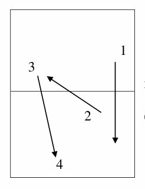

1. Совершенствование начала атаки после короткого приема подачи. 1 3 1 – Короткая подача с нижним вращением по всему столу 2 – Укороченный прием подачи по всему столу 2 (коротко по всему столу) 3 – Скидка (сброс) по всему столу 4 – Свободный розыгрыш очка 4


<!-- Страница оригинала: 24 -->

В данном задании изредка менялось направление приема подачи (например, прием подачи длинной срезкой влево или по всему столу), а остальное оставалось неизменным.


<!-- s88t-exercise-end -->

<!-- s88t-exercise-start:a1-2 -->

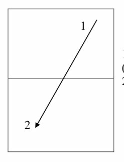

2. Совершенствование техники выполнения топ-спина 1 справа.

1 – Топ-спин справа с захода в левый угол стола (серийно) 2 – Блок (подставка) слева

2


<!-- s88t-exercise-end -->

<!-- s88t-exercise-start:a1-3 -->

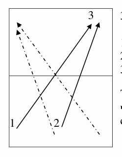

3 3. Совершенствование передвижения.

1 – Топ-спин справа с захода в левый угол 2 – Топ-спин справа из центра в левый угол 3 – Блок (подставка) поочередно, влево – в центр

Также это задание выполняется и в правый угол, чередуя атакующие удары из правого угла и из центра 1 2 стола


<!-- s88t-exercise-end -->

<!-- s88t-exercise-start:a1-4 -->

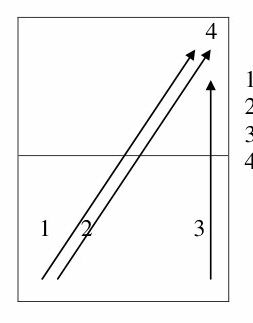

4 4. Совершенствование передвижения.

1 – Топ-спин слева в левый угол 2 – Топ-спин справа с захода в левый угол 3 – Топ-спин справа из правого угла влево 4 – Блок (подставка) слева

1 2 3


<!-- s88t-exercise-end -->

В тренировочных заданиях приветствуется стабильность выполнения и техника выполнения (передвижение и удар) Все вышеизложенные задания выполнялись ежедневно, хотя иногда менялась их последовательность. Примечательно, что данные задания выполнялись до перерыва (который производился в середине тренировки на 10-15 минут), а после перерыва тренер раздавал индивидуальные задания* для каждого из спортсменов. Время выполнения одного задания составляло


<!-- Страница оригинала: 25 -->

12-15 минут, после чего это же задание выполнял напарник. В конце тренировки почти всегда играли на счет – один матч из пяти сетов.

Индивидуальные задания, раздаваемые китайским тренером, строились по следующей схеме:

- Скоротечный розыгрыш очка, то есть выполняется подача+первый ход по заданному направлению (иногда второй ход тоже оговаривался, но очень редко), а после следовал свободный розыгрыш очка!

- В связи с тем, что почти все тренировочные задания до индивидуальной подготовки, строились через правую сторону, многие индивидуальные задания начинались с «начала» атаки слева после выполнения подачи. Это связано еще и с тем, что у многих спортсменов, объективно, правая сторона является сильнейшей, поэтому и совершенствуется «слабейшая» сторона.

- Задания, как правило, разнообразны для каждого спортсмена, поэтому указана только схема построения заданий.

### Приложение 2

#### Технико-тактические задания, выполняемые на тренировке с использованием БКМ (большого количества мячей):

Обратите внимание на последовательность заданий (каждое последующее задание исходит из предыдущего, осложняясь новым направлением атаки) !

<!-- s88t-exercise-start:a2-1 -->

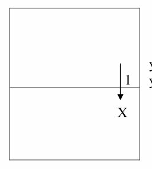

1. Совершенствование скидки справа.

1 - тренер или спарринг-партнер «набрасывает» укороченные мячи с нижним вращением в правый 1 угол

Х Х – спортсмен выполняет только скидку справа


<!-- Страница оригинала: 26 -->


<!-- s88t-exercise-end -->

<!-- s88t-exercise-start:a2-2 -->

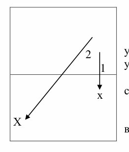

2. Совершенствование техники передвижения и начала атаки. 1 - тренер или спарринг-партнер «бросает» 2 укороченный мяч с нижним вращением в правый 1 угол Х – спортсмен выполняет укороченный удар х справа («оставляет коротко»)

2 – второй мяч «бросается» длинно с нижним Х вращением в левый угол Х – спортсмен выполняет топ-спин справа с захода


<!-- s88t-exercise-end -->

<!-- s88t-exercise-start:a2-3 -->

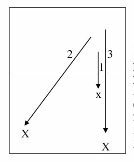

3. Совершенствование техники передвижения и усиления после начала атаки.

2 3 1 - тренер или спарринг-партнер «бросает» 1 укороченный мяч с нижним вращением в правый угол х Х – спортсмен выполняет укороченный удар справа («оставляет» коротко) 2 – второй мяч «бросается» длинно с нижним Х вращением в левый угол Х Х – спортсмен выполняет топ-спин справа с захода 3 – третий мяч «бросается» длинно с верхним вращением в правый угол Х – спортсмен выполняет активный топ-спин справа (усиление) из правого угла


<!-- s88t-exercise-end -->

<!-- s88t-exercise-start:a2-4 -->

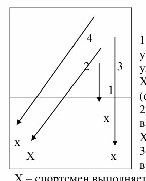

4. Совершенствование техники передвижения и усиления после начала атаки. 4 1 - тренер или спарринг-партнер «бросает» укороченный мяч с нижним вращением в правый 2 3 угол Х – спортсмен выполняет укороченный удар справа 1 (оставляет коротко) 2 – второй мяч «бросается» длинно с нижним х вращением в левый угол х Х – спортсмен выполняет топ-спин справа с захода Х х 3 – третий мяч «бросается» длинно с верхним вращением в правый угол Х – спортсмен выполняет активный топ-спин справа (усиление) из правого угла 4 – четвертый мяч «бросается» длинно с верхним вращением в левый угол


<!-- Страница оригинала: 27 -->

Х – спортсмен выполняет активный топ-спин слева из левого угла


<!-- s88t-exercise-end -->

Последовательность этих заданий выдерживается ежедневно, на каждой тренировке в начальной части работы на БКМ.

Далее следуют задания на совершенствование различных аспектов техники и тактики теннисистов (последовательности в очередности заданий не наблюдалось).

<!-- s88t-exercise-start:a2-5 -->

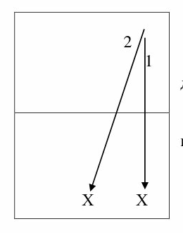

5. Совершенствование передвижения. 2 1 1 - тренер или спарринг-партнер «бросает» длинный мяч с верхним вращением в правый угол Х – спортсмен выполняет топ-спин справа 2 – второй мяч «бросается» длинно с верхним вращением в центр стола Х - спортсмен выполняет топ-спин справа

Х Х


<!-- s88t-exercise-end -->

<!-- s88t-exercise-start:a2-6 -->

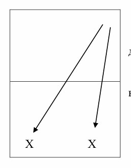

6. Совершенствование передвижения.

1 - тренер или спарринг-партнер «бросает» длинный мяч с верхним вращением в правый угол Х – спортсмен выполняет топ-спин справа 2 – второй мяч «бросается» длинно с верхним вращением в левый угол стола (но не косо влево) Х - спортсмен выполняет топ-спин справа

Х Х


<!-- Страница оригинала: 28 -->


<!-- s88t-exercise-end -->

<!-- s88t-exercise-start:a2-7 -->

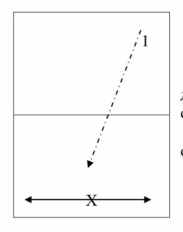

7. Совершенствование реакции и начала атаки 1 справа.

1 - тренер или спарринг-партнер «бросает» длинные мячи с нижним вращением по всей зоне стола (темп средний и равномерный) Х – спортсмен выполняет только топ-спин справа

Иногда это задание усложняется добавлением Х укороченных мячей, изменяя тем самым привычный рисунок передвижения*


<!-- s88t-exercise-end -->

Стоит заметить, что во многих заданиях тренер или спортсмен, набрасывающий БКМ партнеру, осознанно меняет силу и траекторию набрасываемого мяча, провоцируя теннисиста более точно и качественно подходить к мячу ногами!

<!-- s88t-exercise-start:a2-8 -->

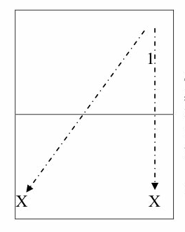

8. Совершенствование реакции и атаки справа.

1 1 - тренер или спарринг-партнер «бросает» длинный мяч с верхним вращением либо вправо, либо косо влево (мяч «бросается» быстро и неожиданно через паузу для того, чтобы спортсмен смог занять исходную позицию перед последующим ударом) Х – спортсмен выполняет только топ-спин справа Х Х


<!-- s88t-exercise-end -->

<!-- s88t-exercise-start:a2-9 -->

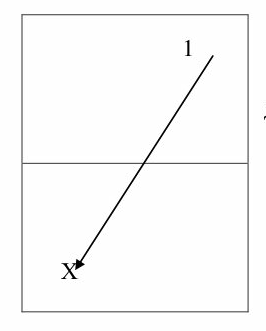

9. Совершенствование начала атаки слева. 1 1 - тренер или спарринг-партнер «набрасывает» длинные мячи с нижним вращением в левый угол Х – спортсмен выполняет только топ-спин слева

Это задание иногда начиналось «выходом атакой» из коротких мячей (укороток)

Х


<!-- Страница оригинала: 29 -->


<!-- s88t-exercise-end -->

<!-- s88t-exercise-start:a2-10 -->

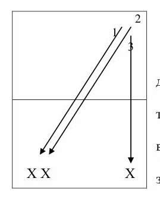

2 10. Совершенствование техники передвижения и 1 усиления после начала атаки слева. 3 1 - тренер или спарринг-партнер «бросает» длинный мяч с нижним вращением в левый угол Х – спортсмен выполняет начало атаки слева топ-спином 2 – второй мяч «бросается» длинно с верхним вращением в левый угол Х – спортсмен выполняет топ-спин справа с ХХ Х захода 3 – третий мяч «бросается» длинно с верхним вращением в правый угол Х – спортсмен выполняет активный топ-спин справа (усиление) из правого угла


<!-- s88t-exercise-end -->

<!-- s88t-exercise-start:a2-11 -->

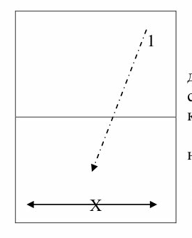

11. Совершенствование координации и реакции 1 1 - тренер или спарринг-партнер «бросает» длинные мячи с верхним вращением по всей зоне стола (темп очень быстрый, но в пределах адаптации к попаданию на стол) Х – спортсмен производит двустороннее нападение как топ-спинами, так и контрударами

Иногда это задание начинается с атаки по «срезке» Х


<!-- s88t-exercise-end -->

Это далеко не все задания, выполняемые теннисистами на тренировках. Но это задания, которые выполнялись ежедневно на совместном УТС Российской и Китайской юношеских сборных команд.

### Приложение 3

#### Комплекс упражнений на общую и специальную физическую подготовки с использованием собственного веса тела в игровом зале.

Все ниже перечисленные упражнения, выполнялись в среднем темпе с максимальной амплитудой выполнения, прямо в игровом зале от стенки до стенки открытого пространства длинной ~50 метров!

1. Выпрыгивания в длину:

- из полного приседа;

- из полуприседа;

- из положения «стоя» 6 серий по 50 метров

2. Выпрыгивания вверх:


<!-- Страница оригинала: 30 -->

- подводя ноги, согнутые в коленях к груди;

- вынося прямые ноги вперед.

3. Прыжковые и беговые упражнения:

- многоскоки;

- прыжки на одной ноге;

- прыжки на двух ногах;

- приставные шаги;

- «гусиный» шаг каждое упражнение по 100 метров

4. Скакалка:

- одинарные на скорость;

- двойные на скорость.

5. Отжимания от пола – 3 серии по 50 раз!

6. Подвижные игры – разнообразные варианты игры «Салки»

Дозировка упражнений указана лишь в тех упражнениях, в которых была возможность измерить. Остальные упражнения измерить, к сожалению, не удалось!

#### Комплекс упражнений на общую и специальную физическую подготовки с использованием специальных тренажеров.

1. Беговая дорожка; 2. «Жим» лежа штанги от груди;

3. Приседания со штангой на плечах;

4. Отталкивание ногами от стенки, сидя на движущейся платформе;

5. Ряд тренажеров на «пресс»;

6. Сгибание предплечий (бицепс);

7. Приведение перекладины за голову;

8. Приведение круглого валика согнутой ногой из положения «нога на валике»;

9. Разведение локтей согнутых рук в стороны вверх; 10.Из положения «согнутых в локте рук в стороны» соединение их впереди себя.

Дозировка каждого упражнения была индивидуальная в зависимости от возраста спортсмена. На каждом тренажере располагался дозатор, на котором можно было выставить нагрузку от 5 кг до 60 кг. Спортсмены производили работу на тренажерах поочередно от одного тренажера к другому, причем так, чтобы нагрузка на одну и ту же мышечную группу не повторялась!

________________________

<!-- Страница оригинала: 31 -->

## МЕТОДИЧЕСКИЕ РЕКОМЕНДАЦИИ ПО ТЕХНИКЕ СОВРЕМЕННОГО НАСТОЛЬНОГО ТЕННИСА ПО РЕЗУЛЬТАТАМ НАБЛЮДЕНИЙ НА СОВМЕСТНОМ УЧЕБНО-ТРЕНИРОВОЧНОМ СБОРЕ ЮНОШЕСКИХ СБОРНЫХ КОМАНД РОССИИ И КИТАЯ

Материалы старшего тренера юношеской сборной команды России Астахова С.В. (2006-2007 г.г.) об УТС сборной команды России в международном центре настольного тенниса г. Женгдинга

Федерация настольного тенниса России 28 декабря 2007 года

Все нижесказанное не претендует на непререкаемую истину, но может быть интересно и полезно российским специалистам и игрокам настольного тенниса.

### 1. Инвентарь (раздел не является рекламой)

Хочу начать с забавного эпизода. В один из первых дней сбора в перерыве между заданиями, я и наши кадеты ходили вокруг ракеток китайских теннисистов, оставленных на столах, и с интересом изучали выбор инвентаря, которым играют наши оппоненты. Так вот, «изучив» каждую из увиденных ракеток, мы стали бурно обсуждать плюсы и минусы их инвентаря (бросалось в глаза, что мяч «липнет» к китайской накладке и даже при небольшом давлении на него и поднятии ракетки вверх, он может какое-то время «висеть» на накладке). Спустя время мы заметили, что на другом конце зала также эмоционально ведется обсуждение нашего инвентаря. Позже, когда мы собрались вместе, китайский тренер проиллюстрировал главное различие следующим образом. Он взял ракетку нашего миникадета (основание – Stiga, накладки- Bryce FX), сантиметров с 20 – ти опустил на нее мяч, и после того, как мяч несколько раз попрыгал до полной остановки – выдохнул по-английски: «Very bad because very fast!» («очень плохо, потому что очень быстро!»). Ту же процедуру он проделал с ракеткой одного из своих учеников. Мяч «прилип» к накладке уже после двух отскоков об ракетку. Наставник произнес: «Good!» («хорошо!») и показал, держа мяч рукой на накладке, как ракетка поворачивается вокруг мяча. Анализируя инвентарь, используемый теннисистами тренировочного центра можно отметить, что почти все игроки используют следующие сочетания:

- основания фирмы «Stiga» (в основном встречались «Clipper wood», реже -«Offensive classic» или «Clipper Oversize»);

- накладка справа – «Hurricane III» фирмы DHS;

- накладка слева – «Hammond (Pro)» фирмы Nittaku. Когда мы поинтересовались, почему выбор накладок и оснований пал именно на такие сочетания в подавляющем большинстве, китайский тренер ответил, что интернат централизованно получил этот инвентарь, но, по их

<!-- Страница оригинала: 32 -->

мнению, в детском возрасте, когда идѐт обучение технике обработки мяча, самое главное – максимальный по продолжительности контакт ракетки с мячом.

### 2. Анализ техники китайских теннисистов.

Первое, что бросается в глаза при анализе техники выполнения ударов и передвижений – это то, что у китайских спортсменов всех возрастов принципы выполнения ударов и передвижений абсолютно одинаковые (от начинающего теннисиста до взрослого). Даже невооруженным взглядом видны базовые основы техники ударов, закладываемые в детстве.

Фото 1. Ден Япин (1988 г од) Фото 2. Ван Личин (2008 год)

В подтверждение сказанного привожу фото двух величайших китайских теннисистов разных поколений. Несмотря на большую разницу в росте этих спортсменов, почти все параметры техники удара справа одинаковы, вплоть до соответствия углов суставов рук и ног. Это говорит о серьѐзной системе работы с начинающими, основой которой является закладка основательного фундамента техники. Второе – при работе с самыми маленькими теннисистами огромное количество времени и внимания уделяется отработке техники передвижения, а также работе корпуса, таза и ног в момент удара (особенно справа). Все эти элементы доводятся до автоматизма при помощи однообразных заданий и под строгим контролем тренера за спиной


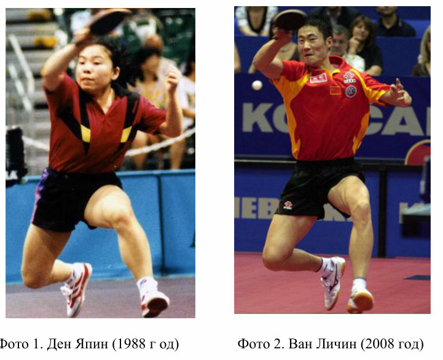


<!-- Страница оригинала: 33 -->

спортсмена, который иногда даже использует в качестве «помощника» большую бамбуковую палку! Приблизительный план тренировочного занятия с начинающими состоит из нескольких технико-тактических заданий, предложенных Вашему вниманию в №3 журнала, со спаррингом на столе (примерно 1,5 часа), далее перерыв (10-15 минут), после чего эти же задания повторяются, но уже с использованием большого количества мячей – БКМ (1,5 часа).

### 2.1. Техника передвижений.

Огромное количество заданий, выполняемых на учебно-тренировочных сборах юношеских сборных команд России и Китая, было посвящено отработке техники передвижений. Тренировочный процесс содержал достаточно много заданий на отработку «скрестного» шага при передвижениях теннисиста к мячу. При наблюдениях за подготовкой молодых китайских теннисистов, бросалось в глаза, что почти весь тренировочный процесс состоял из отработки «скрестного» шага. Описание техники выполнения «скрестного» шага можно встретить в книгах и методических пособиях С.Д. Шпраха, Г.В. Барчуковой и других авторов. Однако практические советы, которые были получены мною и нашими спортсменами от китайских тренеров, мне показались нагляднее.

1. В случае, если ответ соперника пришелся «глубоко» вправо, а вы находитесь в левом углу, первое, что надо сделать – переложить вес тела с «дальней» ноги на «ближнюю» в сторону передвижения и вместе с разворотом корпуса для подготовки к удару по мячу, начать «заваливать» корпус, т.е. переносить вес тела в сторону посланного мяча (Фото 12). На фото 3 отчетливо видно, что верхняя часть корпуса (плечи) китайского спортсмена Кон Линху относительно ног уже находится в «стадии падения» в сторону мяча, хотя до мяча еще остается небольшое расстояние.

2. Удар по мячу надо выполнять в тот момент, когда «дальняя» от цели передвижения нога (в нашем случае – левая), прерывая падения спортсмена, ставится впереди «ближней» (скрещиваясь впереди) и создаѐт необходимую опору для удара (Фото 4).

3. После удара по мячу правая нога освобождается от веса тела и теннисист продолжает динамическое движение в сторону удара, занося правую ногу в сторону для занятия исходного положения и подготовки к выполнению следующего технического действия (Фото 4).


<!-- Страница оригинала: 34 -->

Фото 3 Фото 4

4. Очень часто, при постановке скрещиваемой ноги теннисист оказывается почти боком к столу, при этом вес тела спортсмена в один из коротких промежутков времени, полностью сосредотачивается на одной ноге (Фото 5 и 6). Такие активные передвижения предъявляют серьѐзные требования к уровню физической подготовки.

Фото 5 Фото 6

5. «Заваливание» корпуса в сторону полета мяча, широко применяется китайскими теннисистами при игре на счет. Важно, что:

- при передвижениях на большие расстояния, если позволяет время, спортсмены ставят скрещиваемую ногу в качестве опоры и проводят более мощную атаку (Фото 4, 6 и 11);

- при передвижениях на больших расстояниях, если атака соперника очень стремительна и быстра, то ответный удар выполняется до постановки скрещиваемой ноги в опорное положение, но с заваливанием корпуса .(Фото 7, 8, 9 и 10).


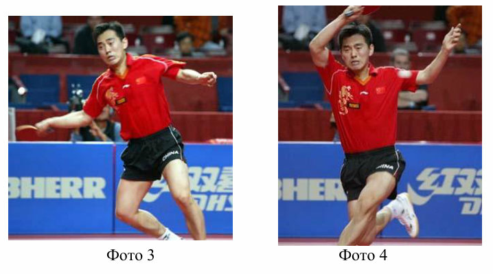

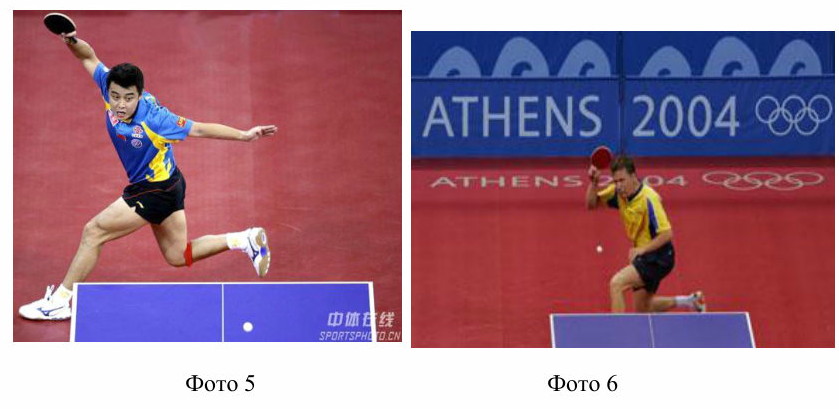


<!-- Страница оригинала: 35 -->

Фото 7 Фото 8

Фото 9 Фото 10

Фото 11 Фото 12

- при передвижении на небольшие расстояния удар справа выполняется без постановки скрещиваемой ноги в опорное положение, но опять же с заваливанием корпуса (Фото 13, 14, 15 и 16).


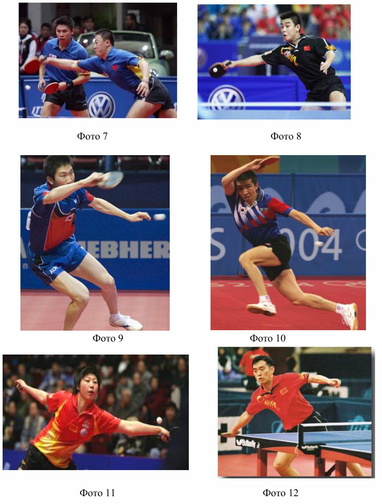


<!-- Страница оригинала: 36 -->

Фото 13 Фото 14

Фото 15 Фото 16

6. Все вышесказанное относится к выполнению передвижения для атаки по мячу, посланному соперником глубоко вправо. При передвижениях для атаки справа «на заходе», советы китайского тренера были следующими:

- после выполнения атаки справа и переноса веса тела на впереди стоящую ногу, освобождается от веса «дальняя» (от цели передвижения) нога (Фото 18).

- после еѐ освобождения от веса тела спортсмен делает этой ногой «скрестный» шаг позади опорной ноги. На фото 18 видно, что левая нога освобождена от веса тела, именно она и выполняет «скрестный» шаг сзади опорной правой ноги.


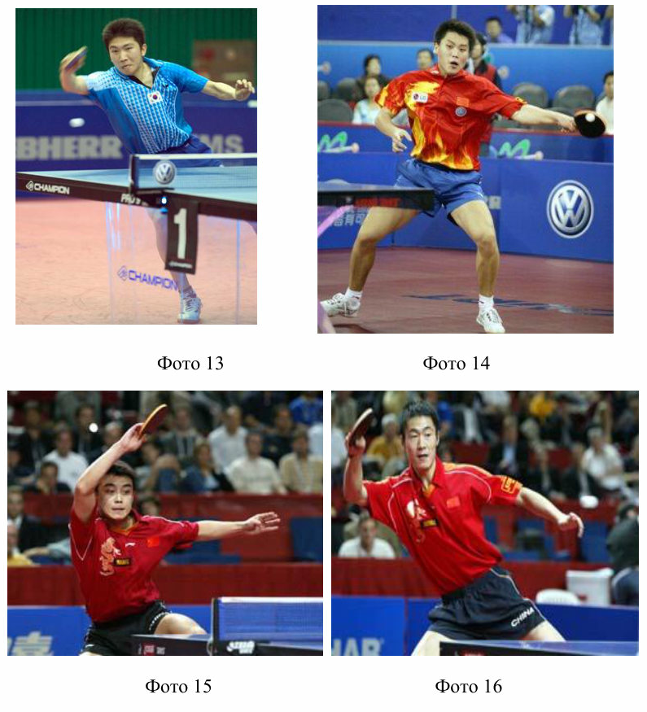


<!-- Страница оригинала: 37 -->

Фото 17 Фото 18

- после выполнения «скрѐстного» шага этой ногой и переноса на неѐ веса тела, ближняя нога отводится в положение опорной и одновременно выполняется атакующий удар справа. (Фото 17).

Фото 19 Фото 20

7. Все передвижения китайские специалисты советуют выполнять с максимальной скоростью. Но самое важное, по их мнению, при приѐме подачи располагаться за левой боковой линией стола (фото 19 и 20).

### 2.2 Техника выполнения атакующих ударов справа и слева.

В отношении техники выполнения топ-спина справа, китайские тренеры обращают внимание на следующие аспекты.

1. При выполнении замаха игровая рука полностью или почти полностью выпрямлена (Фото 21-23, 26-30). После начала движения рука выводится вперѐд корпусом и в момент контакта ракетки с мячом сгибается в локте с использованием кисти. При этом важно, чтобы движение было широким – для создания необходимой мощности атаки (фото 21, 27-29);


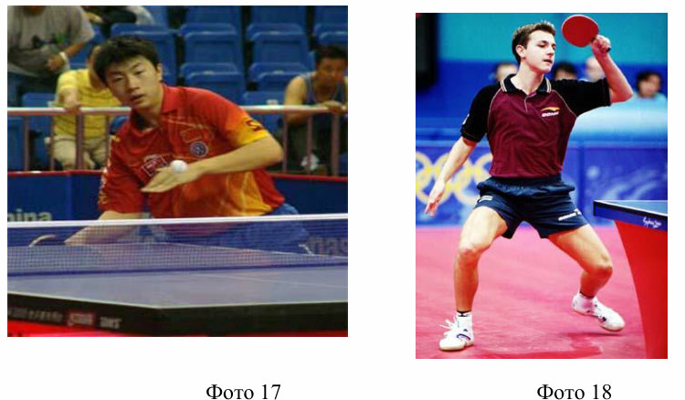

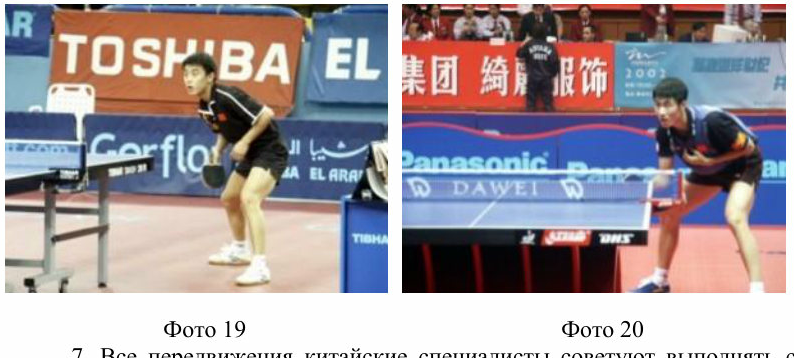


<!-- Страница оригинала: 38 -->

Для атаки по резаным мячам или по опускающемуся мячу (Фото 21-23, 25-26) замах начинается ниже мяча. Для создания скорости атаки и игры на опережение замах производится на уровне полѐта мяча и удар осуществляется по его верхней части (фото 27-29).

Фото 21 Фото 22

Фото 23 Фото 24

Фото 25 Фото 26


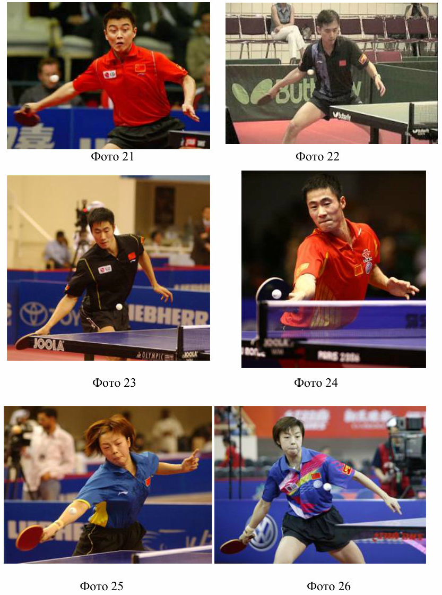


<!-- Страница оригинала: 39 -->

Фото 27 Фото 28

Фото 29 Фото 30

2. При выполнении удара справа важна работа корпуса, которая заключается во вкладывании веса тела в удар и в «скручивании» в тазовом отделе. Не меньшее значение имеет и смена ног при ударе. Для понимания спортсменом «работы» таза при атакующем ударе справа китайский тренер, располагаясь позади теннисиста, руками захватывал таз и в момент удара по мячу резко его «скручивал», подчѐркивая правильную работу.

3.Использование китайскими теннисистами всевозможных способов усиления атаки:

- на снимке 31 видна широта движения, придающая мощь топ-спину;

- на снимке 32 видна конечная фаза движения игровой руки. По небольшому «загибу» кисти с ракеткой можно заключить, что мяч послан очень глубоко (косо) в угол;

- обратите внимание на конечное положение ног теннисистов на фото 31-33. Отчетливо виден разворот таза после выполнения удара по мячу. О правильном развороте свидетельствует тот факт, что колено одной ноги направлено вниз, а колено и бедро второй ноги выставлено в сторону и является той опорой, на которую опустится вес тела теннисиста после выполнения удара;


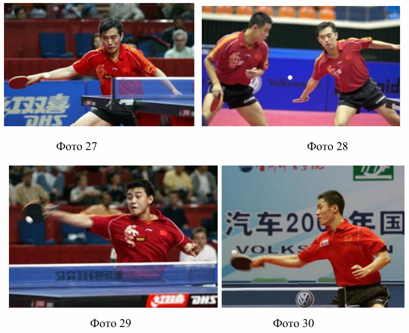


<!-- Страница оригинала: 40 -->

-заметна также очень широкая постановка ног при выполнении завершающей атаки справа. Для сравнения обратите внимание на постановку ног при завершении атаки одного из европейских лидеров (фото 34). Его стойка заметно «уже», при этом разворот таза виден, а вот переноса веса тела на впереди стоящую ногу не наблюдается.

- на фото 31 прослеживается, что левая нога теннисиста все еще не находится в опорном положении. Китайский тренер, давая советы по увеличению мощности атаки, отмечал, что скручивание таза способствует выносу ноги в сторону. После чего необходимо немного приподнять ногу и вместе с весом тела поставить еѐ в опорное положение, «приложившись» при этом ударом по мячу.

Фото 31 Фото 32

Фото 33 Фото 34


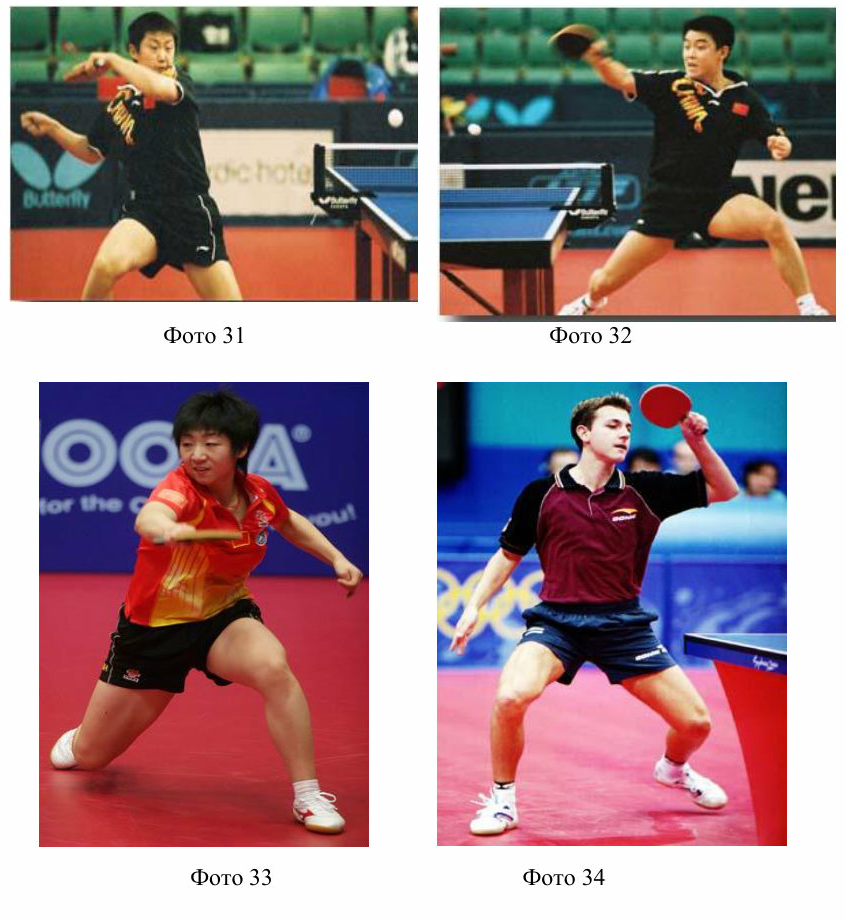


<!-- Страница оригинала: 41 -->

В целях увеличения силы удара китайские теннисисты используют также фазу полѐта. Об этом свидетельствует начальное и конечное расположение стоп ног (фото 35-39). Однако это совсем не значит, что спортсмены прыгают во время завершающей атаки (исключение составляет, удар по свече – где некоторые теннисисты специально перед ударом подпрыгивают вверх). При развороте таза стопы ног одновременно меняют положение и если в этот момент немного согнуть ноги в коленях и развести их в стороны (Фото 35), то, по мнению китайского наставника, создаѐтся некоторый эффект свободного падения тела, который усиливает мощь удара по мячу.

Фото 35 Фото 36

Фото 37 Фото 38 Фото 39


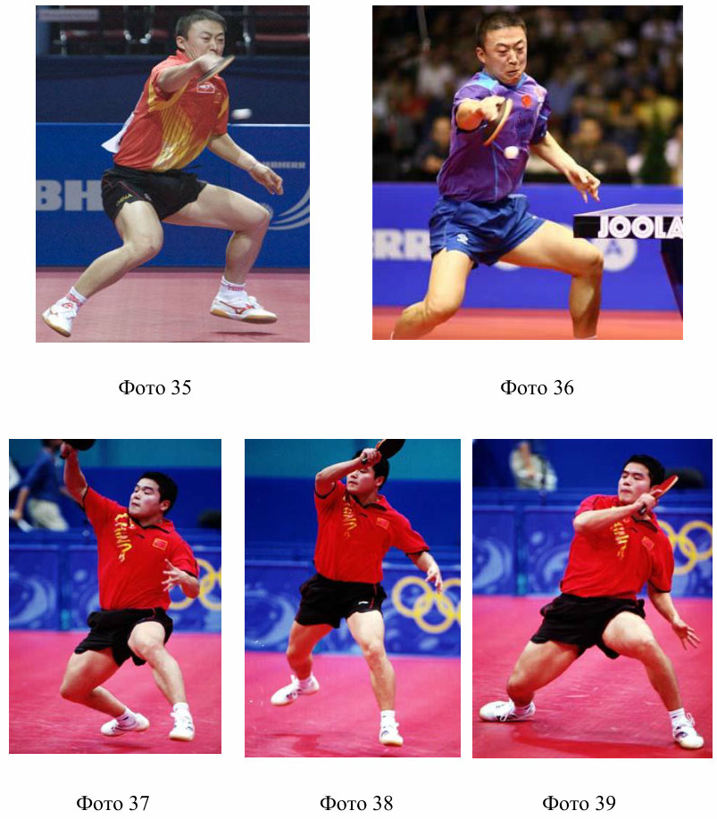


<!-- Страница оригинала: 42 -->

При выполнении топ-спина слева, советы китайского тренера ограничивались тем, чтобы:

- также, как и при игре справа, при завершающей атаке слева было задействовано «скручивание» таза и смена положения стоп. На фото 40 спортсмен перед ударом слева сгибает в колене правую ногу, левая при этом выпрямлена с опорой на пятку. После выполнения удара ситуация должна зеркально поменяться;

- с коротких для атаки мячей приѐм слева осуществляется «обратным» сбросом (Фото 41-43);

Фото 40 Фото 41

Фото 42 Фото 43


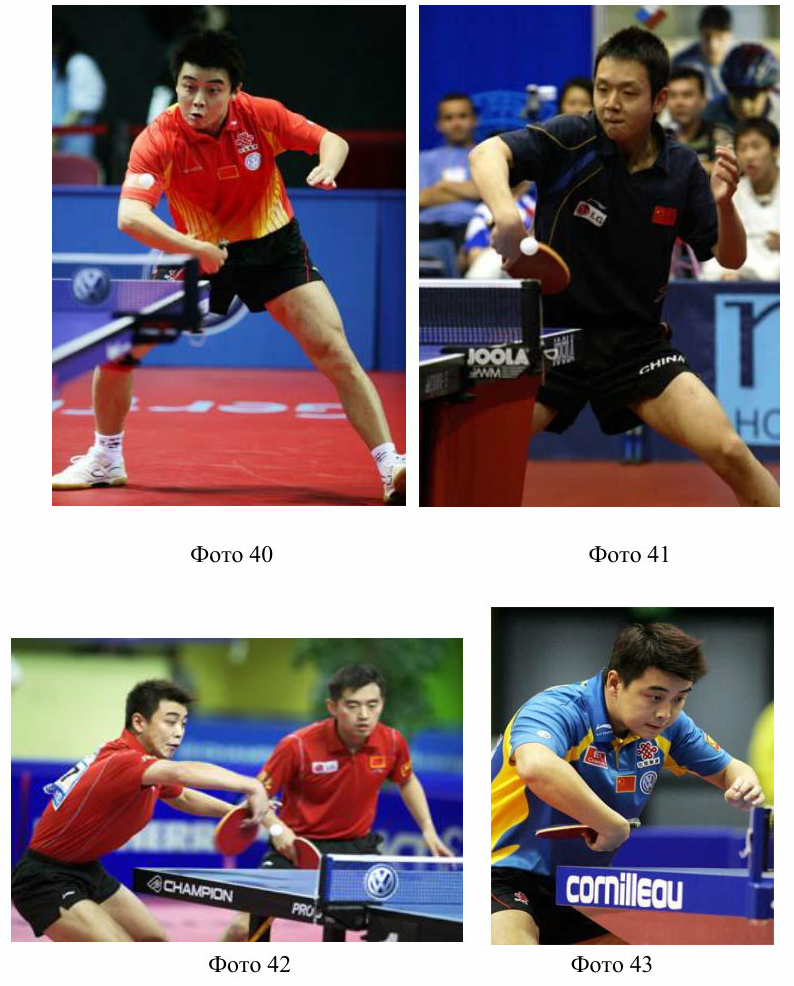


<!-- Страница оригинала: 43 -->

### 3. Использование большого количества мячей (БКМ)

Последнее, что хотелось бы отметить из увиденного и услышанного во время сбора в Китае – это необходимость ежедневного использования в тренировочном процессе БКМ. Причем, это одинаково полезно как для спортсмена, выполняющего задание, так и для спортсмена, набрасывающего мячи партнѐру. Китайские тренеры убеждены, что набрасывание мячей партнѐру также закрепляет технику выполнения ударов и способствует более правильному пониманию и закреплению технических навыков. Именно поэтому теннисисты всех возрастов при использовании БКМ мячи набрасывают самостоятельно.

P.S.: Все права на фото, использованных в данной статье, принадлежат Международной федерации настольного тенниса

___________________

<!-- Страница оригинала: 44 -->

## СТРАТЕГИЯ ПОДАЧ В СОВРЕМЕННОМ НАСТОЛЬНОМ ТЕННИСЕ

Барчукова Г.В., д.п.н., профессор кафедры Теории и методики индивидуально-игровых видов спорта Российского государственного университета физической культуры, спорта и туризма

Как свидетельствуют многочисленные литературные источники (1,2,3,7), в процессе повышения мастерства спортсмена очень часто возникают серьѐзные объективные трудности, препятствующие дальнейшему росту спортивных результатов и касающиеся многих сторон спортивной подготовки. Подавляющее большинство отечественных и зарубежных работ, посвященных настольному теннису, подчеркивают важность подач и ту серьезную роль, которую они играют в настоящее время (4,5,6,8,9).

Подача – это преимущество, удар с которого начинается тактическая атака, это первый удар по слабому месту противника, первый шаг к выигрышу очка. Поэтому к подаче нужно относиться весьма обдуманно и расчетливо. Хорошая подача нередко решает исход матча, о чем забывают многие даже опытные игроки во время соревнования и чему не уделяют и на тренировках достаточно внимания. Уметь пользоваться преимуществом подачи – это значит отлично освоить весь набор приемов первого мяча и некоторые из них, наиболее удачные для комбинаций, приберегать на самые ответственные моменты игры. К преимуществу относится то, что противник не может повлиять на выполнение подачи, а игрок имеет полную возможность занять удобное положение и выполнить любую сложную задачу.

Актуальность исследования заключается в том, что изучение подач сильнейших теннисистов мира, способствует выработке новых построений тактики подач. Следует отметить, что анализ тактики подач сильнейших теннисистов мира, на современном этапе развития настольного тенниса с учетом новых правил игры до 11 очков, ранее не проводился.

Цель работы - выявить особенности подач сильнейших теннисистов мира, для разработки методических рекомендаций по совершенствованию и повышению эффективности тактики подач, с учѐтом современных тенденций развития игры в настольный теннис.

Задачами исследования явились: проведение сравнительного анализа тактики подач сильнейших теннисистов, выявление наиболее эффективных и целесообразных подач и разработка педагогических рекомендаций по совершенствованию и стратегии использования подач, с учѐтом современных тенденций развития игры в настольный теннис. Для решения задач применялись следующие методы исследования:

<!-- Страница оригинала: 45 -->

Видеозапись и стенографическая запись игровых действий теннисистов и методы математической статистики.

Фиксировались следующие параметры: место выполнения подачи у стола и сторона ракетки (тыльная или ладонная); с каким вращением и в каком направлении выполнена подача. Длина подачи и активность второго хода (активный или пассивный), выигрыш на втором ходе, а также характер подач (атакующая или подготовительная). Обязательно фиксировался счет.

Анализ соревновательной деятельности проводился за игроками мирового уровня, входящими в 15 сильнейших теннисистов мира, на чемпионатах мира 2005 и 2007 годов. Всего было просмотрено и проанализировано 18 одиночных игр следующих спортсменов: Ванг Лицинь, Ванг Хао, Ма Линь (все Китай), Тимо Боль (Германия), Калиникос Креанга (Греция), Микаэль Мазе (Дания), Владимир Самсонов (Беларусь):

В результате проведенных исследований было выявлено, что в среднем сильнейшими игроками мира на своей подаче выигрывается 67,1% всех разыгранных очков. При этом большинство сильнейших теннисистов мира, используют подачи ладонной стороной ракетки. Из 7 исследуемых теннисистов, лишь двое (28,6%) применяли подачи тыльной стороной ракетки – это Самсонов и Креанга.

```text
             50
             45
             40
             35
  проценты


             30
             25
             20
             15
             10
              5
              0
                                                                        ь
                     ль


                                                                                             ь
                                            е


                                                          га


                                                                                    о
                                  в


                                                                         н


                                                                                            н
                                          аз
                                  но


                                                                                 Ха
                                                     ан


                                                                      ци
                  Бо


                                                                                         Ли
                                        .М
                                со


                                                      е


                                                                   Ли


                                                                              нг
              Т.


                                                   Кр


                                                                                         а
                                       М
                            ам


                                                                             Ва


                                                                                        М
                                                                нг
                                                К.
                            С


                                                               Ва
                          В.


                          нижне-боковая    верхне-боковая           нижняя    плоская   верхняя

                     Рис. 1 Виды вращения подач, наиболее часто применяемые
                                 сильнейшими теннисистами.
```


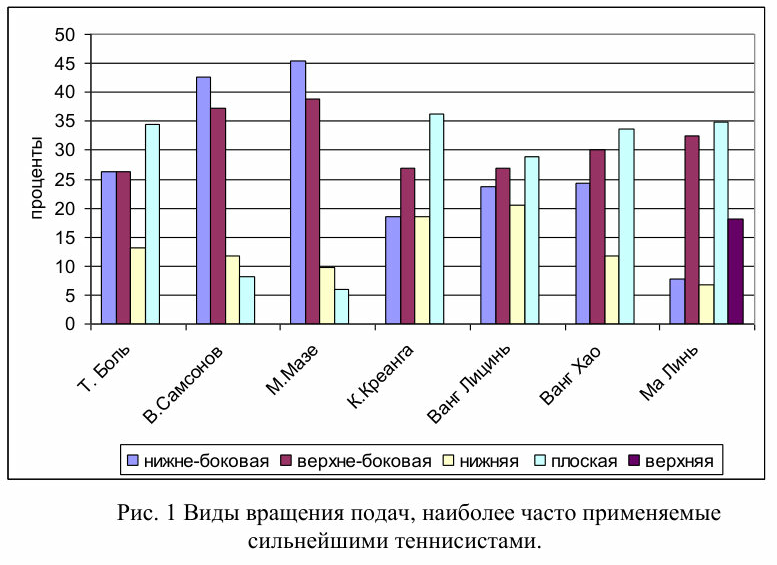


<!-- Страница оригинала: 46 -->

По вращению придаваемому мячу на подаче, большинство теннисистов, чаще используют подачи без вращения (плоские), с нижне-боковым и верхнее-боковым вращением (рис. 1). Сильнейшие теннисисты Боль, Креанга, Ванг Лицинь, Ванг Хао и Ма Линь. Мазе и Самсонов, используют в основном подачи с нижне-боковым вращением.

По направлению, сильнейшие теннисисты почти в равной степени подают в правый угол и центр стола и чуть реже в левый угол стола, чтобы предвосхитить атаку соперника. В то же время направление подачи зависит от расположения у стола противника, который чаще при приеме подачи стоит в левом углу стола. При этом некоторые теннисисты предпочитают подавать больше в левый угол стола: Самсонов, Креанга и Ма Линь, некоторые в центр стола - Мазе, Ванг Хао и Ванг Лицинь и Тимо Боль в правый угол стола (рис. 2).

По длине полета мяча, все исследуемые теннисисты в большинстве использовали подачи средней длины. Чаще всего применял подачу со средней длиной полета мяча – Ма Линь (71,6 %).

Как показали исследования, самыми эффективными подачами обладает Калиникос Креанга – 79,6 % эффективности. Менее всего эффективны подачи у Владимира Самсонова – 52 % эффективности. При этом за эффективные подачи принимались те подачи, с которых: непосредственно было выиграно очко; начиналась атака после приема соперником или очко выиграно со второго хода.

```text
             100
              90
              80
              70
  проценты


              60
              50
              40
              30
              20
              10
               0
                                                                         ь
                      ль


                                                                                              ь
                                             е


                                                           га


                                                                                     о
                                    в


                                                                          н


                                                                                             н
                                           аз
                                  но


                                                                                  Ха
                                                      ан


                                                                       ци
                   Бо


                                                                                          Ли
                                         .М
                                со


                                                       е


                                                                    Ли


                                                                                г
                                                                              ан
               Т.


                                                    Кр


                                                                                          а
                                        М
                               ам


                                                                                         М
                                                                  г


                                                                              В
                                                 К.


                                                                ан
                           .С
                           В


                                                                В


                                             вправо         влево       в центр


               Рис. 2 Виды подач по направлению, используемые сильнейшими
                                     теннисистами
```


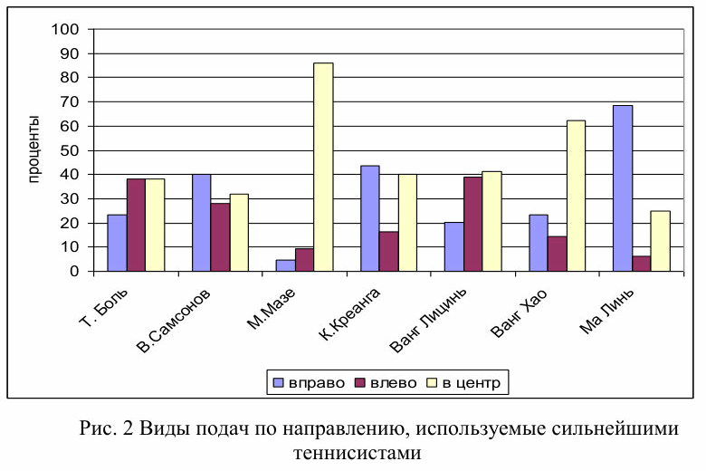


<!-- Страница оригинала: 47 -->

Выявлено, что в среднем теннисисты в 17,9 % случаях выигрывают очки непосредственно подачей, при этом, наибольший показатель выигранных очков непосредственно с подачи у Ванг Хао – 23,3 %, а наименьший у Креанга – 4,6%.

Отмечается также высокая активность сильнейших теннисистов при выполнении второго хода после подачи. Чаще всех, второй ход был активен у Креанги – 74 %. Реже всех атакует со второго хода Самсонов – 46 %. При этом в среднем со второго хода выигрывается 20,5 % подач.

Наилучший результат выигранных очков с активного второго хода у Ванг Хао (24,4 %). Замыкает семерку чемпион Европы 2004 г В.Самсонов (15,7 %).

```text
             80
             70
             60
             50
  проценты


             40
             30
             20
             10
              0
                                                                     нь
                     ль


                                                                                         нь
                                            е


                                                          га


                                                                                  о
                                  в


                                          аз
                                  но


                                                                               Ха
                                                     ан


                                                                     ци
                  Бо


                                                                                       Ли
                                        .М
                                со


                                                      е


                                                                   Ли


                                                                            нг
              Т.


                                                   Кр


                                                                                       а
                                       М
                            ам


                                                                          Ва


                                                                                      М
                                                                нг
                                                К.
                            С


                                                               Ва
                          В.


                                          длинная         средняя     короткая

                      Рис. 3. Виды подач по длине, используемые сильнейшими
                                         теннисистами

    Анализ по выявлению самых эффективных видов подач по
разносторонности, вращению, направлению, длине и характеру позволил
определить, что у всех теннисистов, кроме Владимира Самсонова,
эффективнее подачи из левого угла стола, ладонной стороной ракетки. У
Самсонова более эффективна подача из центра тыльной стороной ракетки
(55 % эффективности), а так же исключение Т.Боль и М. Мазе - они подают
так же ладонной стороной ракетки, но из правого угла стола, так как
спортсмены играют левыми руками.
```


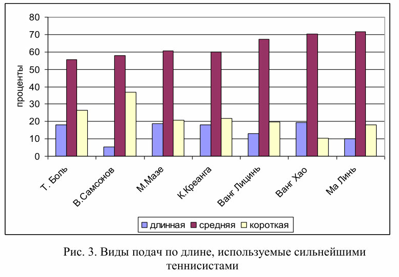


<!-- Страница оригинала: 48 -->

```text
         80,00

         70,00

         60,00

         50,00

         40,00

         30,00

         20,00

         10,00

          0,00

                     ао          ин
                                   ь             нь       ол
                                                            ь       га         аз
                                                                                  е
                                                                                               но
                                                                                                  в
                 Х              Л         иц
                                             и          Б         ан       М                 о
              нг              а          Л           мо       Кр
                                                                 е                          с
           В а            М        н   г            и                                 С   ам
                                 Ва               Т
           Общее          Выигр. с подачи             Выигр. со 2 хода   Активный 2 ход


            Рис. 4 Эффективность подач сильнейших игроков мира
```

По вращению у большинства теннисистов самая эффективная плоская подача. Кроме Микаэля Мазе (самая эффективная нижне-боковая) и Ванг Лициня (самая эффективная верхне-боковая). Выявлено, что у всех, кроме Ванг Хао и Микаэля Мазе, наиболее эффективны подачи направленные в левый угол стола.

По длине, лишь у Ма Линя и Мазе, более эффективны короткие подачи, У остальных средней длины подачи. По характеру выполнения подач, у всех проанализированных теннисистов спортсменов эффективны подачи атакующего характера. Выводы. На основе анализа тактики подач сильнейших игроков мира в настольный теннис выявлены наиболее эффективные виды подач, разработана стратегия выполнения подач и их приема, выявлена модель эффективной подачи, разработаны рекомендации по совершенствованию и повышению эффективности тактики подач.


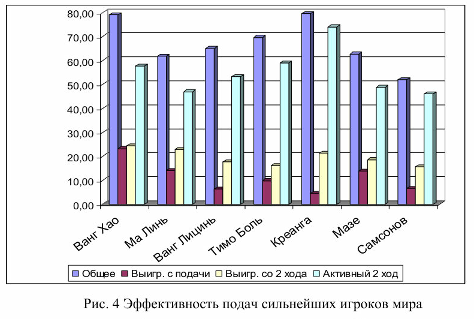


<!-- Страница оригинала: 49 -->

УДК 796.386 О - 75

Особенности обучения технике и тактике настольного тенниса в КНР. Сборник методических материалов № 1 /Федерация настольного тенниса России/ Авторы-составители Астахов С.В., Барчукова Г.В. – М.: Из-во « », 2011. – 49 с.

© Федерация настольного тенниса России, 2011
